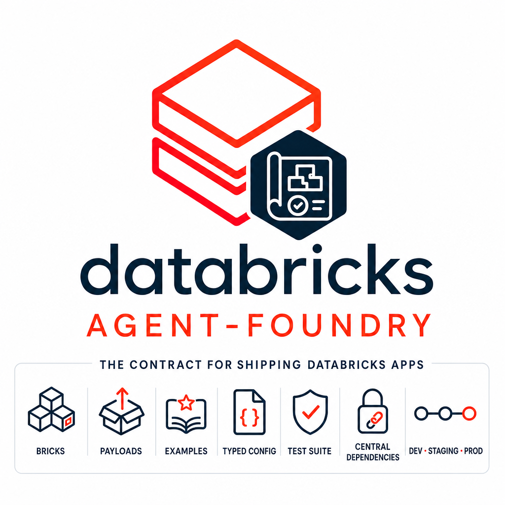
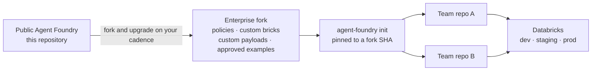
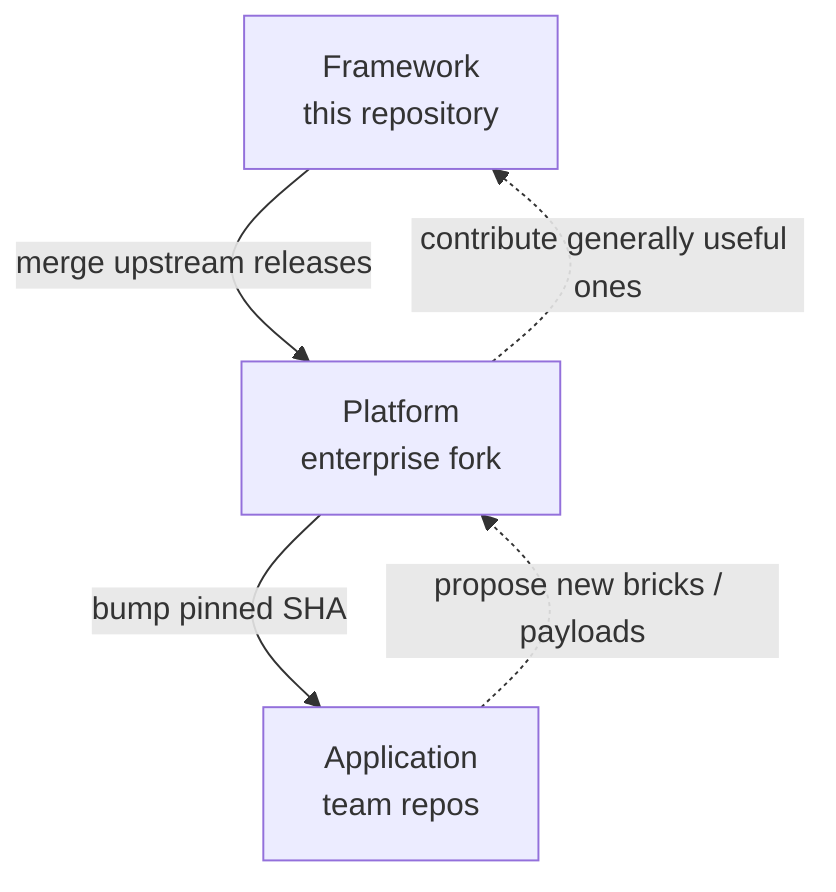
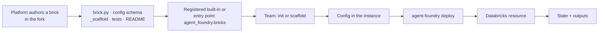
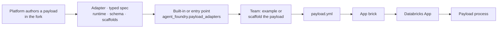

<p align="center">
  
</p>

<h1 align="center">Agent Foundry</h1>

<p align="center">
  Public pin target. Pin a <strong>tag</strong> (not <code>main</code>)
  once you publish. Enable GitHub Actions on a <strong>fork</strong>;
  they stay off on <code>databricks-solutions/databricks-agent-foundry</code>.
</p>

<p align="center">
  <strong>A contract for how teams build and ship Databricks applications.</strong>
</p>

<p align="center">
  Platform teams define the rules once, in a fork. Application teams generate
  their repos from it and ship apps that look the same, deploy the same way,
  and pass the same tests, across <code>dev</code>, <code>staging</code>, and <code>prod</code>.
</p>

<p align="center">
  
  
  
  
</p>

<p align="center">
  <a href="#why-agent-foundry">Why</a> ·
  <a href="#how-organizations-use-this-repository">Adoption model</a> ·
  <a href="#bricks">Bricks</a> ·
  <a href="#payloads">Payloads</a> ·
  <a href="#quick-start">Quick start</a> ·
  <a href="docs/index.md">Docs</a>
</p>

## Maintainers

Databricks Field Engineering maintains Agent Foundry.

| | |
|---|---|
| **Maintainer** | Databricks Field Engineering |
| **Contact** | Open a GitHub issue on this repository for bugs and questions. Security reports: [SECURITY.md](SECURITY.md). |
| **License** | [Databricks License](LICENSE) · [NOTICE](NOTICE) |

Intended use: teams building Databricks Apps / agents, on Databricks
(AWS, Azure, GCP). Supported environments are those documented in
[Getting started](docs/tutorials/getting-started.md). This is not
customer-specific (“client”) code.

## Why Agent Foundry

AI-assisted coding has made code cheap to write. Teams can generate a working
Databricks app in an afternoon. What they also generate is future technical
debt: every app wires up infrastructure differently, lays out its code
differently, and is tested (or not) in its own way. Reviewing that at scale is
impossible, and operating it is worse.

Agent Foundry gives platform teams a **harness** around how downstream
application teams build:

- **A fixed shape for infrastructure.** Every Databricks resource is a
  *brick* with one contract: typed config, declared dependencies, recorded
  state, published outputs.
- **A fixed structure for application code.** What runs inside the App is a
  *payload* with a typed `payload.yml` spec. Unknown keys and unresolved
  variables fail at validate time, not in production.
- **A fixed shape for every App.** One generic App host and one deploy path
  for every team, the same CI/CD from `dev` to `prod`.
- **A test suite that backs the contract.** Bricks, payloads, and examples
  come with unit, offline, and live-workspace acceptance tests, so "it follows
  the standard" is something CI checks, not something a reviewer has to infer.
- **Centralized dependency management.** The platform team patches and locks
  dependencies once in the fork; application teams pick up fixes by bumping
  the pinned SHA and running `uv lock` / `uv sync`
  ([Upgrading](#upgrading-a-generated-repository)). When security fixes are a
  weekly routine, that is one PR in the fork instead of one per team.

Generated code is still welcome. It just has to land in a shape that can be
reviewed against a standard and approved by the same tests every time.

## What it is

| Layer | What it is | Who owns it |
|-------|------------|-------------|
| **Framework** | CLI (`init`, `validate`, `deploy`, `scaffold`), typed config, deploy state, brick/payload contracts, CI/CD templates | Framework maintainers (this repo) |
| **Bricks** | Infrastructure as code: warehouse, data, SQL functions, jobs, Genie, Vector Search, tracing, observability, evaluation, app. See [Bricks](#bricks). | Framework + platform teams |
| **Payloads** | The application running inside the Databricks App, e.g. [`agent`](payloads/agent/README.md) or [`rest_mcp`](payloads/rest_mcp/README.md). See [Payloads](#payloads). | Framework + platform teams |
| **Examples** | Complete starters for `agent-foundry init`, e.g. [`portfolio_assistant`](examples/portfolio_assistant/README.md) and [`rest_mcp_proxy`](examples/rest_mcp_proxy/README.md) | Platform teams |

Platform teams fork the framework to add their own bricks, payloads,
examples, and defaults. Application teams generate their repos from that fork
and change only instance config, brick content, and payload spec.


## How organizations use this repository

Most teams do **not** develop applications in this repo. They **fork** the
framework, encode enterprise rules, then generate **separate application
repositories** for each product team.



Application repos pin a **commit SHA** of the fork (or of public upstream).
That pin is the upgrade unit: bump SHA, lock, sync, redeploy. Teams never
need write access to the framework fork to ship an instance.

### Who changes what

Three levels, one boundary: **the contract** (brick and payload protocols,
typed config, deploy engine). Each level works *inside* the contract of the
level above it.

| Level | Who | What they do | Bound by |
|-------|-----|--------------|----------|
| **Framework** | Maintainers of this repo | Define the contract; ship built-in bricks, payloads, and examples | — |
| **Platform** | Your fork | Enforce dependencies (lock, constraints, package index); provide and approve bricks, payloads, examples; set CI and defaults | The framework contract |
| **Application** | Generated team repos | Assemble their system: pick bricks (jobs, Vector Search, Genie, …), configure the payload spec, add skills and MCP servers | What the bricks and the payload spec allow |

**Upgrades flow down, contributions flow up.**



- **Platform teams can change the contract**, but every change there is
  drift from upstream that has to be re-merged on each upgrade. Adding
  bricks, payloads, and examples does not drift; editing framework code does.
- **Application teams that outgrow a payload's spec** (they need a resource
  no brick provides, or behavior the payload does not expose) propose a new
  brick or payload to the platform team. Generally useful ones go upstream;
  see [CONTRIBUTING.md](CONTRIBUTING.md).
- **Scaffolds and examples are copied, not linked.** Changing them in the
  fork does not rewrite existing team repos; framework *behavior* reaches
  teams only when they bump the pinned SHA.


## Bricks

A **brick** is a deployable infrastructure module. `agent-foundry deploy`
discovers which bricks apply to an instance (usually by directory presence
and `payload.requires`), runs them in order, records state, and publishes
outputs as `${var.*}` for later bricks.



Typical built-in bricks: `warehouse`, `data`, `sql_function`, `job`,
`tracing`, `genie`, `vector_search`, `app`, `observability`, `evaluation`.
Each brick's contract, gotchas, and layout live in
`bricks/<name>/README.md`. Index: [docs/reference/bricks.md](docs/reference/bricks.md).

**Use a brick:** `uv run agent-foundry scaffold --list`, then
`uv run agent-foundry scaffold <name>`.

**Add a brick** (fork or third-party package, no orchestrator rewrite):
[Author a brick](docs/how-to/author-a-brick.md). Register built-ins in
`agent_foundry/bricks.py`, or declare:

```toml
[project.entry-points."agent_foundry.bricks"]
my_brick = "my_package.bricks:MyCustomBrick"
```


## Payloads

A **payload** is the application that runs **inside** the generic App host
(`bricks/app/`). The host never imports payload internals. One line selects
the adapter:

```yaml
payload:
  adapter: agent                    # or rest_mcp, or your adapter name
  requires: [warehouse, tracing, observability]  # framework bricks this payload needs
  spec: { }                         # typed by the payload, opaque to the framework
```



| Payload | What teams get | Doc |
|---------|----------------|-----|
| `agent` | Agent loop with skills and MCP tools, chat UI | [payloads/agent/README.md](payloads/agent/README.md) |
| `rest_mcp` | REST APIs exposed as MCP servers | [payloads/rest_mcp/README.md](payloads/rest_mcp/README.md) |

**Add a payload:** [Author a payload](docs/how-to/author-a-payload.md).
Third-party packages declare:

```toml
[project.entry-points."agent_foundry.payload_adapters"]
rest_mcp = "my_package.adapter:RestMcpPayloadAdapter"
```

An adapter whose `name` matches a built-in **overrides** it — the intended
enterprise customization path.


## Quick start

### Prerequisites

Install [`uv`](https://docs.astral.sh/uv/) and the
[Databricks CLI](https://docs.databricks.com/dev-tools/cli/install.html), then
authenticate once:

```bash
curl -LsSf https://astral.sh/uv/install.sh | sh
curl -fsSL https://raw.githubusercontent.com/databricks/setup-cli/main/install.sh | sh
databricks auth login --host https://your-workspace.cloud.databricks.com
```

### Platform owners: fork this repository

1. Fork to your org (private is fine).
2. Add enterprise bricks, payloads, examples, and CI defaults on that fork.
3. Point teams at **your** `ORG` / `REPO` / `SHA`, not at public `main`, unless
   you intentionally track upstream.

CI, reviewers, runners, PyPI mirror, and the `framework-acceptance`
environment: [Fork for platform teams](docs/how-to/fork-for-platform-teams.md).
See [Package index / proxy](#package-index--proxy) if Dependabot or CI cannot
reach public PyPI.

### Application teams: create your repo with `agent-foundry init`

`init` is how a team gets its own application repository. You run it once,
outside the framework repo, against the framework commit your platform team
approved.

#### 1. Run the wizard

```bash
# ORG / REPO / SHA = your enterprise fork (or public upstream) and the pinned commit.
uvx --from "agent-foundry @ git+ssh://git@github.com/ORG/REPO.git@SHA" \
    agent-foundry init
```

The wizard asks four things:

| Prompt | What to enter | Why it matters |
|--------|---------------|----------------|
| **Project name** | Lowercase, hyphenated (e.g. `claims-assistant`) | Becomes the repo directory, the instance name, and the Unity Catalog `schema_prefix` (`claims_assistant`). |
| **Targets** | `dev` host + catalog (+ optional CLI profile); optionally `staging` and `prod` | One target = one workspace + catalog. Hosts may repeat; **catalogs must be unique** per target, which is how environments stay isolated. |
| **CI provider** | `git` (GitHub Actions) or `gitlab` (GitLab CI) | Only that provider's pipeline is generated. |
| **Starter** | `blank`, `portfolio_assistant`, or `rest_mcp_proxy` | `blank` gives an empty instance to scaffold into. An example copies a complete working instance you then adapt. |

Useful flags: `--outdir <dir>` (parent directory), `--framework-ref <sha>`
(pin explicitly instead of the running CLI's commit), `--no-lock` /
`--no-sync` (offline scaffolding), `--force` (write into a non-empty dir).

#### 2. What you get

```
<project_name>/
├── pyproject.toml            # pins agent-foundry @ <SHA>  ← your upgrade lever
├── uv.lock                   # locked dependencies (from `uv lock`)
├── .python-version           # 3.11
├── foundry.toml              # targets from the wizard + list of instances
├── .agent-foundry/schemas/   # JSON schemas for editor validation
├── .github/ or .gitlab-ci.yml
└── instances/<project_name>/
    ├── foundry.toml          # instance identity (name, schema_prefix, warehouse mode)
    └── ...                   # brick folders + payloads/<payload>/ (from the starter)
```

`init` also runs `uv lock` and `uv sync`, so `.venv` is ready. The repo is
self-contained: you never edit the framework to change your app.

#### 3. Validate, then deploy to dev

```bash
cd <project_name>
git init && git add . && git commit -m "Initial scaffold"
databricks auth login --host <your-dev-workspace>

uv run agent-foundry validate --workspace --target dev   # prerequisites
uv run agent-foundry deploy --target dev --dry-run        # plan, no writes
uv run agent-foundry deploy --target dev                  # provision + ship the App
```

#### 4. Make it yours

- **Adapt the starter**: edit `instances/<project_name>/payloads/<payload>/payload.yml`
  (the payload's spec; see that payload's README) and the brick folders
  (data, Genie, Vector Search, ...).
- **Add a brick**: `uv run agent-foundry scaffold --list`, then
  `uv run agent-foundry scaffold <brick>`. Configure it, redeploy.
- **Inspect resolved config**: `uv run agent-foundry config show --target dev --instance <project_name>`.

A step-by-step walkthrough is in
[Getting started](docs/tutorials/getting-started.md).

### CI deploys (generated repos)

| Trigger | Jobs |
|---|---|
| PR `feature/*` → `main` | unit / offline tests |
| PR `main` → `release` | unit tests, then approved staging deploy + post-deploy acceptance |
| Merge to `release` | approved production deploy |

`dev` is laptop-only. Configure OAuth M2M secrets
`DATABRICKS_HOST_*` / `DATABRICKS_CLIENT_ID_*` / `DATABRICKS_CLIENT_SECRET_*`
for staging and prod. Details: [Deploy via CI/CD](docs/how-to/deploy-cicd.md).

The framework repository's own CI layers (static, offline, packaged example
smoke, brick / payload / example canaries) are listed in
[tests/README.md §What runs when](tests/README.md#what-runs-when).
Platform teams configuring a fork:
[Fork for platform teams](docs/how-to/fork-for-platform-teams.md).


## Upgrading a generated repository

Bump the SHA in the generated repo's `pyproject.toml`
(`agent-foundry @ git+ssh://...@<sha>`), then:

```bash
uv lock --upgrade-package agent-foundry
uv sync --frozen
agent-foundry deploy --target dev
```

`--upgrade-package` is required or `uv lock` keeps the old commit.
**Do not skip `uv sync --frozen`.** `deploy` builds the wheel from `.venv`,
not from the lockfile alone.


## Repository structure

```
agent-foundry/
├── agent_foundry/   # CLI, orchestrator, config, brick/payload registries
├── bricks/          # IaC modules (one README + _scaffold each)
├── payloads/        # App runtimes (agent, rest_mcp, …)
├── examples/        # Starters copied by `agent-foundry init`
├── docs/            # Tutorials, how-tos, reference (start at docs/index.md)
├── tests/
├── pyproject.toml
└── uv.lock
```

CLI verbs: [docs/reference/cli.md](docs/reference/cli.md). Run
`uv run agent-foundry --help` for the live list.

Config is `foundry.toml` (targets + instance identity) plus per-brick YAML
and `payloads/<name>/payload.yml`. Variable order and `${var.*}`:
[docs/reference/config.md](docs/reference/config.md).


## Dependencies

Managed via `pyproject.toml` with a committed `uv.lock`.

| Profile | Command | What it provides |
|---------|---------|------------------|
| Core | `uv sync --frozen` | Deploy (`databricks-sdk`, `pyyaml`) |
| `[dev]` | `uv sync --frozen --extra dev` | + pytest, ruff |
| `[runtime]` | `uv sync --frozen --extra runtime` | + agent App extras |
| `[eval]` | `uv sync --frozen --extra eval` | + evaluation |
| `[extraction]` | `uv sync --frozen --extra extraction` | + file-upload parsers |
| `[call]` | `uv sync --frozen --extra call` | + `agent-foundry call` |
| `[rest_mcp]` | `uv sync --frozen --extra rest_mcp` | + REST→MCP App |
| `[all]` | `uv sync --frozen --extra all` | Everything |

After changing dependencies: `uv lock`, then
`python -m agent_foundry.constraints.export`, commit `pyproject.toml`,
`uv.lock`, and `agent_foundry/constraints/*.txt`, then `uv sync --frozen`.
`.python-version` pins **3.11** for lock/CI; `requires-python` is
`>=3.11,<3.14`.

The App install is a generated `requirements.txt` in the deploy staging dir
(wheel extras + `-c` constraints from `uv.lock`). Each payload declares which
extras its App installs; see the payload's README.

### Package index / proxy

This repo's CI/Dependabot may use an internal PyPI proxy. **Forking?** Point
resolution at an index you can reach. The full checklist (the package index OIDC action,
`uv.lock` registries, hashed installs) is in
[Fork for platform teams — Package index](docs/how-to/fork-for-platform-teams.md#2-package-index--your-pypi-mirror).

- **Your mirror:** update `registries.python-proxy` in `.github/dependabot.yml`
  and local uv/pip config.
- **Public `pypi.org`:** remove the `registries` block and the `registries:`
  reference under the `pip` ecosystem in `.github/dependabot.yml`.


## Design principles

- **Contract over convention.** Shape is enforced by types and tests, not
  by review comments.
- **Fork, then generate.** Enterprise policy lives in the fork; product
  teams own generated application repos pinned to a SHA.
- **Bricks provision; payloads run.** The App host is generic.
- **Declare dependencies.** `payload.requires` and brick `applies_to` decide
  what deploys; skip/missing required bricks fail closed on a full deploy.
- **Typed config at the edge.** Unknown keys and unresolved `${var}` fail at
  validate, not in production.
- **Self-contained instances.** Everything an app needs lives under
  `instances/<name>/`.
- **Extensible without rewriting the orchestrator.** Entry points for bricks
  and payloads; scaffolds compose from both.


## License

(c) 2026 Databricks, Inc. All rights reserved.

The source in this project is provided subject to the Databricks License.
See [`LICENSE`](LICENSE).
