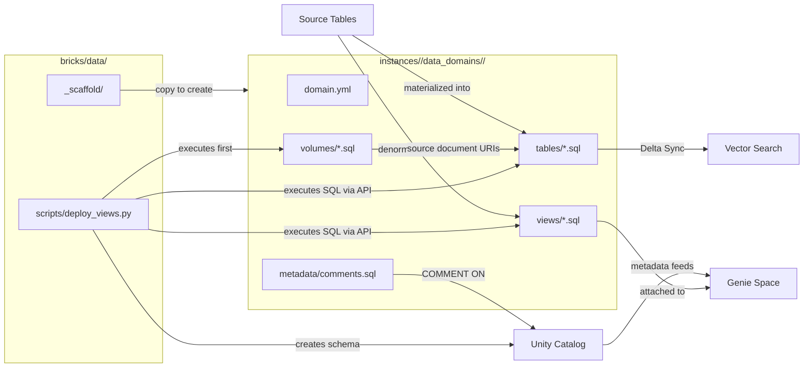

# bricks/data/

> **Technical reference** for deployers and developers.

Data layer -- Unity Catalog volumes, curated views, materialized tables, and metadata. Data modeling quality is the highest-impact factor for Genie accuracy, and materialized tables with Change Data Feed are the foundation for Vector Search indexes.



## Structure

```
bricks/data/
├── _scaffold/                              # Copy to instances/<app>/data_domains/<domain>/
│   ├── README.md                           # Decision tree + quick start
│   ├── volumes/
│   │   └── 00_example_sources.sql          # UC volume for source documents
│   ├── views/
│   │   ├── denormalized/                   # Pre-joined flat views (recommended)
│   │   │   └── _example_catalog_objects.sql
│   │   ├── pre_aggregated/                 # Rolled-up KPI views
│   │   │   └── _example_schema_summary.sql
│   │   └── metric_views/                   # UC metric views (YAML body)
│   │       └── _example_catalog_metrics.sql
│   ├── tables/
│   │   └── _example_docs_corpus.sql        # Materialized Delta table (CDF enabled)
│   └── metadata/
│       ├── _example_comments.sql           # COMMENT ON TABLE/COLUMN
│       └── _example_tags.sql               # UC tags for governance
└── scripts/
    └── deploy_views.py                     # Deploys SQL via Statement Execution API
```

## How It Works

1. **Copy template** to `instances/<app>/data_domains/<your_domain>/`
2. **Configure** `domain.yml` with target catalog and schema
3. **Create source storage** in `volumes/` when indexed rows cite original files
4. **Write SQL** in `views/` for computed views or `tables/` for materialized Delta tables
5. **Add metadata** with `COMMENT ON` statements in `metadata/`
6. **Deploy** with the deploy script

```bash
# Dry run (prints SQL, no execution) -- every domain the app owns
uv run agent-foundry brick data deploy --instance my-app --target dev --dry-run

# Deploy to workspace
uv run agent-foundry brick data deploy --instance my-app --target dev

# Scope to a single domain
uv run agent-foundry brick data deploy --instance my-app/my_domain --target dev
```

`--instance` takes the app name, an `<app>/<domain>` pair, or a path to either.

## Deploy Script

`scripts/deploy_views.py` uses the Databricks SDK Statement Execution API:

1. Loads `domain.yml` to get target `catalog` and `schema`
2. Creates the schema if it doesn't exist (`CREATE SCHEMA IF NOT EXISTS`)
3. Collects SQL files from `volumes/`, `views/`, and `tables/`
4. Executes phases in dependency order -- volumes, views, tables -- with files sorted by path within each phase
5. Applies `metadata/` last (files are split on `;` to support multi-statement patterns)

**Flags:**
- `--instance <name>` -- instance directory under `instances/<app>/data_domains/`
- `--target <dev|staging|prod>` -- selects the `[targets.<target>]` table in `foundry.toml`
- `--dry-run` -- print SQL without executing
- `--vars key=value` -- override variables from CLI

## Views vs Tables

| Use `views/` when | Use `tables/` when |
|---|---|
| Source data already exists in Delta tables | You need to materialize synthetic or transformed data |
| You want lightweight computed layers | Vector Search needs a Delta table with Change Data Feed |
| Genie Space queries benefit from pre-joined/aggregated data | Data must persist independently of source tables |

Both directories are scanned by the deploy script. Views run before tables, and files are sorted by path within each directory. Use numbered prefixes (`01_`, `02_`, ...) to control order within a phase. Each file may contain multiple SQL statements separated by `;`.

## Volumes and citation URIs

Put `CREATE VOLUME` statements in `volumes/`; they run before views and
tables. For retrieval citations, store the original file path in a source
Delta table column such as `doc_uri`, include that column in the Vector Search
index's `columns_to_sync`, and request it through the AI Search MCP `columns`
meta parameter. A slide-specific URI can append a fragment, for example:

```text
/Volumes/my_catalog/my_schema/source_docs/handbook.pptx#slide=12
```

## Schema Convention

Schemas follow the pattern `{schema_prefix}_{purpose}`, where `schema_prefix` is defined in the instance's `foundry.toml` (typically the underscore version of the app name):

| Schema | Purpose | Example contents |
|---|---|---|
| `{prefix}_views` | All Genie Space views | `catalog_explorer_catalog_objects`, `sales_revenue` |
| `{prefix}_indexes` | Source tables + VS indexes | `docs`, `docs_index` |
| `{prefix}_agent` | MLflow traces, eval datasets | `golden_set`, `trace_summary` |

Views within the shared `_views` schema are prefixed with their data domain name to stay unique across multiple Genie Spaces. Each `domain.yml` declares its target schema using `${var.schema_prefix}`:

```yaml
schema: "${var.schema_prefix}_views"    # Genie-feeding domains
schema: "${var.schema_prefix}_indexes"  # Vector Search-feeding domains
```

The deploy script creates schemas automatically if they don't exist.

## Identifier Quoting

Unity Catalog allows hyphens in a catalog or schema name, but Spark SQL rejects a
hyphenated name in an unquoted identifier position (`INVALID_IDENTIFIER`). Always
back-quote each part when writing a table reference in a `.sql` template:

```sql
CREATE OR REPLACE VIEW `${var.catalog}`.`${var.schema}`.my_view AS ...
```

Two positions differ. Volume paths are string literals rather than identifiers,
so a back tick there would become part of the path — leave them bare:

```sql
'/Volumes/${var.catalog}/${var.schema}/source_docs/'
```

A metric view's `source:` still needs the back ticks, but its body is parsed as
YAML before the name is resolved and a leading back tick cannot start a plain
YAML scalar. Wrap the whole name in quotes to satisfy both parsers:

```yaml
  source: "`${var.catalog}`.`${var.schema}`.catalog_objects"
```

A fourth rule applies when a template addresses the agent schema: use
`` `${var.catalog}`.`${var.agent_schema_name}` ``, never `${var.agent_schema}`.
The latter already contains the catalog, so it cannot be back-quoted as a unit.

`bricks/data/tests/unit/test_sql_identifier_quoting.py` enforces all four rules
across every shipped `.sql` file.

## Integration with deploy_all.py

The data brick will be called by the orchestrator before Genie Spaces (dependency order: data first, then Genie). See `agent_foundry/deploy/_orchestrator.py`.

## Further Reading

- [Scaffold README](_scaffold/README.md) -- decision tree, domain.yml reference, variable substitution
- [Genie brick](../genie/README.md) -- the downstream consumer of curated views
