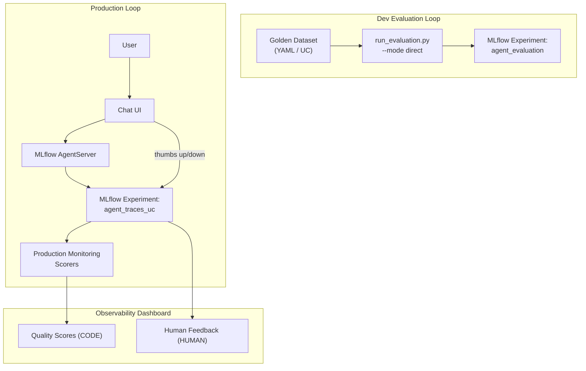

# bricks/evaluation/

> **Technical reference** for deployers and developers.

Systematic evaluation and quality assurance for deployed agents. Provides a reusable scorer catalog, a development evaluation runner, and production monitoring registration -- all driven by a shared config.



## Two Experiments

The evaluation brick uses **two separate MLflow experiments**:

| Config key | Experiment | Purpose |
|------------|-----------|---------|
| `experiment_name` | `agent_evaluation` | Dev evaluation runs (`--mode direct`) |
| `production_experiment` | `agent_traces_uc` | Live traces, trace-based eval (`--mode traces`), and production monitoring |

The `production_experiment` must match the agent's `tracing_experiment` (computed by `InstanceConfig` from `foundry.toml` + the active target).

## Execution — Laptop-Triggered Against the Deployed App

`mlflow.genai.evaluate()` runs on the **developer's laptop** and calls the *deployed* agent over HTTP `/invocations`. Authentication is the developer's interactive user OAuth session (from `databricks auth login`), which carries the app's `.auth/callback` session cookie. That means `gap-auth` forwards the real user identity into the agent runtime, so OBO-dependent skills (e.g. a sample agent's `fn_my_epics`) resolve correctly.

### Trace-based flow (default)

For each golden-set question, `run_evaluation.py` does the following:

1. `POST /invocations` with header `x-mlflow-return-trace-id: true`. The MLflow AgentServer returns the deployed trace ID in `response.metadata.trace_id` ([mlflow/mlflow#20387](https://github.com/mlflow/mlflow/pull/20387), MLflow 3.11+).
2. Poll `mlflow.get_trace(trace_id)` — the deployed agent writes its trace to **UC OTel tables** (the destination is computed by `InstanceConfig` from `foundry.toml` and surfaced as `TRACING_UC_DESTINATION` in `app/app.yaml`), which are queried through `MLFLOW_TRACING_SQL_WAREHOUSE_ID`.
3. Pass records of shape `{inputs, expectations, trace}` to `mlflow.genai.evaluate(data=...)`. When `data` contains a populated `trace` column, the harness skips its predict loop and feeds the deep trace straight to the scorers — so `tool_routing_accuracy`, `genie_sql_correctness`, and `RetrievalGroundedness` see real TOOL / RETRIEVER spans instead of a shallow HTTP wrapper.

This replaces the earlier `predict_fn=deployed` flow, which produced a shallow span that caused `tool_routing_accuracy` and `genie_sql_correctness` to silently skip.

### Known risks

- **Cross-experiment trace copy** (`PERMISSION_DENIED` on `copy_trace_to_experiment`). The deployed trace's source experiment must match the eval run's experiment, otherwise the harness copy-to-experiment call fails. `run_evaluation.py` reuses the agent's `tracing_experiment` (computed by `InstanceConfig`) for the eval experiment name, which keeps source and target experiment IDs identical. Additionally, UC-backed traces short-circuit `_should_clone_trace` in the MLflow harness, so no copy is attempted at all.
- **Terminated tracing warehouse** (pre MLflow 3.12 `mlflow.get_trace` silently returns `None` when the tracing warehouse is terminated). `run_evaluation.py` calls `start_and_wait` on `MLFLOW_TRACING_SQL_WAREHOUSE_ID` before evaluating.
- No CI-style serverless-job path: the Apps OAuth proxy rejects the bearer-only tokens a Databricks Job carries. Laptop OBO remains the supported path.

### HTTP timeout and Genie QPM

Genie Spaces are throttled at **20 QPM per workspace**. During an eval batch (50+ questions in a minute, often 2 Genie calls each), the per-call latency inflates from ~20s steady-state to ~150s under queueing — pushing total trace time past a tight HTTP timeout. Observed distribution on a live workload: p50 3s, p95 191s, p99 305s.

HTTP read timeout defaults to **360s** (covers p99 with headroom). Override with `EVAL_HTTP_TIMEOUT_SECONDS` for agents with different latency profiles:

```bash
EVAL_HTTP_TIMEOUT_SECONDS=600 uv run agent-foundry eval --instance <name>
```

For agents that make many Genie calls, reduce per-turn pressure by instructing the agent to cap Genie calls (e.g. 2 per turn) in its system prompt.

## Scorer Catalog

| Scorer | Type | Dev | Prod | What It Checks |
|--------|------|-----|------|---------------|
| `Safety` | Built-in LLM | Yes | Yes | Harmful/offensive content |
| `RelevanceToQuery` | Built-in LLM | Yes | Yes | Response relevance |
| `RetrievalGroundedness` | Built-in LLM | Opt-in | No | Grounded in retrieved context |
| `Correctness` | Built-in LLM | Yes | No | Matches expected answer |
| `ToolCallCorrectness` | Built-in LLM | Opt-in | No | Correct tool calls (see note below) |
| `tool_routing_accuracy` | Custom code | Yes | **No** | Agent routed to expected tools (needs `expectations`) |
| `genie_sql_correctness` | Custom code | Yes | **No** | Genie produced expected SQL (needs `expectations`) |

Scorers marked **No** for prod require `expectations` (ground truth), which is unavailable for live traces.

> **Note on `ToolCallCorrectness`:** Its verdicts are correct, but the Databricks judge often returns JSON that MLflow cannot parse (it quotes tool arguments without escaping them), so those rows error instead of scoring ([#62](the public issue tracker)). It is intentionally excluded from the default `with_ground_truth` preset; prefer `tool_routing_accuracy` for deterministic tool-routing signal. Instances that want the built-in judge can opt in by adding `- ToolCallCorrectness` to their own `instances/<name>/evaluation/eval_config.yml`.
>
> **Note on `RetrievalGroundedness`:** The built-in judge errors on every row when the trace has no `RETRIEVER` span. It is excluded from the default `traces_only` preset. Instances with a vector-search / RAG skill that emit retriever spans can opt in by adding `- RetrievalGroundedness` under `scorers.traces_only`.

### Instance scorers

When the catalog above does not cover a check your agent needs (a channel-relevance rule, a false-positive check, a domain-specific format), ship the scorer with the instance instead of forking the brick. Both `agent-foundry eval` and `agent-foundry monitors start` pick it up.

**1. Add a module** under the instance's `evaluation/scorers/` folder:

```text
instances/<name>/evaluation/
  eval_config.yml
  datasets/
  scorers/
    channel_relevance.py     # any *.py file is loaded
    _helpers.py              # _-prefixed files are skipped (not scanned for scorers)
```

Every MLflow `Scorer` object defined at module level is registered under its `.name`. Usually that is an `@scorer` function, whose name is the function name:

```python
# instances/<name>/evaluation/scorers/channel_relevance.py
from mlflow.entities import Feedback
from mlflow.genai.scorers import scorer


@scorer
def channel_relevance(outputs: str) -> Feedback:
    return Feedback(value="#" in outputs, rationale="mentions a channel")
```

The function declares only the arguments it needs; MLflow passes them by name:

| Argument | What it receives |
|----------|------------------|
| `inputs` | The dataset row's `inputs` (e.g. `{"question": ...}`) |
| `outputs` | The agent's response |
| `expectations` | The row's `expectations`; missing for live traces, so do not use it in production scorers |
| `trace` | The full MLflow `Trace`, for checks over tool / retriever spans (see `scorers/routing.py`) |

Return a `Feedback`, a `bool`, or a number.

**2. Reference it by name** in `instances/<name>/evaluation/eval_config.yml`. The instance file replaces the brick default, so list every scorer you want to keep:

```yaml
scorers:
  custom:
    - tool_routing_accuracy
    - channel_relevance

production_monitoring:
  scorers:
    - Safety
    - channel_relevance      # registered as "channel_relevance"
```

**3. Check it is picked up.** `--dry-run` resolves the scorers and prints the list without running the evaluation:

```bash
uv run agent-foundry eval --instance <your-app> --target dev --dry-run
#   Scorers: 4 (safety, relevance_to_query, tool_routing_accuracy, channel_relevance)
```

Rules:

- Names must be unique across the instance and must not reuse a framework scorer name (`tool_routing_accuracy`, `genie_sql_correctness`). Either case stops the run with an error, as does a module that fails to import.
- An unknown name in `eval_config.yml` is skipped with a `WARNING: Unknown custom scorer` line, so check the dry-run output after renaming a scorer.
- Modules are loaded by file path, not as a package: import helpers from installed packages, not from sibling files in `scorers/`.
- Scorers used for production monitoring must be self-contained. MLflow registers only the function body and rebuilds it on the server, where MLflow names such as `Feedback` and `Trace` are available but the module's own helpers and other imports are not. Put any other imports and helper logic inside the function.

### Configuring built-in judges

Built-in judge entries (`default`, `with_ground_truth`, `traces_only`, `production_monitoring.scorers`) can be a plain name or a `{name, args}` mapping. `args` are passed to the MLflow judge constructor, so `Guidelines` can be given its required `guidelines` text and an optional `model`:

```yaml
scorers:
  default:
    - Safety
    - name: Guidelines
      args:
        name: grounding
        guidelines: "Every factual claim in the response is supported by the tool outputs."
```

Give each configured `Guidelines` judge a unique `args.name`: it becomes the result column in eval and the registration name in production monitoring, and two judges with the same name collide. Plain entries keep their existing registration names. Custom and instance scorers do not take `args`.

## Human Feedback

The observability dashboard includes a **Human Feedback** chart that shows thumbs-up/down votes from the chat UI. These are stored as `HUMAN`-sourced assessments on MLflow traces. The quality scores chart shows `CODE`-sourced assessments from automated scorers.

## Dataset format

Golden sets are YAML files under `instances/<name>/evaluation/datasets/` (see `datasets/_template.yml`) or a UC `EvaluationDataset` passed with `--dataset`. Each row has `inputs` with a `question`, and optional `expectations` for ground-truth scorers.

A row can also carry request-level inputs. `inputs.custom_inputs` and `inputs.context` are optional mappings that are sent as `ResponsesAgentRequest.custom_inputs` / `.context` in both `--predict-via deployed` and `local`. Rows without them send exactly `{"input": [...], "stream": false}`, as before. They are not `${var.*}`-templated.

```yaml
dataset:
  - inputs:
      question: Remove the oil temperature histogram from the report.
      custom_inputs:            # seeds request-level state the agent reads
        report_spec: {...}
      context:
        conversation_id: eval-123
    expectations:
      expected_tools: []
```

Built-in judges that read `inputs` (`RelevanceToQuery`, `Correctness`) get the whole `inputs` dict as their request text, so a large seed shows up in the judge prompt next to the question.

## Quick Start

```bash
# Laptop eval (default: hits the deployed app with real user OBO)
uv run agent-foundry eval --instance <your-app> --target dev

# In-process deep-trace eval (no OBO) — opt in explicitly
uv run agent-foundry eval --instance <your-app> --target dev --predict-via local

# Score already-logged production traces
uv run agent-foundry eval --instance <your-app> --target dev --mode traces --max-traces 50

# Production monitoring
uv run agent-foundry monitors start  --instance <your-app> --target dev
uv run agent-foundry monitors status --instance <your-app> --target dev
```

## Contents

| Path | Purpose |
|------|---------|
| `conf/eval_config.yml` | Scorer selection, experiment split, monitoring settings |
| `scorers/` | Reusable scorer functions (built-in + custom); `registry.py` adds instance scorers ([Instance scorers](#instance-scorers)) |
| `scripts/run_evaluation.py` | Laptop eval CLI (user OBO via `/invocations`) |
| `scripts/register_monitors.py` | Production monitoring CLI |
| `datasets/_template.yml` | Example evaluation dataset format |
| `_scaffold/datasets/smoke.yml` | One greeting record copied with the eval config |
| `tests/` | Offline unit tests |
