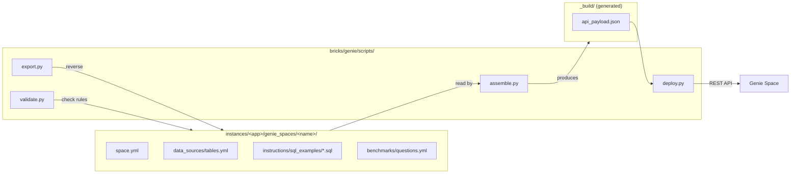

# bricks/genie/

> **Technical reference** for deployers and developers.

Genie Space infrastructure-as-code. Manages N Genie Space instances, each with its own data sources, instructions, benchmarks, and deployment config.



## Contents

| Path | Purpose |
|------|---------|
| `_scaffold/` | Starter kit -- copy to `instances/<app>/genie_spaces/<name>/` |
| `scripts/assemble.py` | Compile decomposed files into `serialized_space` JSON |
| `scripts/deploy.py` | Create/update/destroy via the Genie Management REST API |
| `scripts/export.py` | Fetch an existing space and decompose into editable files |
| `scripts/validate.py` | Validate against all API rules without deploying |

## Workflow

### 1. Create a new instance

```bash
cp -r bricks/genie/_scaffold/ instances/my_app/genie_spaces/my_space/
```

### 2. Edit the decomposed files

- Set title, warehouse, permissions in `space.yml`
- Add tables and column configs in `data_sources/tables.yml`
- Write SQL examples in `instructions/sql_examples/`
- Add benchmark questions in `benchmarks/questions.yml`

### How the agent reaches a Genie Space

Add a `managed_genie` MCP server,
`payloads/agent/mcp_servers/<name>/server.yml`. The deploy publishes each
space's id as `${var.genie_space_id__<space directory>}`:

```yaml
type: managed_genie
space_id: "${var.genie_space_id__my_space}"
tools:
  allow:
    - match: "query_space_*"
      expose_as: query_space
    - match: "poll_response_*"
      expose_as: poll_response
```

A skill's `SKILL.md` describes when to ask Genie. The deprecated skill
`tools.yml` binding (`type: genie`, matched through `tool_name` in
`space.yml`) still works for one release.

In every command below, `--instance` takes the app name, an `<app>/<space>`
pair, or a path to either. Pass the app name to act on all of its spaces;
`assemble` needs a single space, so name one when the app owns several.

### 3. Validate

```bash
uv run agent-foundry brick genie validate --instance my-app
```

### 4. Assemble

```bash
uv run agent-foundry brick genie assemble --instance my-app/my_space --target dev
```

This produces `<space_dir>/_build/api_payload.json`.

### 5. Deploy

```bash
uv run agent-foundry brick genie deploy --instance my-app --target dev
uv run agent-foundry brick genie deploy --instance my-app/my_space --target dev --dry-run
```

### Import an existing space

`agent-foundry genie import` is the first-class alias for the export
flow -- fetches the live Genie Space from the workspace and writes it
into the decomposed file layout this brick consumes:

```bash
uv run agent-foundry genie import --space-id <id> --instance my-app/my_space
# Equivalent to:
uv run agent-foundry brick genie export --space-id <id> --instance my-app/my_space
```

Import needs `<app>/<space>` so the new space has a name on disk.

## Deployment Strategy

All deployment uses the Databricks API/SDK:

- `assemble.py` builds the `serialized_space` JSON from decomposed files
- `deploy.py` calls the Genie Management REST API to create or update the space

State is tracked per-target in the workspace under `/Shared/agent-foundry/<instance>/_state/genie_spaces/`, enabling automatic create-vs-update detection.
