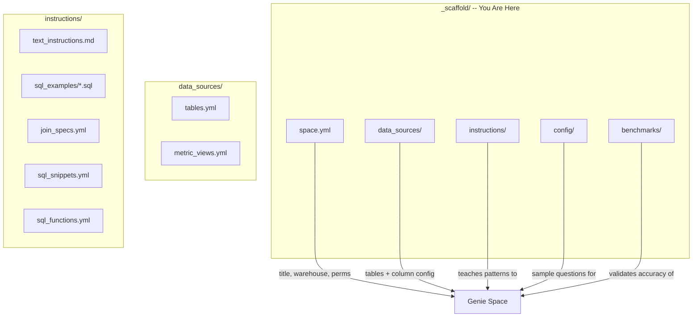

# bricks/genie/_scaffold/

Starter kit for a new Genie Space instance. Copy this entire directory to `instances/<app>/genie_spaces/<your_space_name>/` and customize the files.



## File Structure

| Path | Purpose | Priority |
|------|---------|----------|
| `space.yml` | Title, description, warehouse_id, permissions | Required |
| `data_sources/tables.yml` | Table identifiers + column configs (entity matching, format assistance) | Required |
| `data_sources/metric_views.yml` | Pre-aggregated metric views (optional) | Optional |
| `config/sample_questions.yml` | Starter questions shown in the UI | Recommended |
| `instructions/text_instructions.md` | General behavior instructions (max 1, keep concise) | Medium |
| `instructions/sql_examples/*.sql` | Example Q&A pairs with YAML frontmatter (10-20 recommended) | High |
| `instructions/join_specs.yml` | Pre-defined join relationships between tables | Medium |
| `instructions/sql_snippets.yml` | Reusable filters, expressions, measures | Medium |
| `instructions/sql_functions.yml` | Unity Catalog SQL function references | Low |
| `benchmarks/questions.yml` | Ground-truth Q&A pairs for validation (20-50 recommended) | High |

## SQL Example File Format

Each `.sql` file in `instructions/sql_examples/` uses YAML frontmatter:

```sql
---
question: "Show top 10 customers by revenue"
usage_guidance: "Use when user asks about customer rankings"
parameters:
  - name: region_name
    type_hint: STRING
    description: "Region to filter by"
    default_value: ["North America"]
---
SELECT customer_name, SUM(order_amount) as total_revenue
FROM ${var.catalog}.${var.schema}.orders o
JOIN ${var.catalog}.${var.schema}.customers c
  ON o.customer_id = c.customer_id
WHERE region = :region_name
GROUP BY customer_name
ORDER BY total_revenue DESC
LIMIT 10
```

## Tuning Priority

1. **Entity matching** (highest impact) -- enable on categorical columns in `tables.yml`
2. **SQL examples** -- one quality example = 20 lines of instructions
3. **Text instructions** (lowest impact) -- keep under 2,000 chars
