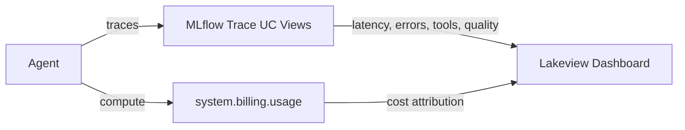

# bricks/observability/

> **Technical reference** for deployers and developers.

Deployable Lakeview dashboard for agent operational monitoring.



## What This Is

A Lakeview dashboard deployed via the REST API, with two canvas pages rendered as tabs:

| Tab | Question it answers |
|-----|---------------------|
| **Agent Operations** | Is my agent healthy? Volume, latency, errors, tools, quality, feedback, users. |
| **Token & Cache Economics** | What is my agent's context costing, and is prompt caching working? |

Neither replaces deep single-trace analysis — use the MLflow Traces UI for that.

## Prerequisites

| Requirement | Status | Detail |
|-------------|--------|--------|
| MLflow Trace Storage in Unity Catalog | **Public Preview** | Workspace must have this preview feature enabled. Traces must be written to UC for the dashboard tables to exist. |
| At least one agent trace | Required | The UC trace views (`mlflow_experiment_trace_unified`, `mlflow_experiment_trace_metadata`) are auto-created on the first trace write. |
| SQL Warehouse | Required | Dashboard queries execute on a SQL warehouse specified via `warehouse_id`. |

> **Preview note:** MLflow trace storage in UC is in Public Preview. Table schemas may evolve.

## Data Sources

| Source | Table/View | What It Provides |
|--------|-----------|-----------------|
| MLflow Trace UC | `{catalog}.{schema}.mlflow_experiment_trace_unified` | Request volume, latency, errors, tool calls, token usage, per-span cache accounting |
| MLflow Trace UC | `{catalog}.{schema}.mlflow_experiment_trace_metadata` | Quality scores, user identity, request sources |
| System Tables | `system.billing.usage` | DBU cost per warehouse |

Table references back-quote both substituted parts —
`` `${var.catalog}`.`${var.schema}`.mlflow_experiment_trace_unified ``. Unity Catalog permits
hyphens in catalog names, and a hyphenated identifier is invalid in SQL unless quoted, so the
bare form fails with `INVALID_IDENTIFIER` on those workspaces while working everywhere else.
A test rejects an unquoted reference.

`trace_metadata` is a **`VARIANT`** column, so values are read with the path form
`trace_metadata:['mlflow.trace.user']::string`. Map subscripting fails with
`INVALID_EXTRACT_BASE_FIELD_TYPE`, and a test rejects it. The per-span cache fields are
reached by exploding `spans` on the same view, which keeps request time, user and session
on the row — no join, and no need for `mlflow_experiment_otel_spans`.

Queries are scoped by the UC catalog and schema specified in the instance configuration. All data is queried live — no ETL pipelines or intermediate tables.

## Dashboard Panels

### KPI Counters

| Panel | Metric | Window |
|-------|--------|--------|
| Token Usage | Sum of OTEL token attributes from spans | 30 days |
| Unique Users | Distinct `mlflow.trace.user` | All time |
| Total Requests | Trace count | 30 days |
| Avg Requests/User | Requests per unique user | 7 days |
| Avg Latency (ms) | Mean `execution_duration_ms` | 30 days |
| Error Rate % | Non-OK trace ratio | 30 days |

### Charts

| Panel | Type | Metric |
|-------|------|--------|
| Request Volume | Area chart | Daily trace count |
| Latency p50/p95/p99 | Line chart | Daily percentiles |
| Daily Unique Users | Line chart | Users per day |
| Requests by Source Type | Stacked bar | JOB vs NOTEBOOK vs other |
| Tool Call Breakdown | Horizontal bar | Span name frequency (top 20) |
| Quality Scores | Line chart | Assessment averages by scorer |
| Cost Attribution | Stacked bar | Daily DBU by SKU |

### Token & Cache Economics

Everything on this tab derives from the LLM span's `attributes:['mlflow.spanOutputs'].usage`
block, which is the only place the prompt-cache breakdown exists. MLflow's own token
counters report the **uncached-equivalent** input, so they read the same whether or not
caching worked — see [prompt-caching.md](../../docs/explanation/prompt-caching.md#reading-the-dashboard).

| Panel | Type | Metric |
|-------|------|--------|
| Input Tokens (uncached-equiv) | Counter | `prompt_tokens`, matching what MLflow reports |
| Cache Read % | Counter | Share of input served from cache at 0.1x |
| Modelled Savings % | Counter | 1 − billed units / uncached equivalent |
| Effective Multiplier | Counter | Billed units per uncached-equivalent token |
| Output Tokens | Counter | Never discountable |
| Prefix Rebuilds / 100 Req | Counter | Static-tier writes per 100 requests; a byte-stability alarm |
| Daily Input Tokens by How They Were Priced | Stacked bar | Cache read, rolling write, static write, uncached |
| Billed DBU (actual) | Counter | `system.billing.usage`, the real-money cross-check |
| What Caching Saves | Line chart | Modelled billed units against uncached equivalent |
| Input Tokens vs Billed Units by Model | Grouped bar | Per serving model |
| Most Expensive Requests | Table | Top 100 traces, split by priced bucket, with `trace_id` |
| Tool Results by Weight | Table | Which tools introduce the most context |

Billed units are **modelled** from the published multipliers — cache read 0.1x, rolling
(5m) write 1.25x, static (1h) write 2x, uncached 1.0x — not read from billing.

## Contents

| Path | Purpose |
|------|---------|
| `dashboards/template.lvdash.json` | Parameterized Lakeview dashboard definition (27 datasets, 2 canvas pages) |
| `dashboards/queries/*.sql` | SQL datasets (human-readable, reviewable) |
| `scripts/deploy_dashboard.py` | Create/update/publish via Databricks SDK |
| `tests/unit/test_observability.py` | Offline validation |

## Usage

```bash
# Dry run (validate template + variable substitution)
uv run agent-foundry brick observability deploy-dashboard \
    --instance observability --target dev --dry-run

# Deploy to workspace
uv run agent-foundry brick observability deploy-dashboard \
    --instance observability --target dev

# Destroy (also reachable via ``agent-foundry destroy --brick observability``)
uv run agent-foundry brick observability deploy-dashboard \
    --instance observability --target dev --action destroy
```

## Configuration

### Variables

`catalog` and `schema` come from `[targets.<target>]` in the repo-root
`foundry.toml`; `name` and the other identity fields come from
`instances/<name>/foundry.toml`. `--vars key=value` overrides either, and
`warehouse_id` is filled from the warehouse brick's state when unset.

All SQL queries use `${var.catalog}` and `${var.schema}` placeholders. The cost query reads directly from `system.billing.usage` (no variable substitution needed).

### Pointing at a Different Agent

Create a new observability instance per agent:

```bash
cp -r instances/observability instances/observability-agent2
```

Rename it in `instances/observability-agent2/foundry.toml`, list it under `[[instances]]` in the repo-root `foundry.toml`, then deploy against the agent's schema:

```bash
uv run agent-foundry brick observability deploy-dashboard \
    --instance observability-agent2 --target dev --vars schema=my_agent_schema
```

Each instance keeps independent state in the workspace under `/Shared/agent-foundry/<instance>/_state/dashboard/`.

## Deployment Lifecycle

| Flag | Default | Description |
|------|---------|-------------|
| `--instance` | (required) | Instance name under `instances/` |
| `--target` | `dev` | Selects `[targets.<target>]` in `foundry.toml` |
| `--action` | auto-detect | Force `create`, `update`, or `destroy` |
| `--dry-run` | off | Validate without calling the API |
| `--no-publish` | off | Create/update the draft without publishing |
| `--vars` | none | Override variables from the command line |

1. **First deploy** — creates the dashboard, saves `dashboard_id` and `etag` to the workspace state file
2. **Subsequent deploys** — detects existing state, uses PATCH to update in place
3. **Destroy** — `--action destroy` trashes the dashboard and removes the state file

State file is safe to delete if you want to force a fresh create.

### Integration with deploy_all.py

The observability brick is the final step in `agent-foundry deploy` (data -> genie -> vector_search -> app -> observability). It soft-fails if trace tables don't exist yet (e.g., first deploy before any agent traffic).

## Customization

### Adding a Dataset

1. Add SQL to `dashboards/queries/` (numbered, e.g. `20_my_metric.sql`) and to `EXPECTED_QUERIES` in the tests
2. Add a dataset entry to `datasets` in `template.lvdash.json`
3. Register the dataset on the global time filter — **both** `w_time_range_filter.queries[]` and its `spec.encodings.fields[]`, or the tab ignores the date range
4. Add a widget referencing the dataset to the `layout[]` of the page you want it on
5. Run `--dry-run` to validate, then deploy

### Widget Grid

The grid width depends on `layoutVersion`: pages **without** the key are 6 columns wide, pages
declaring `"layoutVersion": "GRID_V1"` are 12. This template omits it, so every row must sum to
width 6, and a test enforces that. Layout versions may be mixed per page, so a page can be
migrated to the 12-column grid on its own.

### Format Contract

The Lakeview JSON fails softly — a wrong widget version renders "Invalid widget definition"
and a field-name mismatch renders "no selected fields to visualize", neither of which the
deploy call reports. `tests/unit/test_observability.py` therefore asserts the rules that bite:

- widget type to `spec.version`: counters, tables and filters are 2; charts are 3
- text widgets carry `multilineTextboxSpec` and no `spec` block, with `\n`-terminated lines
- every `fieldName` in the encodings matches a declared `query.fields[].name` exactly
- every `queryLines` fragment except the last ends in whitespace, and none contains `--`
  (fragments are concatenated with no separator, so a comment would swallow the query)
- each canvas row sums to width 6 and no two widgets overlap

### Modifying Queries

Edit SQL in `dashboards/queries/*.sql` for documentation. The executed queries come from `queryLines` in `template.lvdash.json` — keep both in sync.

## Further Reading

- [MLflow Tracing in Unity Catalog](https://docs.databricks.com/aws/en/mlflow3/genai/tracing/)
- [Lakeview Dashboard REST API](https://docs.databricks.com/api/workspace/lakeview)
