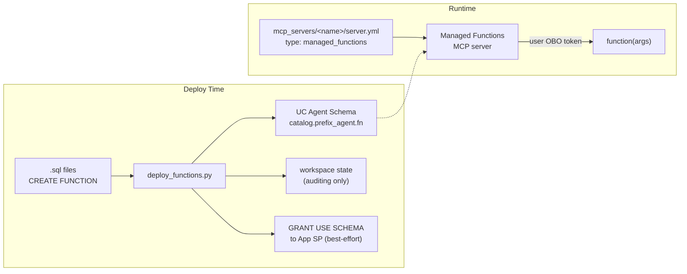

# bricks/sql_function/

> **Technical reference** for deployers and developers.

Deploys Unity Catalog SQL functions as IaC — defining functions as `.sql` files in instance directories and executing them via the Statement Execution API. Functions land in the **agent schema** (`catalog.schema_prefix_agent`) alongside OTEL trace tables.

At runtime, the agent calls the functions through a `managed_functions` MCP server — no new runtime code needed.



## Structure

```
bricks/sql_function/
├── _scaffold/                       # Copy to instances/<app>/sql_functions/<name>/
│   ├── README.md                    # Quick start
│   ├── config.yml                   # Schema override (usually not needed)
│   └── functions/
│       └── example.sql              # Starter function with COMMENT clauses
├── scripts/
│   └── deploy_functions.py          # Deploys SQL via Statement Execution API
└── tests/
    ├── conftest.py                  # Test fixtures
    └── test_deploy_functions.py     # Offline unit tests
```

## How It Works

1. **Copy template** to `instances/<app>/sql_functions/<name>/`
2. **Write SQL** in `functions/` using `CREATE OR REPLACE FUNCTION` with the full three-level
   name, back-quoted per [Identifier quoting](#identifier-quoting)
3. **Add COMMENTs** on both the function and every parameter (critical for LLM tool discovery)
4. **Expose to the agent** with a `managed_functions` MCP server, see [Wiring to the Agent](#wiring-to-the-agent)
5. **Deploy** — the orchestrator runs this brick automatically, or deploy standalone:

```bash
# Dry run -- every function group the app owns
uv run agent-foundry brick sql_function deploy \
    --instance my-app --target dev --dry-run

# Deploy, scoped to one group
uv run agent-foundry brick sql_function deploy \
    --instance my-app/my_functions --target dev
```

`--instance` takes the app name, an `<app>/<group>` pair, or a path to either.

## COMMENT Convention

Always add `COMMENT` to both the function and every parameter. The agent LLM uses these descriptions to decide when and how to call the tool:

```sql
CREATE OR REPLACE FUNCTION catalog.schema.lookup_status(
  ticket_id STRING COMMENT 'The ticket ID to look up (e.g. JIRA-1234)'
)
RETURNS STRING
COMMENT 'Looks up the current status of a support ticket by its ID.'
LANGUAGE SQL
RETURN ...;
```

The deploy script warns when `.sql` files lack `COMMENT` clauses.

## Identifier Quoting

Name the function with the catalog and schema back-quoted separately:

```sql
CREATE OR REPLACE FUNCTION `${var.catalog}`.`${var.agent_schema_name}`.lookup_status(
```

Do not use `${var.agent_schema}` in SQL. It resolves to `catalog.schema`, so
there is no way to back-quote it correctly -- `` `${var.agent_schema}` `` asks
for one schema literally named `catalog.schema`, and leaving it unquoted fails
as soon as either part contains a hyphen:

```
The unquoted identifier acme_platform-eu-dev is
invalid and must be back quoted as: `acme_platform-eu-dev`
```

Unity Catalog permits hyphens in catalog names, so this is a real shape rather
than a hypothetical one. `${var.agent_schema_name}` is the schema name on its
own for exactly this purpose.

## Wiring to the Agent

Add `payloads/agent/mcp_servers/<name>/server.yml` pointing at the agent schema.
Managed Functions names each tool `<catalog>__<schema>__<function>`, so match
the tail and give it a stable alias:

```yaml
type: managed_functions
catalog: "${var.catalog}"
schema: "${var.schema_prefix}_agent"
tools:
  allow:
    - match: "*__*__lookup_status"
      expose_as: lookup_status
```

A skill's `SKILL.md` describes when to call `lookup_status`. The deprecated
skill `tools.yml` entry (`type: uc_function`, `function_name:
"${var.agent_schema}.lookup_status"`) still works for one release.

## Security Model

- **SP role**: Infrastructure only — creates schemas, deploys function definitions, resolves metadata. Never executes data-plane SQL.
- **User OBO token**: All function execution goes through the user's identity via the SQL warehouse. UC enforces `EXECUTE` on the function and `SELECT` on underlying tables.
- **`EXECUTE` privilege**: Managed by workspace admins on users/groups, not granted to the App SP.

## Scope

**SQL functions only** (`LANGUAGE SQL`) for v1. Python UDFs (`LANGUAGE PYTHON`) require different compute and dependency management — not yet supported.

## Distinction from Genie SQL Snippets

Genie Spaces have their own `instructions/sql_functions.yml` which defines inline SQL snippets for Genie's natural language engine. Those are **not** UC functions and are deployed by the Genie brick. This brick manages proper UC-registered functions callable by the agent through a `managed_functions` MCP server.

## Integration with deploy_all.py

Deployed after Data Domains and before Genie Spaces in the brick dependency order. Functions may depend on views deployed by the data brick, and Genie SQL snippets may reference functions.
