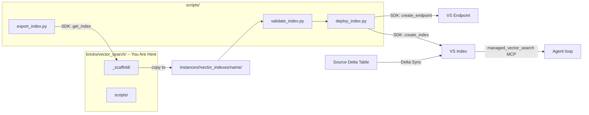

# bricks/vector_search/

> **Technical reference** for deployers and developers.

Vector Search index management. Creates, validates, and deploys Vector Search endpoints and indexes for semantic document retrieval and RAG pipelines.



## Structure

```
bricks/vector_search/
├── _scaffold/                     # Copy to instances/<app>/vector_indexes/<name>/
│   ├── README.md                  # Instance setup guide
│   ├── index_config.yml           # Endpoint + index + embedding configuration
│   └── benchmarks/
│       └── queries.yml            # Retrieval quality test queries
├── scripts/
│   ├── deploy_index.py            # Create/update/destroy endpoint + index
│   ├── validate_index.py          # Offline config validation
│   └── export_index.py            # Export existing index to template format
└── README.md
```

## How to Add a New Vector Search Index

1. Copy `_scaffold/` to `instances/<app>/vector_indexes/<your_index_name>/`
2. Edit `index_config.yml` with your endpoint, source table, and embedding config
3. Validate: `uv run agent-foundry brick vector_search validate-index --instance <name>`
4. Deploy: `uv run agent-foundry brick vector_search deploy-index --instance <name>`
5. Wire the index in **skills** (`instances/<app>/payloads/agent/skills/...`) for agent discovery (MCP registration is optional when MCP is enabled)

## How to Import an Existing Index

```bash
uv run agent-foundry brick vector_search export-index \
  --index-name catalog.schema.my_index \
  --output instances/my_app/vector_indexes/my_index/
```

## Deployment via Orchestrator

The orchestrator auto-discovers all application instances under `instances/`:

```bash
uv run agent-foundry deploy --target dev --vars vs_endpoint_name=my_endpoint --vars catalog=my_catalog
```

`vs_endpoint_name` is shared: the brick creates the endpoint only if it is
missing, then puts each index in the instance's UC schema. Two instances
can reuse one endpoint.

## MCP Integration (optional)

Managed Vector Search MCP endpoints follow this URL shape when MCP is enabled:

```yaml
- name: my_docs_index
  type: managed_vector_search
  url: "${var.host}/api/2.0/mcp/vector-search/${var.catalog}/my_docs"
  description: "Documentation retrieval"
```

Columns returned by the MCP tool must be present in
`delta_sync.columns_to_sync`. For citations, store a `doc_uri` column in the
source Delta table, sync it into the index, and include it in
`tools.default_meta.columns` in the MCP server's `server.yml`.

In this repo, MCP servers are registered under
`payloads/agent/mcp_servers/<name>/server.yml`; skills reference the
allow-listed tool by name.
