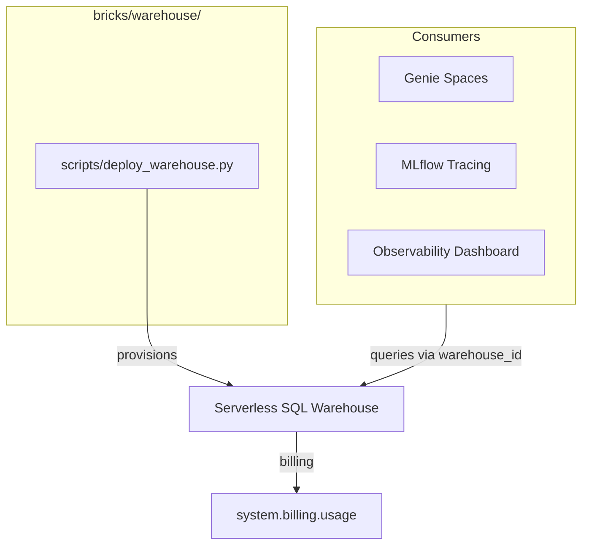

# bricks/warehouse/

> **Technical reference** for deployers and developers.

Dedicated SQL warehouse provisioning with custom billing tags for cost attribution and resource isolation.



## Contents

| File | Purpose |
|------|---------|
| `scripts/deploy_warehouse.py` | Create, update, or destroy a tagged serverless SQL warehouse |
| `tests/unit/test_deploy_warehouse.py` | Offline unit tests (config, state, tags, dry-run) |

## Why a Dedicated Warehouse?

A shared workspace warehouse makes cost attribution impossible — Genie, MLflow tracing, and dashboard queries all appear as generic SQL compute. A dedicated warehouse with billing tags ensures every DBU is attributable to the application instance via `usage_metadata.warehouse_id` in `system.billing.usage`.

Resources that use this warehouse:

- **Genie Spaces** — configured via `warehouse_id` in `space.yml`
- **MLflow Tracing** — writes to the inference table through `MLFLOW_TRACING_SQL_WAREHOUSE_ID`
- **Observability Dashboard** — runs its own queries on the same warehouse

## End-User Access (Admin Prerequisite)

With user authorization (OBO), SQL runs under the end user's identity, so the user — not the app's service principal — needs `CAN_USE` on **this exact warehouse**, plus Unity Catalog `SELECT` on the queried tables. The `sql` OBO scope caps what the token may do; it does not grant warehouse or data access. Warehouse permissions are per object: rights on another warehouse do not carry over.

Agent Foundry does not grant these permissions. A dedicated warehouse starts with no end-user access, so a workspace admin must grant `CAN_USE` to the relevant group after the first deploy. Otherwise chat users get `PERMISSION_DENIED ... not authorized to use this SQL Endpoint`. Alternatively, set `[warehouse] mode = "reuse"` with a `warehouse_id` the group can already use.

## Instance Configuration

Each application instance configures its warehouse at `<instance>/warehouse/config.yml`:

```yaml
name: "${var.warehouse_display_name}"
size: "2X-Small"
auto_stop_mins: 10
tags:
  ai_solution_managed_by: "${var.app_name}"
```

| Field | Description |
|-------|-------------|
| `name` | Warehouse display name (supports `${var.*}` substitution) |
| `size` | Cluster size (`2X-Small`, `Small`, `Medium`, etc.) |
| `auto_stop_mins` | Idle timeout before auto-stop |
| `tags` | Custom billing tags applied to the warehouse |

## Deployment

The warehouse is the **first brick** in the orchestrator's deploy order, since downstream bricks (Genie, Observability) depend on `warehouse_id`.

```bash
# Via the orchestrator (recommended)
uv run agent-foundry deploy --target dev --instance <your-app>

# Standalone
uv run agent-foundry brick warehouse deploy \
  --instance <your-app> --target dev

# Dry run
uv run agent-foundry brick warehouse deploy \
  --instance <your-app> --target dev --dry-run

# Destroy (also reachable via ``agent-foundry destroy --brick warehouse``)
uv run agent-foundry brick warehouse deploy \
  --instance <your-app> --target dev --action destroy
```

## State Management

After creation, the warehouse ID is persisted to the workspace at `/Shared/agent-foundry/<instance>/_state/warehouse/<instance>/<target>.json`:

```json
{
  "warehouse_id": "abc123def456",
  "name": "<your-app>-warehouse"
}
```

On subsequent deploys, the script detects the existing ID and updates settings/tags instead of creating a new warehouse. If the warehouse was deleted externally, it falls back to name-based lookup before creating a new one.

## Cost Attribution

The dedicated warehouse's `warehouse_id` appears in `system.billing.usage` under `usage_metadata.warehouse_id`, covering all SQL compute (Genie, tracing, dashboard). The `ai_solution_managed_by` tag provides an additional catch-all via `custom_tags['ai_solution_managed_by']` for tagged resources like UC schemas, VS indexes, serving endpoints, and apps.
