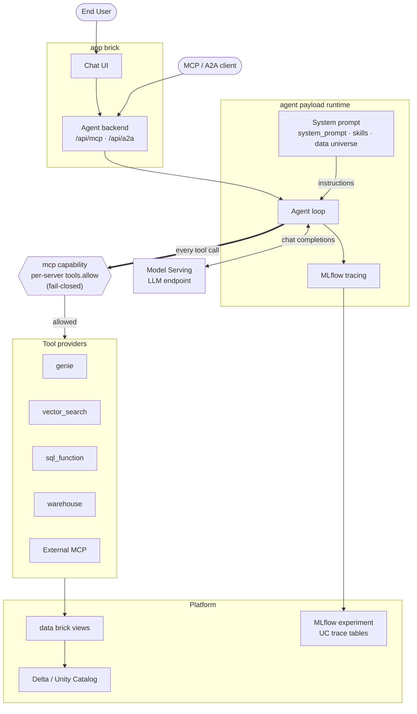

# Architecture

> How Agent Foundry is put together and why. This is the conceptual
> overview; for the hands-on path see the
> [getting-started tutorial](../tutorials/getting-started.md), for commands
> see the [CLI reference](../reference/cli.md), and for the config contract
> see the [configuration reference](../reference/config.md).

## The brick model

Agent Foundry is a set of composable **bricks**. A brick is a self-contained
module (templates + scripts + one authored `README.md`) that owns one
capability and knows how to deploy itself. You include only the bricks an
instance needs; the orchestrator deploys whichever are present.

The bricks fall into a few roles:

- **Host** -- `app`: the Databricks App that serves the chat UI and the
  agent backend, and exposes `/api/mcp` and `/api/a2a`. The instance layout
  is `app/` (`config.yml` for App infrastructure, `payload.yml` for the
  payload adapter); `agent_app` is a deprecated alias.
- **Runtime** -- the `agent` payload (`payloads/agent/runtime`): the agent
  loop, skills assembled into the system prompt, the MCP allowlist wrapper,
  and MLflow tracing.
- **Integration** -- `mcp`: the single gate every tool call passes through
  (see below).
- **Tool providers** -- `genie`, `vector_search`, `sql_function`,
  `warehouse`: managed Databricks capabilities the agent can call as tools.
- **Data** -- `data`: curated views and metadata the tools read.
- **Orchestration** -- `job`: scheduled or event-driven notebook, Spark
  Python, and SQL workflows that refresh the data and indexes agents depend on.
- **Operations** -- `observability` (Lakeview dashboard) and `evaluation`
  (scorers + production monitors).
- **Deploy helper** -- `tracing`: provisions the MLflow experiment / UC
  trace tables the runtime writes to.

## MCP is the universal integration layer

Every tool the agent can call is reached through the [`mcp`](../../payloads/agent/deploy/mcp/README.md)
brick. Managed Databricks tools (Genie, Vector Search, UC Functions, SQL
warehouse), external MCP servers, and custom MCP apps all attach the **same
way**, so the agent code stays tool-agnostic.

The `mcp` brick enforces a per-server `tools.allow` allowlist that is
**fail-closed**: a tool the allowlist does not name cannot be invoked. That
makes the brick the single, auditable chokepoint for "what can this agent
ever do" -- the property that distinguishes Agent Foundry from a hand-wired
agent.

## Runtime: agent loop, skills, and MCP

`app` hosts the chat UI and the agent backend and exposes two
programmatic surfaces alongside it -- `/api/mcp` (MCP) and `/api/a2a` (A2A
JSON-RPC) -- both with OAuth-enforced on-behalf-of (OBO) identity, so the
agent is reachable from other agents and scripted clients without a browser.

The agent loop (`payloads/agent/runtime`) has two inputs side by side:

- **Skills** are instructions: when to reach for which tool, what arguments
  matter, how to present the result. They are assembled into the system
  prompt, together with `system_prompt` and the optional data-universe
  block, and cached as a stable prefix. By default every skill body is
  inlined (`eager`); `lazy` presents a routing index and loads a body via
  `_load_skill` when needed.
- **MCP servers** provide the tools. They are mounted directly on the agent
  from `mcp_servers/`; skills reference them but do not proxy them. Every
  tool call passes the fail-closed allowlist.

The runtime emits MLflow traces throughout.

## Deployment model

`agent-foundry deploy` (orchestrator in `agent_foundry/deploy/_orchestrator.py`)
**auto-discovers** application instances: any directory under `instances/`
carrying a `foundry.toml` marker is a self-contained application. No
registration step is needed. Leftover files from older layouts fail the
run; see
[unsupported layouts](../reference/config.md#unsupported-layouts).

For each instance, the present bricks are deployed in dependency order:

1. `warehouse` -- SQL warehouse (dedicated or reused)
2. `data` -- curated views and metadata
3. `sql_function` -- Unity Catalog SQL UDFs
4. `tracing` -- MLflow experiment / UC trace tables
5. `genie` -- Genie Spaces
6. `vector_search` -- Vector Search indexes
7. `app` -- bundled agent + chat UI. During its deploy the agent
   **payload** provisions its own capabilities in order (an in-code
   manifest, `payloads/agent/deploy/assembly.py`): assembled skill
   bundle, then the MCP server registry + allowlist (publishing
   `mcp__<server>` URLs into the app's config), then chat history
   (Lakebase) when enabled.
8. `observability` -- Lakeview dashboard

Skills and MCP were standalone bricks before the payload split; they are now
**agent-payload provisioning steps** that run inside the `app` deploy, so
they no longer appear as separate steps in the deploy graph. Their
authoring surfaces moved under the agent payload
(`payloads/agent/skills/`, `payloads/agent/mcp_servers/`); the standalone
CLI verbs (`agent-foundry brick skills|mcp ...`) are unchanged. The agent's
runtime config and feature toggles are authored once in the payload's typed
`spec` (`payloads/agent/payload.yml`).

Each brick goes through **assemble -> validate -> deploy**. Brick outputs
(e.g. `space_id`, `index_name`) are written to the workspace state (`/Shared/agent-foundry/<instance>/_state/`) and
propagated to downstream bricks as `${var.*}` references. Evaluation runs as a
separate step (`agent-foundry eval` / `agent-foundry monitors`), not as part
of the deploy graph.

For how values flow into bricks (`foundry.toml` -> `${var.*}` -> per-brick
YAML), see the [configuration reference](../reference/config.md).

## Multi-instance, self-contained by design

A repo can hold many instances, each bundling its own bricks, MCP servers,
agent config, and app manifest. *Environments* are isolated by Unity Catalog
(a distinct catalog per target); *instances* within a repo are namespaced by
their `schema_prefix` (the schema, not a fourth UC dimension). Some
examples also split one instance across `{prefix}_views`, `_indexes`, and
`_agent`. Vector Search **endpoints** are shared on purpose; isolation is
the index's three-part name. Databricks Jobs API names include
`target_name` so the same instance on two targets does not collide.
Instances are discovered independently, so adding an application is just
adding a directory -- there is no central registry to edit.

## Observability and evaluation

The runtime's MLflow traces land in the UC trace tables provisioned by
`tracing`. The `observability` brick builds a Lakeview dashboard over
them, and the `evaluation` brick runs GenAI scorers and registers production
monitors against the same traces -- so what you see in development and what
you measure in production read from one source.
