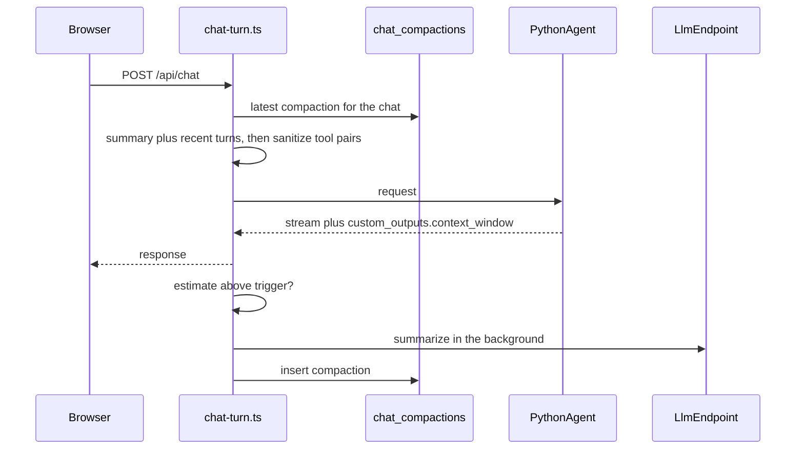

# Conversation compaction

> **Explanation** -- how the agent payload lets a chat continue past the model's
> context window, and why it is built this way. For the knobs see
> [Payload config](../reference/config.md); for the wider token budget see
> [Context management design](context-management-design.md) and
> [Prompt caching](prompt-caching.md). Compaction manages the history layer;
> the plan and long-term memory live outside it, see
> [Agent memory and plans](agent-memory.md).

## The problem

Users keep one chat open for a long time. Without compaction, the payload has two
ways of handling a growing context:

1. **Tool-result clearing**
   replaces older tool output with a placeholder once the request is large.
2. **The context-limit notice**
   answers the provider's `prompt is too long` rejection with "start a new
   conversation".

Clearing cannot reach prose. Once a conversation's user and assistant text
fills the window, the thread is over and the user starts again by hand, losing
the working context. Compaction is the step between the two: summarize the
older turns, persist the summary, and send it in their place.

## What the providers and frameworks offer

Researched October 2026.

**Provider-side compaction exists, but not on our path.**

- Anthropic offers on-demand compaction (a request that returns a signed,
  readable summary block) and threshold compaction (`context_management`,
  summarizes inside the request that crosses a token threshold). Both are beta
  and need beta headers on the native Messages API.
- OpenAI Responses offers inline `context_management.compact_threshold` and a
  standalone `POST /responses/compact`. xAI offers the same endpoint. Both
  return an **encrypted** compaction item that cannot be shown to a user.
- Gemini offers prompt caching only; compaction is left to the client.

The runtime calls Databricks model serving through
`set_default_openai_api("chat_completions")`, which reaches none of these. Even on
Databricks Unified Responses, the encrypted items would fail the "never silent" requirement below, and
Claude on Chat Completions and Gemini would still need our own summarizer.

**Framework practice has converged.** LangChain `SummarizationMiddleware`, Google
ADK compaction, Microsoft Agent Framework, AWS AgentCore and Claude Code all use
the same shape:

- Remove reversible material first (tool output), summarize prose second.
- Trigger well before the window, keep the most recent turns verbatim, and leave
  a gap between the trigger and the post-compaction size so the next compaction
  is not immediate.
- Never split a tool call from its result.
- Keep two stores: the model's working context is rewritten, the transcript the
  user sees is append-only.
- Offer both automatic and user-initiated compaction. Claude Code auto-compacts
  near the limit and also offers `/compact <focus>`: an automatic summary is
  weakest when the next turn changes direction, because the summarizer cannot
  see what is coming.

## Decisions

| Question | Decision |
|---|---|
| Provider-side or our own summarizer? | Our own. Provider compaction is unreachable on Chat Completions, and the OpenAI/xAI items are opaque. |
| Automatic, manual, or both? | Automatic in the background after a turn crosses the threshold, shown by a context meter next to the send button and a notice while the summary is written. Manual "Compact conversation" with an optional focus is opt-in (`manual_action`), since users rarely need it once compaction is visible. |
| Where does it live? | The TypeScript chat server and Lakebase: history assembly and persistence already live there, and the MCP and A2A paths carry a single question, not a transcript. |
| Who measures occupancy? | The Python runtime. It is the only layer that sees the system prompt, skill bodies and tool schemas. It reports the size before tool-result clearing, which is what the next turn starts from. TypeScript decides on the number it reports. |
| How is the prompt cache protected? | The summary is written once and replayed as identical bytes on every later turn. A compaction rewrites the conversation layer once; the system and tools prefix stays cached. The turns kept verbatim carry their signed reasoning (`reasoning_replay`, see [config](../reference/config.md)), so they keep matching the cache too; entries for summarized turns are no longer sent. |
| How is a lossy summary kept visible? | Lakebase keeps the full transcript. The chat shows a divider with the summary; earlier messages stay above it. |
| Default | On wherever chat history (Lakebase) is on. |

## How it works



The context steps run in this order, each only when the previous one is not
enough:

1. **Tool-result clearing** -- Python, before every model call, on the request
   only.
2. **Compaction** -- TypeScript, per conversation, persisted.
3. **Context-limit notice** -- the last resort when a request is rejected anyway.
   With compaction on, the rejection itself triggers a compaction, so the
   notice says the earlier messages are being summarized and asks the user to
   send the message again instead of starting over.

### Occupancy reporting

Every model call's input filter records the estimated prompt tokens of the
request it is about to send -- before clearing, with the same character
estimate clearing uses, which covers the messages, the instructions and the
tool definitions. Before, not after: clearing lasts one run, so the next turn
starts from the uncleared history. A post-clearing number could stay under the
trigger while every turn clears again and breaks the prompt cache.

The character estimate counts high (about 1.1x on the canary). So once the
turn's last call returns, the reported number is the provider's input-token
count for that call, scaled back to the uncleared size by the ratio of the
estimates before and after clearing: exact when nothing was cleared, estimated
only for the cleared share. Without a count from the provider, for example when
the call failed, it stays the estimate. The number for the last call reaches
the caller in `custom_outputs`:

```json
{"context_window": {"estimated_input_tokens": 131204}}
```

When the provider rejects the prompt as too long, the entry carries
`"limit_exceeded": true` instead. The key is `context_window` rather than a
generic `context` so it cannot collide with what an instance `finalize` hook
returns; on a clash the framework entry wins.

### The trigger

`spec.runtime.context.compaction.trigger_input_tokens` must sit below
`tool_result_clearing.clear_above_input_tokens`. Compaction is the normal
valve: it runs after a turn and summarizes the stored transcript, which
clearing never touches. Clearing is the emergency valve within one turn, where
compaction cannot run; it fires near the window limit and clears every eligible
tool result at once, so it breaks the prompt cache once rather than on every
call. Unset, the trigger defaults to 120,000 or the clearing threshold minus
20,000, whichever is smaller, so an instance that lowered its clearing threshold
stays valid.

### Where the boundary goes

Compaction keeps the last `keep_recent_turns` user turns verbatim and summarizes
everything before them. The boundary is always a user message. A tool call and
its result belong to the assistant reply between two user messages, so cutting
at a user message can never separate them, and the existing tool-pair
sanitizers have nothing new to repair.

### What a summary must keep

The summary prompt has a fixed keep-list that instances can add to but not
remove from: the current goal and open tasks, decisions and constraints the user
stated, selected resources, IDs, numbers, URLs and error strings, approaches
already ruled out, and the next step. `compaction.instructions` appends
instance-specific rules; the manual action appends the user's focus. A second
compaction summarizes the previous summary plus the turns since it. With
`context.plan` on, the plan is stored outside the conversation and recited
after the summary, so the goal and milestones survive compaction verbatim.

### The context meter

After each turn the chat server writes one `data-contextWindow` part with the
runtime's estimate, the trigger and whether compaction starts. A ring next to
the send button shows the estimate as a share of `trigger_input_tokens` (not of
the model's window, which compaction keeps the chat away from), with a warning
colour from 80%. A triggering turn shows "Summarizing earlier messages…"; the
ring polls the chat's summaries for up to two minutes and empties once a new
one is stored. The next turn's estimate refills it. A turn over the trigger
while no turn is older than the `keep_recent_turns` kept verbatim starts no
compaction, so the ring stays in the warning colour instead.

### Persistence

Each compaction is a row in `ai_chatbot.chat_compactions`: the chat, the first
message kept verbatim, the summary text, the model, whether it was automatic or
manual, and the estimate that triggered it. The row is deleted with its chat
through a cascading foreign key, which covers both the chat delete route and
history retention. The model request uses the latest row; the transcript is
never modified.

### Searching the summarized turns

The summary replaces the older turns for the model only, so they can be
restored. While compaction is on, the agent has two tools and a short
`## Earlier turns` block telling it to look there before asking the user again
or calling a tool again. Both call the chat UI server on localhost for the
request's conversation id, and both see the turns before the latest summary's
boundary, each tool result up to 100,000 characters (the summarizer sees
1,500):

- `_search_history(query)` (`POST /api/chat/:id/history/search`) returns up
  to five excerpts of about 600 characters with their user turn and offset,
  best match first.
- `_read_history(turn?, offset?)` (`POST /api/chat/:id/history/read`) returns
  an outline without a turn -- each turn's request and length, and each of
  its tool calls with the start of its input and its offset, up to 100 --
  and otherwise up to 8,000 characters of the turn from the offset, ending
  between tool calls where it can, with where the next page starts. It covers what a word search misses: the agent can read
  around a hit, or browse when it doesn't know what to search for.

Before the first summary there is nothing to search or read, and the tools say
so; keeping them in every request keeps the tool list, and so the cached
prompt, the same when a chat is first compacted.

The runtime calls both as the user: it forwards the user's `x-forwarded-*`
identity headers, which the Apps proxy sets on every request and the chat UI
server builds its session from, so the route's usual chat access check
applies. A caller of `/invocations` who names someone else's conversation id
gets nothing from it. The runtime builds the URL itself, from
`CHAT_APP_PORT` and a conversation id that must be a plain path segment, so
neither the caller nor the model can point the tool anywhere else. A smoke
probe checks on every deploy with compaction on that the route answers 403
for a chat the caller cannot read.

## Limits

- **Ephemeral mode** (no Lakebase) has no compaction: there is nowhere to keep
  the summary, and an unpersisted summary regenerated on every turn would break
  the prompt cache every turn.
- **An already-oversized thread** -- one that grew before compaction was
  on, for example -- is summarized in chunks of at most 150,000 characters of
  rendered transcript, oldest first, each on top of the summary of the chunks
  before it; only the final summary is stored. A message is never split across
  chunks. A run summarizes at most eight chunks; beyond that the oldest messages
  are left out and the summarizer is told how many.
- **History search matches words**, not meaning: each text or tool call is
  ranked by the query's words it contains, rare ones such as ids and emails
  counting more than common ones, with a bonus for the whole phrase. It
  covers only the turns the summary replaced; the recent ones are in view.
- **The trigger is an absolute token count**, like the clearing threshold.
  A fraction of the model's window would need the window size, which the runtime
  does not know.
