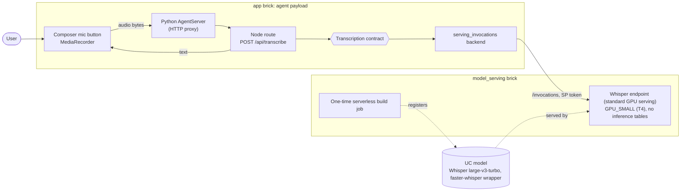

# Speech-to-text input — design

> **Explanation** -- the design for a microphone button in the agent chat UI
> that turns a spoken recording into text in the composer. It is
> non-streaming: the user records, stops, and the transcript appears. The
> design fixes one **transcription contract**. The shipped backend is a
> self-hosted Whisper model on standard GPU Model Serving (one T4), deployed
> by the generic `model_serving` brick. The Foundation Model API (Gemini)
> and Custom LLM Serving are possible later backends behind the same
> contract. For the host and payload model see
> [Architecture](architecture.md) and
> [Author a payload](../how-to/author-a-payload.md); for the configuration
> see [Speech input](../../payloads/agent/CAPABILITIES.md#speech-input).

## Scope

In scope:

- A microphone button in the chat composer of the `agent` payload.
- Record, stop, upload one recording, receive the transcript, insert it into
  the composer. The user edits and sends manually; nothing is auto-sent.
- One transcription contract, with backends as swappable implementations.
- Opt-in per instance, off by default.

Out of scope:

- Streaming transcription (partial results while speaking). See
  [Streaming outlook](#streaming-outlook).
- Programmatic speech input over `/api/mcp` or `/api/a2a`.
- Text-to-speech, voice conversations, speaker diarization.
- Storing audio.

## Requirements

| Area | Requirement |
|---|---|
| Governance | Audio is processed inside the Databricks workspace. Some deployments require processing in **EU member states only**, which rules out services committed only to a wider geography. |
| Regions | Any region with GPU Model Serving, including Azure West Europe and AWS. |
| Languages | Multilingual, auto-detected; an optional per-instance language hint. |
| Length | Long dictation is a use case; one recording is capped at **5 minutes**. |
| Text behavior | The transcript is inserted into the composer for editing. |
| Surfaces | Chat UI only. |
| Latency | Must feel instant once warm; an always-on endpoint is acceptable. |
| Audio retention | Discarded after transcription. Only metadata is recorded. |
| Rollout | Opt-in via `payload.yml`. |

## Platform constraints

- **No managed speech-to-text endpoint exists.** Databricks has no dedicated
  transcription task type. External-model endpoints support only
  `llm/v1/completions`, `llm/v1/chat` and `llm/v1/embeddings`, so a
  provider's transcription API cannot be attached as a standard external
  model.
- **Standard GPU Model Serving runs a small custom model on a T4.** A custom
  MLflow model (here: a thin wrapper around faster-whisper) is served on
  `GPU_SMALL` (one T4, 16 GB) and called on `/invocations`.
  - The serving container is built from the model's pinned requirements, so
    the model can be logged and registered from any compute, including CPU.
  - Custom-model requests are capped at **16 MB**, with a fixed **597 s**
    execution timeout.
  - The CUDA version of the serving image is not selectable. CTranslate2,
    the engine under faster-whisper, needs CUDA 12 and cuDNN 9, so the
    wrapper ships and loads them itself (see
    [The Whisper wrapper model](#the-whisper-wrapper-model)).
  - GPU capacity differs by region and is not guaranteed on creation.
- **Gemini pay-per-token models accept audio.** Several `databricks-gemini-*`
  Foundation Model API endpoints accept audio as an `audio_url` content part
  (a base64 data URI) in Chat Completions. Requests are capped at **4 MB**,
  and the region table marks most Gemini models as requiring
  cross-geography routing. The model is an LLM that follows a "transcribe"
  instruction, not a dedicated speech model. See
  [Later backends](#later-backends).
- **Custom LLM Serving supports speech-to-text (Public Preview).** The task
  `llm/v1/audio/transcriptions` exposes the OpenAI-compatible
  `audio.transcriptions` API on vLLM. Registration packs the environment of
  the machine it runs on, so it needs serverless GPU compute, and the
  smallest GPUs are larger than a T4.
- **Payload logging stores audio.** AI Gateway inference tables log the
  request body, which would persist the base64 audio. They stay off for any
  endpoint this feature calls.
- **Databricks Apps cut requests off at 120 s.** The Apps proxy terminates
  any request after 120 seconds, regardless of the serving endpoint's 597 s
  limit, so the app's own timeout is the binding one.
- **The AgentServer relay passes raw audio through.** MLflow's chat proxy
  forwards `/api/*` to the Node server, reads the body as raw bytes and
  forwards it unchanged, with a 300 s timeout (`CHAT_PROXY_TIMEOUT_SECONDS`).
  When Node is unreachable or fails, the proxy answers with a **plain-text**
  502 or 503, not JSON.

## Options considered

### Backend

| Option | Outcome |
|---|---|
| Browser speech recognition (Web Speech API) | Rejected: audio goes to the browser vendor. |
| Whisper large-v3-turbo (faster-whisper wrapper) on standard GPU serving, T4 | **Shipped.** In-workspace, smallest GPU, registration from any compute. |
| Gemini via Foundation Model API | **Later backend.** No infrastructure to run, but cross-geography routing needs explicit operator acceptance and does not satisfy EU-member-states-only processing. |
| Speech-to-text model on Custom LLM Serving (Whisper large-v3-turbo or Qwen3-ASR) | **Later backend.** OpenAI-compatible API and vLLM throughput, but registration needs serverless GPU compute and there is no T4 option. |
| Legacy Marketplace Whisper (`system.ai.whisper_large_v3`) on classic GPU serving | Rejected: the larger, slower model, and no control over decoding or the duration cap. |
| Provider transcription API via custom proxy model | Deferred: only needed if no in-workspace backend fits. |
| Whisper inside the app container | Rejected: app compute is CPU-only and size-limited; it competes with the agent. |

### Topology

1. **Endpoint plus a thin route in the agent payload.** The serving endpoint
   is the reusable API; each consuming app owns its own route.
2. **Endpoint serving a custom wrapper model** that encapsulates decoding,
   the cap and backend routing. It is hard to extend to streaming, and
   calling Gemini from inside a served model needs extra credentials. (The
   Whisper wrapper only runs the model; the cap, routing and errors stay in
   the app route.)
3. **A separate `speech` payload app** (like `rest_mcp`) that exposes
   `/api/transcribe` to the agent payload and other apps. It is reusable and
   ready for streaming, but adds an always-on app, an extra hop for the
   audio, and app-to-app OAuth.

**Chosen: topology 1 now, built so it can become topology 3.** The contract
and backends are written as a self-contained module with no dependency on
chat code, so they can move into a `speech` payload when streaming or a
second consuming app arrives. The browser always needs a same-origin route on
its own app, because the session cookie only works there. So the agent
payload's route remains in topology 3; it just forwards to the speech app
instead of to an endpoint.

## Decisions

| # | Decision |
|---|---|
| D1 | One transcription contract; backends are swappable implementations of it. Every backend must pass the same contract tests. |
| D2 | A Foundation Model API backend (`fmapi_chat`, Gemini) is a later addition, not part of the first release. |
| D3 | The shipped backend is Whisper large-v3-turbo in a faster-whisper wrapper on standard GPU Model Serving (`GPU_SMALL`, T4), called on `/invocations` (`serving_invocations`). |
| D4 | A future `fmapi_chat` backend in production uses a model confirmed as in-geo, or the operator explicitly accepts cross-geography routing for the chosen model. |
| D5 | The agent-side route lives in the Node chat server override, behind the existing session check. |
| D6 | The app's service principal calls the endpoint. Access is granted with `CAN_QUERY` through the app's resources. |
| D7 | New infrastructure lives in a **generic** `model_serving` brick (an endpoint for a Unity Catalog model, optionally built by the brick). It knows nothing about speech. |
| D8 | Speech logic lives in the agent payload while no extra app is needed; it moves to a separate `speech` payload when one is (topology 3). |
| D9 | Audio is never stored: no inference tables, no volume, no logging of bodies. |
| D10 | Hard cap of 5 minutes per recording, configurable downward. |
| D11 | Auto-detect language by default, with an optional per-instance hint. Without an instance hint, the client sends the browser language as the hint. |
| D12 | Logs never contain audio or transcript text. The route logs only the endpoint's error status and the error type. A structured log line per transcription is planned (see [Observability](#observability)). |
| D13 | If the target region has no GPU capacity for the configured workload type, the deploy fails with a clear error. No automatic fallback. Capacity cannot be checked in advance, so the error comes when endpoint creation fails. |
| D14 | Where a workspace requires processing in EU member states only, `serving_invocations` on an endpoint in an EU region is the production backend. `fmapi_chat` is not used there, because Gemini processing is only committed to the Databricks Europe geo (EEA, Switzerland and UK). |

## Architecture



The UI, the route and the contract do not depend on the backend. A later
backend changes only the backend module and its configuration.

## The transcription contract

TypeScript, Node server (`server/src/lib/transcription.ts`):

```typescript
type TranscriptionErrorCode =
  | "too_long"
  | "unsupported_format"
  | "empty_audio"
  | "backend_unavailable"
  | "overloaded"
  | "timeout";

/** Codes only the route raises; backends never return them. */
type RouteErrorCode = TranscriptionErrorCode | "busy";

interface TranscriptionRequest {
  audio: Uint8Array;
  mimeType: string;
  languageHint?: string;
}

interface TranscriptionResult {
  text: string;
  detectedLanguage?: string;
  durationSeconds?: number;
}

interface TranscriptionBackend {
  readonly name: "serving_invocations";
  transcribe(request: TranscriptionRequest, signal: AbortSignal): Promise<TranscriptionResult>;
}
```

Rules every backend must satisfy:

- Returns verbatim text in the spoken language. No translation, no summary.
- Silence or no speech yields `empty_audio`, not invented text.
- A truncated result is an error (`backend_unavailable`), never a partial
  transcript.
- Raises only the codes above; anything else maps to `backend_unavailable`.
- Honors the abort signal, so a user cancel or a client disconnect stops the
  call.
- Never logs the audio or the transcript.

The route owns everything that is not backend-specific: session check,
feature flag, per-user limit, size and duration cap, MIME allow-list,
language-hint normalization, timeout, telemetry, and mapping error codes to
HTTP status.

### HTTP surface

`POST /api/transcribe`

- The body is the raw audio (`Content-Type: audio/webm`, `audio/ogg` or
  `audio/mp4`), parsed with a route-local raw body limit. The global JSON
  limit stays unchanged.
- An optional `X-Speech-Language` header carries the language hint: the
  instance `language` when set, otherwise the browser language. The route
  normalizes it to the two-letter ISO 639-1 code (`de-DE` becomes `de`),
  which Whisper expects, and drops values it cannot parse.
- `200 {"text", "detectedLanguage"?, "durationSeconds"?}`.
- Errors are `{"error": <user-safe message>, "code": <RouteErrorCode>}`,
  matching the `{ error }` shape of the existing file-upload route:
  - `429` for `busy` (one transcription in flight per user)
  - `413` for `too_long`
  - `415` for `unsupported_format`
  - `422` for `empty_audio`
  - `502` for `backend_unavailable`
  - `503` for `overloaded` (the endpoint answered 429 or 503: at capacity or
    still scaling up)
  - `504` for `timeout`
- After a network error, `502`, `503` or `504` the error toast offers Retry,
  which re-sends the same recording. The client holds it in memory only
  while the toast is shown (30 s); it is never stored.
- The client also handles non-JSON error bodies, because the AgentServer
  relay answers with plain text when the Node server fails.

## Configuration

`spec.ui.speech_input` in `payload.yml` (`SpeechInputUI` in
`payloads/agent/contracts.py`), following the other `spec.ui.*` toggles:

```yaml
spec:
  ui:
    speech_input:
      enabled: false                                # opt-in
      backend: serving_invocations                  # the only backend today
      endpoint: ${var.serving_endpoint_name__speech}
      max_seconds: 300                              # 1..300
      language: null                                # optional hint, e.g. "de"
```

Validation (Pydantic, `extra="forbid"` like the rest of the spec):
`enabled: true` requires `endpoint`, `max_seconds` is limited to 1..300, and
`language` must be two letters.

The wiring follows the existing feature-flag path:

1. The spec sets environment variables on the app: `ENABLE_SPEECH_INPUT`,
   `SPEECH_BACKEND`, `SPEECH_ENDPOINT`, `SPEECH_MAX_SECONDS` and
   `SPEECH_LANGUAGE`.
2. `/api/config` exposes `features.speechInput`, `speechMaxSeconds` and
   `speechLanguage`.
3. `AppConfigContext` reads them as `speechInputEnabled` and the two values,
   defaulting to off.
4. The mic button is only shown when that flag is on.

When the feature is enabled, deploy adds a `speech-endpoint` resource with
`CAN_QUERY` on `endpoint` to the app (`speech_app_resources` in
`payloads/agent/deploy/config.py`). `endpoint` is resolved like the gateway
blocks; an unresolved `${var.*}` placeholder fails the app deploy, so a
missing brick output can never silently drop the grant.

`agent-foundry scaffold speech_input` writes `model_serving/speech/` into the
instance: the endpoint config, the Whisper wrapper and its build script.

## The `model_serving` brick

A built-in brick under `bricks/model_serving/`. It is **generic** (D7): it
serves any Unity Catalog model, a classic ML model on CPU just as well as
Whisper on a GPU, and speech input is only its first user. The full field
reference is in [its README](../../bricks/model_serving/README.md).

- **Layout:** nested, like `vector_search`:
  `instances/<app>/model_serving/<sub>/endpoint_config.yml`, one endpoint per
  sub-instance.
- **Config:** the endpoint name, a three-part model name, `version` or
  `alias` (latest by default), `workload_type` (`CPU` by default),
  `workload_size` (`Small` by default) and `scale_to_zero` (`true` by
  default).
- **Optional build:** with `build:`, the brick uploads the build script and
  its files to the workspace and runs them as a one-time serverless job with
  the pinned dependencies. The script registers exactly one new version,
  which the brick then serves. The brick keeps a hash of the build inputs in
  its state and rebuilds only when the script, a file or a dependency
  changes, or the recorded version is gone. A lost state means one rebuild.
- **Endpoint:** create or update with a 60-minute wait, since GPU container
  builds and provisioning take 20 to 40 minutes. An endpoint that already
  serves the desired version and compute is left untouched. On failure the
  brick prints the tail of the container build log, and names the region
  and workload type when capacity is missing (D13). No inference table is
  ever configured (D9).
- **Outputs:** `${var.serving_endpoint_name__<sub>}`, for example
  `serving_endpoint_name__speech` for `spec.ui.speech_input.endpoint`.
- **Deploy order:** 65, after `vector_search` and before `job` and `app`.
- **Destroy:** deletes the endpoint and waits until it is gone. For a model
  the brick built, it also deletes the registered model and the build's
  MLflow experiment. A model registered outside the brick is never deleted.
- **Serverless build scripts** have no `__file__` and must not raise
  `SystemExit`, because serverless runs them through `exec()` and fails the
  task on any `SystemExit`, even 0. The brick README documents both.

Out of scope (YAGNI): several served entities per endpoint, traffic splits,
AI Gateway settings and inference tables.

## The Whisper wrapper model

`payloads/agent/deploy/speech/_scaffold/`, copied into the instance by the
scaffold verb.

- **Class:** an `mlflow.pyfunc.PythonModel` with typed request and response
  records, so MLflow infers the signature from the type hints. It is logged
  from a code file (models from code) and registered to Unity Catalog under
  `${var.catalog}.${var.schema_prefix}_agent.speech_whisper_turbo`.
- **Build:** `build_whisper.py` runs in the brick's serverless job. It
  downloads the CTranslate2-converted turbo weights from Hugging Face,
  logs them as an MLflow artifact, runs a CPU smoke test on silence and only
  then registers the version. The weights never pass through a laptop.
- **Weights pin:** the download is pinned to a commit of
  `dropbox-dash/faster-whisper-large-v3-turbo` (`WEIGHTS_REVISION` in
  `build_whisper.py`), so a changed or taken-over repository cannot swap the
  weights. Moving to newer weights means bumping that revision.
- **`load_context`:** loads the model once per serving worker on `cuda` in
  `float16` (about 1.6 GB).
- **CUDA libraries:** `nvidia-cublas-cu12` and `nvidia-cudnn-cu12==9.*` are
  pinned dependencies, and `load_context` loads them explicitly before
  importing CTranslate2. faster-whisper's documented `LD_LIBRARY_PATH`
  approach does not work here, because it must be set before Python starts.
- **Decoding:** PyAV (`av`), which bundles FFmpeg, decodes webm, ogg and mp4
  to 16 kHz mono. No system FFmpeg is needed. The build caps `av` below 19,
  because faster-whisper 1.2.1 passes an argument PyAV 19 removed.
- **Duration cap:** the wrapper decodes the audio first and rejects anything
  longer than 302 s (the 300 s ceiling plus the route's grace) before
  inference.
- **Transcription:** `BatchedInferencePipeline` for long recordings,
  `vad_filter=True`, and `condition_on_previous_text=False`. Whisper invents
  text on silence (for example "Thank you.") and can loop on long audio.
  Empty text after voice-activity filtering maps to `empty_audio`.
- **Logs:** the endpoint logs show the serving worker's stderr, so the
  wrapper's diagnostics go to stderr. It never logs audio or text.

## Implementation details

### Node route

`POST /api/transcribe` (`server/src/routes/transcribe.ts`) follows the
pattern of `routes/files.ts`:

- `authMiddleware` on the router and `requireAuth` on the route, then an
  `ENABLE_SPEECH_INPUT` check that answers `501` when off.
- A route-local `express.raw({ type: [...allowed MIME types], limit: '2.5mb' })`.
  The global JSON parser ignores audio content types. Five minutes at the
  client's 32 kbps is about 1.2 MB.
- MIME checks compare the base type, because browsers send parameters such
  as `audio/webm;codecs=opus`.
- A per-user in-flight set (keyed by the session user) answers `429 busy`
  for a second concurrent request and is cleared in a `finally` block.
- Auth uses the app service principal (D6); the route ignores
  `x-forwarded-access-token`.
- Calls use plain `fetch` with an `AbortSignal` that combines the route
  timeout (100 s) and the client disconnect. They do **not** use
  `databricksFetch`, which logs request bodies.

### `serving_invocations` request

`POST {host}/serving-endpoints/{endpoint}/invocations`:

```json
{"inputs": [{"audio_base64": "<audio>", "mime_type": "audio/webm", "language": "de"}]}
```

The response is `{"predictions": [{"text": "...", "language": "de", "duration_seconds": 42.1}]}`.
The field names are fixed by the wrapper's typed signature. An endpoint
answer of 429 or 503 maps to `overloaded`; other failures map to
`backend_unavailable`.

### Client

- A mic button next to the send button with idle, recording (with elapsed
  time) and transcribing states, and cancel while recording or uploading.
- Recording uses `MediaRecorder` and picks the first supported MIME type
  (`audio/webm;codecs=opus`, `audio/ogg;codecs=opus`, `audio/mp4`), with
  `audioBitsPerSecond` at about 32 kbps.
- The client stops automatically at `max_seconds`.
- **Silence check.** While recording, a Web Audio `AnalyserNode` tracks the
  input level. If it never rises above a speech threshold, the client shows
  "no speech detected" and does not upload.
- The transcript is inserted at the cursor, with a separating space when
  needed. It never replaces text the user has already typed.
- After every stop, cancel or error, the client stops all tracks of the
  microphone stream, so the browser does not keep showing the microphone as
  in use.

## Security and privacy

- **Authentication:** the session check on `/api/transcribe` is the same as
  for the chat routes. Requests without a user are refused before the body is
  read.
- **Authorization:** the app service principal holds `CAN_QUERY` on exactly
  the configured endpoint.
- **Audio retention:** nothing is stored. There are no inference tables, no
  volume writes, and no request or response body in logs or traces. The
  client drops the recording after a successful transcription, or when the
  Retry toast closes.
- **Input hardening:** a MIME allow-list, a byte limit before parsing, and a
  request timeout of 100 s, below the Apps proxy's 120 s cut-off, so the user
  gets a clean `timeout` error instead of a dropped connection. The byte
  limit alone does not bound the GPU work, because low-bitrate Opus fits
  close to an hour into 2.5 MB. The wrapper therefore rejects anything over
  302 s before inference, and the route checks the configured `max_seconds`
  again on the reported duration.
- **Per-user limit:** one transcription in flight per user; a second request
  gets `429` with `busy`. A replica runs one synchronous worker, so it
  transcribes one recording at a time and queues the rest; without this one
  user could push everyone else into timeouts. The limit is held in memory in
  the Node process, which is enough for a single app instance. There is no
  limit across users: under load, requests queue at the endpoint until the
  100 s route timeout, and the user can retry the same recording from the
  error toast.
- **Supply chain:** the model weights are pinned to a Hugging Face commit and
  the build dependencies to exact versions.
- **Browser:** the microphone permission is requested only on click. If the
  user denies it, the UI shows an error state with no retry loop.
- **Embedding:** when the app is embedded in an iframe, the browser blocks
  the microphone unless the iframe allows it (`allow="microphone"`). This is
  a documented limitation, not something the app can fix.

## Observability

Today the route logs only failures: the HTTP status the endpoint answered
and the type of an unexpected error, never audio or text (D12). The endpoint
side is visible in the Model Serving metrics (request latency, GPU memory)
and in the endpoint logs.

Planned: the Node server has no OpenTelemetry exporter; only the Python side
emits telemetry. Rather than adding the OpenTelemetry Node SDK, the route
would write one structured JSON log line to stdout per transcription, with
the backend and endpoint, the audio duration and size, the latency, the
outcome or error code and the detected language. Apps telemetry exports app
logs to the `telemetry_destination` tables, so the existing observability
dashboard could chart them without new tables.

## Performance and cost

Measured on one `GPU_SMALL` T4 with workload size `Small`:

- **Latency:** 1 to 2 s for 20 to 30 s clips, about 5 s for a 290 s
  recording. webm, ogg and mp4 all decode, and silence returns empty text.
- **Concurrency:** requests run one after another on the single worker. Two
  parallel 290 s recordings finished in 5 s and 10 s, four in 5 to 20 s, all
  well under the 100 s route timeout. `Small` already allows 4 concurrent
  requests, so the single model in the wrapper is the bottleneck, not the
  endpoint.
- **Scaling:** `Medium` or `Large` workload sizes add T4 replicas, but
  scale-out is reactive, so a burst queues until a new replica is up. The
  endpoint stays on `Small` until real load shows it is needed.
- **Cold start:** with `scale_to_zero: true`, the first request after idling
  is held while the GPU comes up and answered after about a minute, inside
  the 100 s route timeout. A slower cold start ends in the `timeout` toast,
  with Retry.
- **First deploy:** the build job takes about 10 minutes, the GPU endpoint
  20 to 40 minutes.
- **Cost:** with `scale_to_zero: false` the T4 is billed around the clock,
  even when nobody records. The scaffold defaults to scale-to-zero, which
  suits test instances; production sets it to `false` knowingly.

## Testing

- **Unit tests (Python):** the spec validation, the environment variables
  and app resource, the brick's config, version resolution, rebuild decision,
  create/update/no-op paths, build-log failure path and destroy (against the
  SDK fakes), and the wrapper with a stub engine and decoder, including the
  duration cap and the weights pin.
- **Unit tests (TypeScript):** the route's cap, MIME allow-list and error
  mapping with a fake backend, the per-user limit, the language-hint
  normalization, the client's MIME selection, silence threshold, insertion
  at the cursor and retryable statuses, in the out-of-tree harness
  (`payloads/agent/ui/tests/ts/`).
- **Smoke probe:** with `spec.ui.speech_input.enabled`, the payload smoke
  posts a short synthetic clip to `/api/transcribe` and expects its code word
  back. The clip is generated with macOS `say`, so it contains no personal
  voice data. The probe retries 502, 503 and 504 while a scale-to-zero
  endpoint wakes up.
- **Live recordings:** recordings of real speech are personal data and
  **never enter the repository**. Live checks read them from a git-ignored
  folder or an environment variable and skip when they are missing.
  Transcript quality is judged by reading, not by a metric; the automated
  assertions are the ones that need no reference transcript: non-empty
  text, the language unchanged, `empty_audio` for silence, and the right
  error codes.

## Known limitations

- **Hugging Face access.** The build job downloads the weights from Hugging
  Face. A workspace that blocks it needs the weights from a Unity Catalog
  volume instead, which is not built.
- **Transitive dependencies.** Only `av` is capped. A breaking release of a
  transitive dependency shows up as a failed build, not as a failing
  endpoint, because a built version keeps what it ran with.
- **GPU capacity.** `GPU_SMALL` must be available in the target region; a
  shortage surfaces as a failed endpoint creation after a wait (D13).
- **iframes** need `allow="microphone"` from the embedding page.

## Later backends

### Gemini on the Foundation Model API (`fmapi_chat`)

A second backend behind the same contract, for workspaces where
cross-geography routing is acceptable and no GPU endpoint should run:

- One plain Chat Completions request with a strict verbatim-transcription
  instruction, the language hint, the audio as a base64 `audio_url` data
  URI, and the lowest reasoning effort the model allows. Tools and
  structured output fail together with audio, so neither is used.
- When Enforce Unity Gateway is on, the same models are reached as Unity
  Catalog model services (`system.ai.*`) through `/ai-gateway/mlflow/v1`,
  which need an `EXECUTE` grant instead of `CAN_QUERY`.
- Reasoning tokens count against `max_tokens`, so the limit stays well above
  a 5-minute transcript. `finish_reason: "length"` maps to
  `backend_unavailable`.
- Some models reject `temperature`, return `content` as a list of parts
  rather than a string, or answer `400` with a safety block on harmless
  audio. LLMs also tend to invent text for silence, so the client's silence
  check stays the primary guard.
- The 4 MB request cap leaves room for 5 minutes at 32 kbps after base64.
- Configuration would add `backend: fmapi_chat` and an
  `accept_cross_geo_routing` flag that is required for any model not
  confirmed as in-geo, so cross-geography processing is always a recorded
  decision (D4), never a default.

### Custom LLM Serving (`audio_transcriptions`)

A third backend that sends the recording as a multipart file to the
OpenAI-compatible `audio.transcriptions` API of an endpoint served under
`llm/v1/audio/transcriptions`, with candidates such as Whisper large-v3-turbo
or Qwen3-ASR. vLLM serves many concurrent requests per GPU, which matters
for higher load or streaming. It becomes attractive when registration no
longer needs serverless GPU compute or smaller GPUs become available.

## Streaming outlook

Streaming transcription is the trigger to move the contract and backends into
a separate `speech` payload (topology 3):

- A Databricks App can hold a WebSocket. The chat already uses one, at
  `/api/chat/socket`, through the same AgentServer relay.
- The agent payload's `/api/transcribe` becomes a forwarder, and other apps
  call the speech payload directly.
- Naive chunking (recording 3 to 10 s pieces and transcribing each) loses
  words at chunk borders, so streaming needs a model or server built for it;
  Custom LLM Serving is the likely backend.
- Model Serving has no streaming or WebSocket input, so the WebSocket ends in
  the speech payload app.

The current design keeps that move cheap, because the contract module has no
dependency on chat code and the route is the only piece that knows where the
backend runs.

## Sources

- [Model Serving limits and regions](https://docs.databricks.com/aws/en/machine-learning/model-serving/model-serving-limits)
- [Debug model serving timeouts](https://docs.databricks.com/aws/en/machine-learning/model-serving/model-serving-timeouts)
- [Foundation Model APIs limits and quotas](https://docs.databricks.com/aws/en/machine-learning/foundation-model-apis/limits)
- [Query audio and video models](https://docs.databricks.com/aws/en/machine-learning/model-serving/query-audio-video-models)
- [Supported Foundation Model API models](https://docs.databricks.com/aws/en/machine-learning/foundation-model-apis/supported-models)
- [External models](https://docs.databricks.com/aws/en/machine-learning/foundation-models/external-models/)
- [Serve custom LLMs with Custom Model Serving](https://docs.databricks.com/aws/en/machine-learning/model-serving/serve-custom-llms)
- [faster-whisper](https://github.com/SYSTRAN/faster-whisper)
