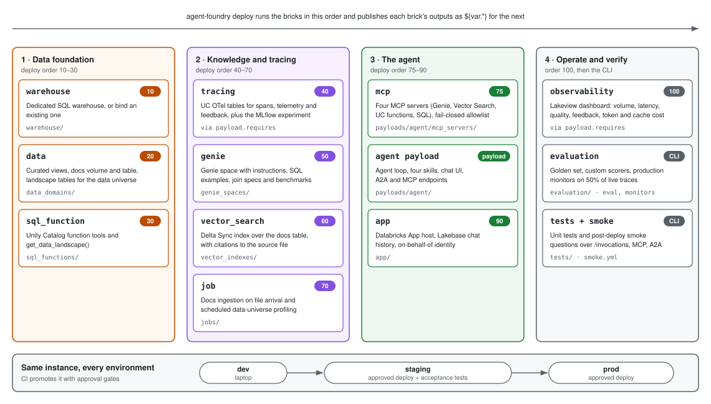
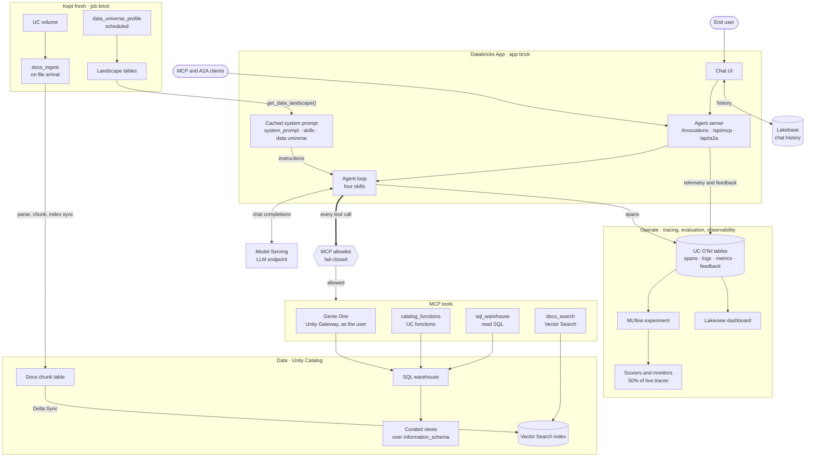

<p align="center">
  
</p>

# Portfolio Assistant — an end-to-end production agent

Most agent examples stop at a chat UI calling an LLM. A production agent
needs much more around it: curated and governed data, document retrieval
with an ingestion pipeline, metadata that stays fresh, tracing, evaluation
before and after release, production monitoring, an operations dashboard,
identity and permissions, and a deploy path across `dev`, `staging`, and
`prod`. Built by hand, that is weeks of glue code, and every team builds it
differently.

This example ships all of it as one instance. Pick `portfolio_assistant` in
`agent-foundry init`, run `agent-foundry deploy`, and every part below is
provisioned in your workspace, wired together, and covered by tests.

## What the agent does

A data assistant over Unity Catalog. Users ask about tables, columns, and
schemas (`system.information_schema`) and about the documentation corpus;
the agent answers with SQL results, charts, and citations back to the
source file. Other agents can call it over A2A or MCP.

## What's in the box

The instance is assembled from bricks and the agent payload.
`agent-foundry deploy` runs the bricks in the order shown below; the table
after the diagram maps each concern to the files you edit.

<p align="center">
  
</p>

| Concern | What the example deploys | Where |
|---------|--------------------------|-------|
| **Agent App** | Chat UI, agent with three skills (`catalog-explorer`, `sql-runner`, `documentation-explorer`), Lakebase chat history, per-message feedback, A2A and MCP endpoints | `app/`, `payloads/agent/` |
| **Agent capabilities** | Every payload capability that needs no extra infrastructure: plan, long-term memory, per-user skills with the resources panel, file and image upload, charts, Markdown reports, reasoning, prompt caching. Speech input stays off because it needs a Whisper GPU endpoint ([capabilities guide](../../payloads/agent/CAPABILITIES.md)) | `payloads/agent/payload.yml` |
| **Governed tools** | Three MCP servers (Vector Search, UC functions, SQL warehouse) behind a fail-closed allowlist, plus Genie One through Unity Gateway as the signed-in user | `payloads/agent/mcp_servers/`, `payloads/agent/payload.yml` |
| **Curated data** | Views over `information_schema` with Unity Catalog comments | `data_domains/catalog_explorer/` |
| **Analytics** | Genie space with instructions, SQL examples, join specs, and benchmark questions | `genie_spaces/info_schema/` |
| **Document retrieval** | UC volume → file-arrival job that parses and chunks PDFs, slides, Word and Markdown files → chunk table → Vector Search index, with citations to the source file and page | `data_domains/docs_corpus/`, `jobs/docs_ingest/`, `vector_indexes/docs_search/` |
| **Metadata management** | Scheduled profiling job rebuilds landscape tables; `get_data_landscape()` feeds the agent's data universe into the cached prompt | `jobs/data_universe_profile/`, `sql_functions/data_universe/`, `data_domains/data_universe/` |
| **Compute** | Dedicated SQL warehouse (or reuse an existing one) | `warehouse/`, `foundry.toml` |
| **Tracing & experiment tracking** | Agent spans, App telemetry, and user feedback written directly to Unity Catalog OTel tables (spans, logs, metrics, annotations); the MLflow experiment and the dashboard read from them | `tracing` brick (via `payload.requires`) |
| **Evaluation** | Golden set, built-in scorers plus custom ones (tool routing, Genie SQL correctness), per-skill eval questions | `evaluation/`, `payloads/agent/skills/*/eval/` |
| **Production monitoring** | Registered scorers sampling 50% of live traces | `evaluation/eval_config.yml` |
| **Operations dashboard** | Lakeview dashboard: volume, latency, errors, tools, quality, feedback, users, token and cache economics | `observability` brick (via `payload.requires`) |
| **Cost control** | Prompt caching and tool-result clearing | `payloads/agent/payload.yml` |
| **Identity & permissions** | On-behalf-of scopes, service principal grants, App resources | `app/config.yml` |
| **Tests** | Instance unit tests; post-deploy smoke questions over `/invocations`, MCP, and A2A | `tests/`, `smoke.yml` |

## Before you deploy

- A Databricks workspace with Unity Catalog and a serverless SQL warehouse,
  the Databricks CLI authenticated, and `uv`
  ([Getting started](../../docs/tutorials/getting-started.md#prerequisites)).
- A catalog where you can create schemas. The example creates
  `portfolio_assistant_views`, `_indexes`, and `_agent` in it.
- The Foundation Model endpoint named in `payloads/agent/payload.yml`
  (`spec.runtime.model.name`) and in `app/config.yml`.
- Workspace support for Databricks Apps, Genie, and Vector Search. Chat
  history gets its own Lakebase project. The shared Vector Search endpoint
  (`vs_endpoint_name` in `foundry.toml`) is created only if it is missing.

## Try it

Generate the repo as described in the
[Quick start](../../README.md#quick-start), choosing `portfolio_assistant` as
the starter. Then, from the generated repo:

```bash
uv run agent-foundry validate --workspace --target dev   # prerequisites
uv run agent-foundry deploy --target dev --dry-run        # plan, no writes
uv run agent-foundry deploy --target dev                  # provision every brick and ship the App
```

The dry run lists everything that will be created; the resulting names are in
[Naming Convention](#naming-convention). Smoke tests, evaluation, and
monitoring follow in [the lifecycle](#the-lifecycle-it-covers), and
[What's Safe to Change](#whats-safe-to-change) lists the settings to adapt first.

## The lifecycle it covers

1. **Build:** `agent-foundry init` generates the repo with this instance.
2. **Deploy:** `agent-foundry deploy --target dev` provisions every brick.
3. **Verify:** `agent-foundry smoke` probes the live App; `agent-foundry eval`
   scores it against the golden set.
4. **Release:** CI promotes to `staging` and `prod` with approval gates and
   acceptance tests.
5. **Operate:** `agent-foundry monitors` registers production scorers; the
   dashboard and human feedback show quality and cost.
6. **Improve:** traces and feedback point to the next golden-set questions
   and skill changes.

## Architecture

The example runs on the built-in **`agent` payload** inside the generic `app` host. The agent loop gets its instructions from a cached system prompt (`system_prompt`, skills, and the data universe) and its tools from MCP servers mounted next to it. Skills tell the agent *when and how* to use tools; they do not proxy them. Every tool call passes the fail-closed **MCP allowlist**, the single auditable place that decides which tools the agent can ever invoke. The cost and behaviour trade-offs of the payload's toggles (prompt caching, skill loading, the data universe) are covered in [`payloads/agent/README.md`](payloads/agent/README.md). Each piece is provided by a composable **brick** (see [What's in the box](#whats-in-the-box)); include only the ones you need.

How the pieces connect: every tool call passes the allowlist (thick arrow),
the MCP servers reach the data through the SQL warehouse and the Vector Search
index, the jobs keep the data fresh, and tracing feeds the operations side.



This example uses four managed MCP servers; external MCP servers and custom MCP Apps attach the same way, behind the same allowlist. A minimal instance might use only the `agent` payload + `app` + one MCP server; the orchestrator (`agent-foundry deploy`) deploys whichever bricks are present.

For how the host itself stays payload-agnostic and how payloads are swapped, see the [framework architecture](../../docs/explanation/architecture.md).

## Naming Convention

All Databricks resource names follow the pattern `[target] solution-name-brick-name`
(display names) or `target-solution-name-brick-name` (API resource names).
Names are auto-computed by `InstanceConfig` from `app_name` + `target_name` --
instance configs only contain instance-specific overrides.

| Resource | Example (dev) |
|----------|---------------|
| Warehouse | `[dev] portfolio-assistant-warehouse` |
| Genie Space | `[dev] portfolio-assistant-genie-info-schema` |
| Dashboard | `[dev] portfolio-assistant-dashboard` |
| Docs ingest job | `dev-portfolio-assistant-docs-ingest` |
| App | `dev-portfolio-assistant-app` |
| Chat UI | `dev-portfolio-assistant-app-ui` |
| Chat history (Lakebase) | `dev-portfolio-assistant-lakebase` -- provisioned by the `app` brick when `spec.ui.chat_history.enabled = true` (payload.yml) |
| MLflow experiment | `/Shared/agent-foundry/dev/portfolio-assistant/experiments/portfolio-assistant-traces` |
| UC schemas | `{catalog}.portfolio_assistant_views`, `_indexes`, `_agent` |

## Configuration Contract

Instance configs hold only instance-specific values. Auto-computed fields
(resource names, tracing paths, workspace paths) are injected by brick
deploy scripts from `InstanceConfig.to_variables()`.

Each config file uses inline safety markers:
- `SAFE TO CHANGE` -- deployer can freely modify
- `CHANGE WITH CARE` -- requires coordinated changes across files listed below

### Cross-File Dependencies

| Concern | Files that must agree |
|---------|----------------------|
| **LLM endpoint** | `payloads/agent/payload.yml` `spec.runtime.model.name`, `app/config.yml` `llm-endpoint` serving endpoint name |
| **Genie** | `payloads/agent/payload.yml` pins `system.ai.genie_one_mcp`. Genie One can't be pointed at a space, so `skills/catalog-explorer` names the curated views from `data_domains/catalog_explorer/` in each question. `genie_spaces/info_schema/` serves the Genie UI and its benchmarks. |
| **Vector index** | `payloads/agent/mcp_servers/docs_search/server.yml` catalog and schema <-> where `vector_indexes/docs_search/` deploys the index; skills name the MCP tool (`docs_search__docs_index`), never the index FQN. |
| **Vector index + columns** | `vector_indexes/.../index_config.yml` `columns_to_sync`, `payloads/agent/mcp_servers/docs_search/server.yml` `tools.default_meta.columns` |
| **Docs ingestion** | `jobs/docs_ingest/job.yml` watches the volume created by `data_domains/docs_corpus`, writes to its `docs_chunks` table, and passes `${var.vs_index_name__docs_search}` to the sync notebook. The columns written by `sql/ingest_chunks.sql` must match `tables/01_docs_chunks.sql`. |
| **Domain name** | `data_domains/catalog_explorer/domain.yml` `domain.name`, `genie_spaces/.../space.yml` `variables.domain`, `data_sources/tables.yml` identifiers |
| **App name / schema prefix** | `foundry.toml` `app_name` + `schema_prefix` -- referenced by other files via `${var.*}` |

### What's Safe to Change

| Setting | File | Notes |
|---------|------|-------|
| LLM model | `payloads/agent/payload.yml` `spec.runtime.model.name` | Also update `app/config.yml` endpoint name |
| System prompt | `payloads/agent/payload.yml` `spec.runtime.system_prompt` | Free to customize |
| Prompt caching, skill loading, data universe | `payloads/agent/payload.yml` `spec.runtime.context` / `tools.skills` | Interacting cost trade-offs -- see [`payloads/agent/README.md`](payloads/agent/README.md) |
| Max tool calls / iterations | `payloads/agent/payload.yml` `spec.runtime` | Tune agent behavior |
| Tracing on/off | (always on) | Tracing is always enabled in deployed Apps; to disable, call `mlflow.tracing.disable()` from a startup hook (see `payloads/agent/runtime/tracing.py`) |
| Input/output redaction | `app/app.yaml` | `MLFLOW_TRACE_REDACT_INPUTS` / `MLFLOW_TRACE_REDACT_OUTPUTS` env vars |
| Warehouse mode | `foundry.toml` `[warehouse] mode` | `"dedicated"` (default; provisions a new warehouse) or `"reuse"` (binds to an existing `warehouse_id`) |
| Warehouse size | `warehouse/config.yml` | Affects cost and performance (dedicated mode only) |
| Warehouse auto-stop | `warehouse/config.yml` | Idle timeout (dedicated mode only) |
| Request timeout | `app/app.yaml` | `CHAT_PROXY_TIMEOUT_SECONDS` |
| Scorer lists | `evaluation/eval_config.yml` | Add/remove evaluation scorers |
| Own scorers | `evaluation/scorers/*.py` | `@scorer` functions referenced by name in `eval_config.yml` ([Instance scorers](../../bricks/evaluation/README.md#instance-scorers)) |
| Eval sample rate | `evaluation/eval_config.yml` | Production monitoring frequency |
| Retrieval tuning | `payloads/agent/mcp_servers/docs_search/server.yml` `tools.default_meta` | Retrieval settings |
| OBO scopes | `app/config.yml` | Add scopes when adding tools |

### Source-document citations

The documentation corpus demonstrates the full citation path:

1. `data_domains/docs_corpus/volumes/00_docs_sources.sql` creates the Unity
   Catalog volume before dependent tables.
2. `tables/01_docs_chunks.sql` creates the chunk table (one row per chunk,
   keyed by `chunk_id`) and seeds it with synthetic articles, so the agent
   can answer before anything is uploaded.
3. `jobs/docs_ingest` runs when files land in the volume:
   - `sql/ingest_chunks.sql` parses new and modified PDF, Word, PowerPoint
     and image files with `ai_parse_document`, reads `.md` / `.txt` as text,
     and lets `ai_prep_search` split both into chunks. Each chunk keeps its
     file's `/Volumes/...` path in `doc_uri` and its page in `page_number`.
     It also removes chunks of modified and deleted files.
   - `notebooks/sync_index.py` then triggers the Delta Sync index.
4. `vector_indexes/docs_search/index_config.yml` embeds `chunk_to_embed`
   (chunk text plus document and page context) and syncs `doc_uri` and
   `page_number`.
5. `payloads/agent/mcp_servers/docs_search/server.yml` includes `doc_uri`
   and `page_number` in AI Search MCP `tools.default_meta.columns`.

Upload documents to `/Volumes/<catalog>/portfolio_assistant_indexes/docs_sources/`.
Deleting a file does not trigger the job; its chunks are removed on the
next run.

**Prerequisites.** `ai_parse_document` is
[available only in some regions](https://docs.databricks.com/aws/en/resources/feature-region-support#ai-functions-aws),
and `ai_prep_search` is in Beta and needs a SQL warehouse that supports it.
Both are billed under the `AI_FUNCTIONS` product. The file-arrival trigger
fails with `s3:GetBucketNotification` errors when the volume's external
location has file events enabled but its IAM role lacks the
[file events permissions](https://docs.databricks.com/aws/en/connect/unity-catalog/cloud-storage/manage-external-locations#file-events);
grant them or disable file events on that location.

**Upgrading an existing deployment.** The chunk table and index have new
names (`docs_chunks`, `docs_chunks_index`), so redeploying creates them next
to the old `docs` table and `docs_index` index. Delete the old two once the
new index is online:

```bash
databricks vector-search-indexes delete-index <catalog>.portfolio_assistant_indexes.docs_index
# then: DROP TABLE <catalog>.portfolio_assistant_indexes.docs;
```

## File Layout

```
instances/portfolio-assistant/
  foundry.toml                    # Instance identity (name, app_name, schema_prefix, [warehouse])
  app/config.yml                  # Generic host: app resources (SP), OBO scopes, grants, payload ref
  payloads/agent/payload.yml      # Payload adapter + spec: the single config contract
                                  #   (spec.runtime LLM/prompt/limits/tools, spec.ui toggles, spec.integrations a2a/mcp_server)
  payloads/agent/skills/          # One <skill-id>/SKILL.md per skill, plus eval questions
  payloads/agent/mcp_servers/     # MCP server registry (per-server tools.allow allowlist)
  evaluation/eval_config.yml      # Scorer config and monitoring
  evaluation/datasets/            # Golden set for evaluation
  evaluation/scorers/             # Optional instance @scorer modules (none shipped)
  warehouse/config.yml            # SQL warehouse sizing (dedicated mode only; name auto-computed)
  data_domains/                   # View definitions for Genie
  genie_spaces/                   # Genie Space IaC (title auto-computed)
  vector_indexes/                 # Vector Search index definitions
  jobs/docs_ingest/               # File-arrival docs parsing + chunking job (SQL) and index sync
  jobs/data_universe_profile/     # Scheduled profiling of curated views (data universe)
  sql_functions/catalog_utils/    # Unity Catalog SQL function tools
  sql_functions/data_universe/    # get_data_landscape() / get_table_metadata()
  smoke.yml                       # Post-deploy smoke questions (agent-foundry smoke)
  assets/                         # README icon and "what's in the box" diagram
  tests/                          # Instance unit tests
```
