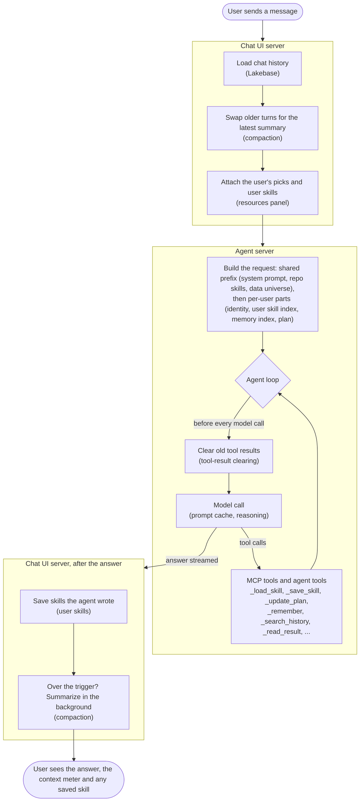
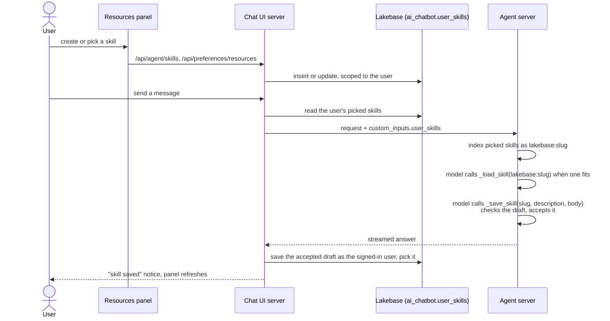
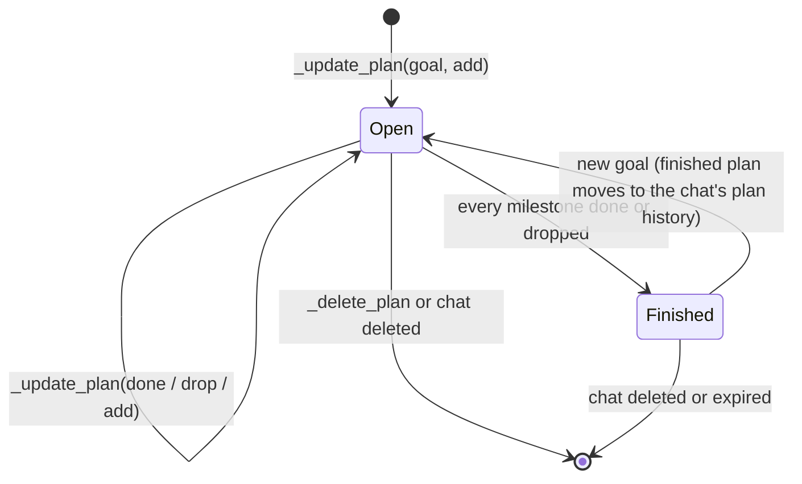
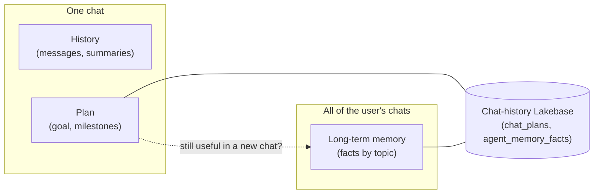
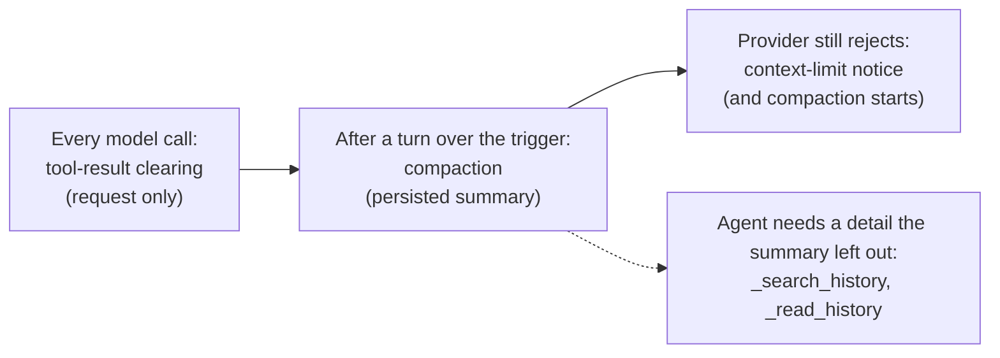
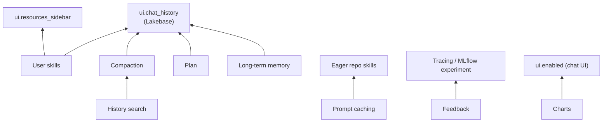

# Agent capabilities guide

What the agent payload's opt-in capabilities do for your users, how they
work, and how to turn them on. Every switch lives in
`instances/<name>/payloads/agent/payload.yml`; the full knob tables are in the
[payload README](README.md#configuration-what-you-set) and the
[config reference](../../docs/reference/config.md). For the design behind a
capability, follow its "Design" link.

New capabilities are opt-in: an instance that sets none of them behaves as
before. New projects get a scaffold that turns several on (see the table).

## At a glance

| Capability | What users get | Switch | Off unless set? | On in new projects | Needs |
|---|---|---|---|---|---|
| [Repo skills](#repo-skills) | The agent follows your team's playbooks | `skills/<id>/SKILL.md`, `runtime.tools.skills.repository.enabled` | On by default | Yes (`loading: eager`) | — |
| [Unity Catalog skills](#unity-catalog-skills) | Playbooks governed in Unity Catalog, next to the repo ones | `runtime.tools.skills.unity_catalog` | Yes | No | Unity Catalog skills |
| [User skills](#user-skills) | Each user keeps their own playbooks; the agent can write them | `runtime.tools.skills.user_skills.enabled` + `store: lakebase` | Yes | Yes | Chat history, resources panel |
| [Plan](#plan) | Long tasks stay on track inside one chat | `runtime.context.plan.enabled` | Yes | No | Chat history |
| [Long-term memory](#long-term-memory) | The agent remembers facts about the user across chats | `runtime.context.memory.enabled` | Yes | No | Memory store |
| [Tool-result clearing](#tool-result-clearing) | Tool-heavy turns don't overflow the context window | `runtime.context.tool_result_clearing` | On by default | Yes | — |
| [Compaction](#compaction-and-the-context-meter) | Chats can go on past the context window | `runtime.context.compaction` | Follows chat history | Yes | Chat history |
| [History search](#history-search) | The agent finds details a summary left out | Comes with compaction | — | Yes | Compaction |
| [Large SQL results](#large-sql-results) | Big query results stay readable | Comes with the managed SQL MCP server | — | With a SQL server | `managed_sql` MCP server |
| [Data universe](#data-universe) | The agent knows what data exists without a tool call | `runtime.context.data_universe.enabled` | Yes | No | A UC table function |
| [Prompt caching](#prompt-caching) | Lower cost and latency on Claude | `runtime.context.prompt_cache.enabled` | On by default | Yes | Claude endpoint, eager skills |
| [Reasoning](#reasoning) | Users can read how the agent thought | `runtime.reasoning.*` | Endpoint default | Endpoint default | Thinking model |
| [File and image input](#file-and-image-input) | Users attach spreadsheets, documents and images | `ui.file_upload.enabled` / `.images` | Yes | Yes | Vision model for images |
| [Charts](#charts) | The agent draws interactive charts in the chat | `ui.charts.enabled` | On by default | Yes | Chat UI |
| [Feedback](#feedback) | Users rate answers with thumbs, a comment and tags | `ui.feedback.enabled` | On by default | Yes | Tracing (`MLFLOW_EXPERIMENT_ID`) |
| [Resources panel](#resources-panel) | Users see and pick what the agent uses | `ui.resources_sidebar.enabled` | Yes | Yes | — |
| [Speech input](#speech-input) | Users dictate a message instead of typing it | `ui.speech_input.enabled` | Yes | No | A Whisper serving endpoint |
| [Unavailable tools notice](#unavailable-tools) | Users are told when a tool is down | Always on | — | Yes | — |
| [Chat history and retention](#chat-history-and-retention) | Chats are kept, listed and expired | `ui.chat_history.*` | On by default | Yes | Lakebase |

## How the pieces fit into one chat turn

The chat UI server (TypeScript) and the agent server (Python) run in the same
Databricks App. Each capability hooks in at one step:



The order of the prompt matters: everything that is the same for every user
(system prompt, repo skills, tool manuals, data universe) comes first and is
shared through the prompt cache. Everything per user or per chat (identity,
plan, memory index, user skill index) comes after it, so one user's state
never invalidates another user's cache.

---

## Skills

A skill is a playbook: a name, a one-line description of when to use it, and
instructions. There are three kinds, and they can be used together: the
developer's repo and Unity Catalog skills, and each user's own.

### Repo skills

Written by your team in the repository and deployed with the App.

- **Author:** `skills/<skill-id>/SKILL.md` with frontmatter `name` and
  `description`, then the body. Optional `eval/questions.yml` feeds
  evaluation. Validate with `agent-foundry brick skills validate`.
- **Switch:** `runtime.tools.skills.repository.enabled` (default `true`). With
  `false`, a non-empty `skills/` folder fails validation.
- **Loading:** `runtime.tools.skills.loading`.
  - `eager` (default): every skill body is in the system prompt.
  - `lazy`: the prompt lists skills by name and description, and the model
    loads a body with `_load_skill` when it needs it. Lazy loading does not
    work with prompt caching, so deploy falls back to eager when both are on.
- **Details:** [deploy/skills](deploy/skills/README.md).

### Unity Catalog skills

Skills your team publishes in Unity Catalog, for example with the
`ai_gateway` brick. They sit next to the repo skills, which come first in
the prompt.

```yaml
spec:
  runtime:
    tools:
      skills:
        unity_catalog:           # on once the block is present
          pinned:
            - fqn: "cat.sch.sql-runner"
              identity: sp       # as the App; obo runs as the user
          discovery: {enabled: true, locations: ["cat.sch"]}  # as the App
          refresh_seconds: 900   # re-check for edits; 0 reads once
```

- **Refresh.** Every `refresh_seconds` the App re-checks the App's skills
  (pinned `sp` plus discovery). Only a changed skill is downloaded again, and
  unchanged skills render the same bytes, so the prompt cache only busts on a
  real edit. With lazy loading only the index is refreshed.
- **Names.** Deploy rejects a repo skill folder named like a pinned skill.

### User skills

Each user keeps their own skills, for example "how I like my weekly report"
or "the checks I run before a release". Users manage them in the resources
panel, and the agent can write one for them when asked.

```yaml
spec:
  runtime:
    tools:
      skills:
        user_skills:
          enabled: true          # turns user skills on
          store: lakebase        # or unity_catalog (+ locations, authoring_schema)
          max_skills: 20         # per user (default 20)
          max_skill_md_chars: 20000
  ui:
    chat_history: {enabled: true}      # required: skills are stored in this Lakebase
    resources_sidebar: {enabled: true} # required: users manage skills here
```

**What users do**

1. Create a skill in the resources panel (**New skill**), or ask the agent:
   "save this as a skill". A skill has a slug (lower-case letters and digits
   with single hyphens, at most 40 characters), a description and a body.
2. **Pick** the skill to make it active. A skill created in the panel waits
   under **Add from your catalog** until it is picked; a skill the agent
   saves is picked for the user straight away (up to 64 picks in total).
   Unpicking puts it back in the catalog.
3. From the next message on, the agent sees the picked skills and uses the
   one that fits.
4. Edit or delete skills in the panel. The agent can create and update a
   skill, but never delete one.

**How it works**



- **Who writes.** The agent server has no database access. `_save_skill` only
  checks and accepts a draft; the chat UI server saves it as the signed-in
  user after the answer has streamed, so no service-to-service trust is
  added. Every query is scoped to the caller's user id; nobody else can read
  or change a user's skills.
- **Prompt cost.** The skill index sits after the cached prefix, and
  `_load_skill` / `_save_skill` are registered even when nothing is picked, so
  the cache is shared across users.
- **Tracing.** Traces record skill names and body hashes, never the text.
- **Limits.** `max_skills` per user and `max_skill_md_chars` per body. Skills
  are kept until the user deletes them; deleting removes the pick too.
- **One user store.** `user_skills.store` picks Lakebase skills or Unity
  Catalog picks (`store: unity_catalog`, which Databricks Apps cannot serve
  yet: the user token lacks the `unity-catalog` scope). Repo, Unity Catalog
  and user skills share one `_load_skill` tool
  ([config reference](../../docs/reference/config.md)).

---

## Plan

For work that takes many tool calls or several turns, the agent sets a goal
and a few outcome milestones, marks them done or dropped as it goes, and has
the plan recited before every model call so long tasks stay on track. Users
see the plan in a collapsible panel above the chat input.

```yaml
spec:
  runtime:
    context:
      plan:
        enabled: true
        max_chars: 8000      # longest stored plan (default 8000)
  ui:
    chat_history: {enabled: true}   # required: the plan belongs to a chat
```

| Agent tool | Does |
|---|---|
| `_update_plan(goal?, add?, done?, drop?)` | Starts or changes the goal, adds milestones (up to 10), marks milestones done with a one-line result or dropped with a reason |
| `_delete_plan()` | Deletes this chat's plan |



- **Recitation.** While a milestone is open, the plan is placed last in the
  request context as `## Current plan` before every model call. After 8 model
  calls without an update, it adds a reminder to mark progress.
- **Survives compaction.** The plan is stored outside the conversation, so the
  goal and milestones stay verbatim when older turns are summarized. The last
  five finished goals are listed one line each.
- **Decision points.** The planning guidance tells the agent to decide routine
  choices itself and to ask at real decision points, with two to four options
  and a recommendation.
- **Storage.** The plan is a row of the chat in the chat-history Lakebase and
  is deleted with the chat, including by retention.
- **Chat only.** `/api/mcp` and A2A callers get no plan tools.
- **Design:** [Agent memory and plans](../../docs/explanation/agent-memory.md#plan).

## Long-term memory

The agent keeps stable facts about the signed-in user that are useful in a
new chat, for example "my workspace is the EU one" or "the cost table is
`finance.costs.daily`".

```yaml
spec:
  runtime:
    context:
      memory:
        enabled: true
        max_entry_chars: 8000   # longest topic
        index_max_entries: 50   # topics listed per request (max 100)
  ui:
    chat_history: {enabled: true}   # required: memory is kept in its Lakebase
```

| Agent tool | Does |
|---|---|
| `_remember(fact, topic)` | Stores one fact under a topic; storing it again is a no-op |
| `_recall(query)` | Searches the user's memory by words, grouped by topic |
| `_forget(fact, topic)` | Removes one fact |
| `_list_memories()` | Lists topics with their fact counts |



- **When it writes.** When the user states a stable fact or asks the agent to
  remember something. It never saves secrets, and it checks memory before
  asking for something the user may have said before.
- **What the model sees.** Each request lists the user's topics and fact counts
  (not the facts), so the agent knows what exists without a tool call;
  `_recall` reads the facts.
- **Identity.** The user is the `x-forwarded-user` the Apps proxy sets, never a
  tool argument, so the agent cannot read or write another user's memory.
  The chat UI server scopes every memory query to that user.
- **Everywhere.** Memory needs no chat, so `/api/mcp` and A2A callers get it too.
- **Lifecycle.** The table is created on first use; memory is kept until the
  user asks the agent to forget it, and chat deletion and retention leave it.
  `destroy --force` deletes the Lakebase project and with it all memory.
- **Design:** [Agent memory and plans](../../docs/explanation/agent-memory.md#long-term-memory).

---

## Long conversations

Three mechanisms keep long, tool-heavy chats inside the model's context
window. Each one only acts when the one before is not enough:



### Tool-result clearing

Before each model call, older tool results are replaced with a short
placeholder in the request sent to the model. The stored chat is untouched,
and the agent can call the tool again if it needs a result back.

```yaml
spec:
  runtime:
    context:
      tool_result_clearing:
        enabled: true                    # on by default
        keep_tool_uses: 3                # recent rounds kept verbatim (default 3)
        clear_at_least_chars: 300000     # only clear when it saves this much (default)
        clear_above_input_tokens: 150000 # emergency valve near the window limit (default)
```

Lower `clear_above_input_tokens` for endpoints whose window is smaller than
200k tokens. Design: [context management](../../docs/explanation/context-management-design.md).

### Compaction and the context meter

Once a chat grows past the trigger, the chat UI server summarizes everything
before the last few user turns in the background. Later requests send the
summary plus the recent turns; the transcript itself is never modified.

```yaml
spec:
  runtime:
    context:
      compaction:
        enabled: true            # default: on exactly when chat history is on
        trigger_input_tokens: null   # default: 120000, or clearing threshold - 20000
        keep_recent_turns: 3
        instructions: null       # extra rules for the summary (max 2000 chars)
        manual_action: false     # show a "Compact conversation" action
```

- **What users see.** A ring next to the send button shows how full the chat is
  relative to the trigger, with a warning colour from 80%. A turn that
  triggers compaction shows "Summarizing earlier messages…"; the ring empties
  once the summary is stored.
- **What a summary keeps.** The goal and open tasks, decisions and constraints,
  selected resources, IDs, numbers, URLs and error strings, approaches ruled
  out, and the next step. `instructions` adds to this list.
- **Rules.** `trigger_input_tokens` must stay below
  `tool_result_clearing.clear_above_input_tokens`. Compaction needs chat
  history (there is nowhere else to keep the summary).
- **Design:** [Conversation compaction](../../docs/explanation/conversation-compaction.md).

### History search

While compaction is on, the agent can get back what a summary left out
instead of asking the user again or re-running a tool.

| Agent tool | Does |
|---|---|
| `_search_history(query)` | Searches the summarized turns of this chat, full tool results included; up to five excerpts, best match first |
| `_read_history(turn?, offset?)` | Without a turn: an outline of the summarized turns. With a turn: one page of it |

Both run as the user against the chat UI server, so the usual chat access
check applies; nobody can read another user's chat through them. Search
matches words, not meaning, so ids, names and numbers work best.

---

## Large SQL results

With a managed SQL MCP server (`mcp_servers/<name>/server.yml`,
`type: managed_sql`), SQL results reach the model bounded: at most 50 rows and
about 8,000 characters, with long cells cut to end in `…[+N chars]`. The
agent is told to search, filter and aggregate in SQL, and to read more with
one tool:

| Agent tool | Does |
|---|---|
| `_read_result(query, offset?, limit?, columns?, row?, column?, char_offset?)` | Re-runs the identical query read-only, as the user, and returns only the requested rows, columns or one full cell |

Nothing is stored: the warehouse answers an identical query from its result
cache. The tool is only offered when the read-only SQL tool is mounted.

## Data universe

A block in the system prompt lists the data the agent can query, one row per
view with its location, size and description, so the agent knows the
landscape before its first tool call.

```yaml
spec:
  runtime:
    context:
      data_universe:
        enabled: true                  # must be set explicitly
        function: get_data_landscape   # UC table function; bare names resolve in the agent schema
        max_rows: 200                  # truncation is announced in the block
        refresh_minutes: 60            # 0 pins the block for the process lifetime
```

The runtime only runs `SELECT * FROM <function>()`, so you change what the
agent sees with `CREATE OR REPLACE FUNCTION`, without redeploying. The block
is part of the cached prefix, so it is nearly free to carry.

## Prompt caching

On Claude endpoints the stable part of each request (tools, system prompt,
repo skills, data universe) is marked for the provider's prompt cache and
billed as cache reads on later requests. On by default.

```yaml
spec:
  runtime:
    context:
      prompt_cache:
        enabled: true      # on by default
        static_ttl: "1h"   # the stable prefix: "5m" or "1h" (default "1h")
        rolling_ttl: "5m"  # the conversation history (default: the endpoint's 5 minutes)
```

Design and how to verify it: [Prompt caching](../../docs/explanation/prompt-caching.md).

## Reasoning

For thinking models, `runtime.reasoning` sets how much the model thinks and
whether users see it. Unset fields leave the endpoint's default.

```yaml
spec:
  runtime:
    reasoning:
      thinking: adaptive   # adaptive | between_tools | enabled | disabled
      effort: medium       # Claude 5.x: scale thinking with effort
      emit: true           # stream the reasoning; the chat UI shows it collapsed
```

- **Claude 5.x** rejects `enabled` and `disabled`: use `adaptive` with `effort`.
  `enabled` needs `budget_tokens`.
- **Per request.** Callers override `emit` with
  `custom_inputs.include_reasoning`.
- **Across turns.** The chat UI stores the model's thinking blocks with the
  chat and sends them back on later turns (`reasoning_replay`), so the model
  keeps its earlier reasoning and the prompt cache stays valid.

## File and image input

```yaml
spec:
  ui:
    file_upload:
      enabled: true   # CSV, XLSX and related documents
      max_mb: 10
      images: true    # PNG, JPEG, WebP for vision models
```

- **Files** are parsed out of process and their content is added to the
  conversation.
- **Images** are added by paste, drag-and-drop or the attach button. The
  browser scales them to at most 1568 px on the longest edge, and the result
  must be under 5 MB. They reach the model as image content, so the model must
  accept images; a text-only model answers with a notice. Images are stored in
  the chat and re-sent on later turns.

## Charts

`ui.charts.enabled` (on by default, and on in new projects) lets the agent
draw an interactive chart in the chat by writing an `echarts-chart` fenced
block. The chat UI renders it; when the switch is off the fence stays a code
block.

```yaml
spec:
  ui:
    charts:
      enabled: true   # on by default
```

- **Types.** `bar`, `line`, `area`, `pie`, `scatter`. At most 500 rows.
- **How to emit.** Put the chart spec in a fenced `echarts-chart` block, or
  call `payloads.agent.runtime.chart_helpers.render_chart` so the fence is
  valid before it reaches the UI.
- **In the UI.** Users can switch chart type, download CSV, and click a
  category to drill in. A bad spec falls back to the code block instead of
  breaking the chat.

## Feedback

`ui.feedback.enabled` (on by default, and on in new projects) puts thumbs,
a comment box and category tags on each assistant message. The chat UI
writes `HUMAN` assessments onto the MLflow trace, so tracing must be bound
(`MLFLOW_EXPERIMENT_ID`; the scaffold `requires: [tracing]`).

```yaml
spec:
  ui:
    feedback:
      enabled: true   # on by default
```

- **Thumbs** → `user_feedback` (boolean)
- **Comment** (up to 1000 characters) → `user_feedback_comment`
- **Tags** (multi-select) → `user_feedback_categories`. Defaults: Wrong
  answer, Missing context, Hallucination, Too verbose, Not helpful, Other.
  Override the list with `FEEDBACK_CATEGORIES` on the App.
- Without a trace id the UI still accepts the action but skips MLflow. The
  observability dashboard charts these assessments.

## Resources panel

`ui.resources_sidebar.enabled` adds a full-height **Resources** panel on the
right of the chat:

- **Your picks:** what the user added; sent with every message. The agent
  re-checks every pick against its policy and limits, so a pick can never
  widen what it may use.
- **Add from your catalog:** what the user's own grants allow, plus their
  [user skills](#user-skills).
- **Agent:** what the agent always uses (MCP servers, skills), read-only, with
  whether each runs as the user or as the App. Collapsed when the user can
  pick.

Picks are saved in Lakebase when chat history is on. Details:
[config reference](../../docs/reference/config.md).

## Speech input

```yaml
spec:
  ui:
    speech_input:
      enabled: true
      endpoint: ${var.serving_endpoint_name__speech}
      max_seconds: 300   # 1..300; recording stops by itself at the limit
      # language: de     # two-letter hint; unset = detect per recording
```

- **Flow.** A microphone button next to the send button records in the
  browser. On stop, the chat UI server posts the clip to `/api/transcribe`,
  which calls the serving endpoint as the app, and the transcript lands at
  the cursor in the composer. Nothing is sent to the agent until the user
  presses send.
- **Endpoint.** `agent-foundry scaffold speech_input` writes
  `model_serving/speech/`: a Whisper large-v3-turbo model that the
  `model_serving` brick builds once and serves on `GPU_SMALL` with
  scale-to-zero. Set `scale_to_zero: false` there for production, since a
  cold start takes about a minute.
- **App resource.** Deploy grants the app `CAN_QUERY` on the endpoint.
- **Privacy.** Recordings are not stored; only the transcript the user sends
  becomes part of the chat. Inference tables stay off on the endpoint.
- **Silence.** A recording without speech is dropped in the browser, not sent.

## Unavailable tools

When a configured MCP server cannot be reached, the request goes on without
it. The model is told not to substitute another tool, the user sees "Some
tools are unavailable right now: …" ahead of the answer, and the trace is
tagged `mcp.unavailable`. Always on. Details:
[Unavailable MCP servers](README.md#unavailable-mcp-servers).

## Chat history and retention

```yaml
spec:
  ui:
    chat_history:
      enabled: true        # on by default; Lakebase-backed
      sidebar_days: 30     # sidebar lists chats from the last N days
      retention_days: 365  # chats inactive this long are deleted
```

Chat history is the foundation for user skills, the plan and compaction.
Deleting or expiring a chat also deletes its summaries and plan.

---

## Agent tools reference

The agent tools the capabilities above add, next to your MCP tools. All of
them start with `_`.

| Tool | Capability | Runs as |
|---|---|---|
| `_load_skill` | Lazy repo skills, user skills | Agent (reads skills already in the request) |
| `_save_skill` | User skills | Draft checked by the agent; saved by the chat UI server as the user |
| `_update_plan`, `_delete_plan` | Plan | App service principal, bound to the user and chat |
| `_remember`, `_recall`, `_forget`, `_list_memories` | Long-term memory | App service principal, bound to the user |
| `_search_history`, `_read_history` | History search (compaction) | The user |
| `_read_result` | Large SQL results | The user (read-only SQL) |

## What depends on what



Validation enforces these at load time: for example,
Lakebase user skills without `ui.resources_sidebar.enabled` fail with
`user_skills.store: lakebase requires spec.ui.resources_sidebar.enabled`.
Feedback without a bound experiment still shows the buttons but does not
write assessments. Charts need the chat UI; they have no other load-time
check.
