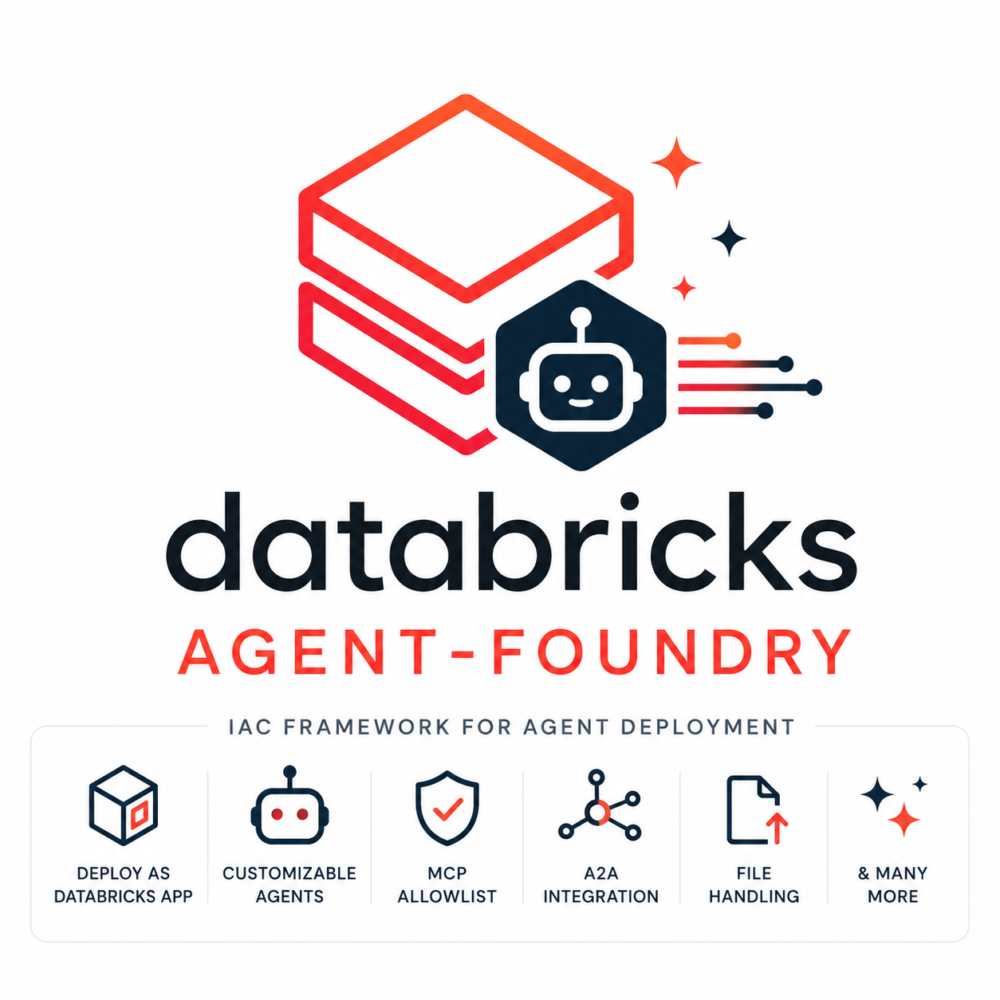
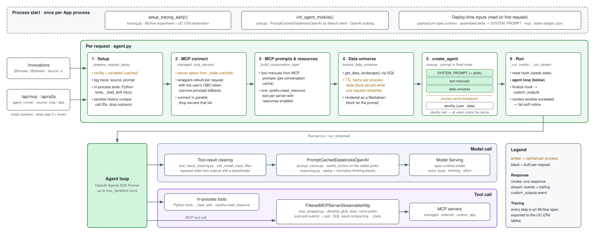

  

# payloads/agent/

> The conversational **agent payload**: agent runtime, skills, MCP
> tools, chat UI, and the tracing / evaluation / observability loop that
> ship with it. Framework-level bricks and forks:
> [repository README](../../README.md). Adding a new payload type:
> [Author a payload](../../docs/how-to/author-a-payload.md).

Select it with `adapter: agent` in
`instances/<name>/payloads/agent/payload.yml`. Scaffold default
`requires: [warehouse, tracing, observability]` so a full deploy provisions the MLflow
experiment and Lakeview dashboard unless you drop those names, and fails up
front when the instance has no SQL warehouse.

Authoring surfaces: `payload.yml` (`spec.runtime` / `spec.ui` /
`spec.integrations`), `skills/`, `mcp_servers/`.

---

## Capabilities (what the agent can do)

New to the opt-in capabilities? The [capabilities guide](CAPABILITIES.md)
explains what each one does for users, how it works (with diagrams), and how
to turn it on:

| Capability | Switch in `payload.yml` |
|---|---|
| [Repo skills](CAPABILITIES.md#repo-skills) | `skills/<id>/SKILL.md`, `runtime.tools.skills.repository.enabled` |
| [Unity Catalog skills](CAPABILITIES.md#unity-catalog-skills) | `runtime.tools.skills.unity_catalog` |
| [User skills](CAPABILITIES.md#user-skills) | `runtime.tools.skills.user_skills.enabled` + `store: lakebase` |
| [Plan](CAPABILITIES.md#plan) | `runtime.context.plan.enabled` |
| [Long-term memory](CAPABILITIES.md#long-term-memory) | `runtime.context.memory.enabled` |
| [Tool-result clearing](CAPABILITIES.md#tool-result-clearing) | `runtime.context.tool_result_clearing` |
| [Compaction](CAPABILITIES.md#compaction-and-the-context-meter) | `runtime.context.compaction` |
| [History search](CAPABILITIES.md#history-search) | Comes with compaction |
| [Large SQL results](CAPABILITIES.md#large-sql-results) | A `managed_sql` MCP server |
| [Data universe](CAPABILITIES.md#data-universe) | `runtime.context.data_universe.enabled` |
| [Prompt caching](CAPABILITIES.md#prompt-caching) | `runtime.context.prompt_cache.enabled` |
| [Reasoning](CAPABILITIES.md#reasoning) | `runtime.reasoning.*` |
| [File and image input](CAPABILITIES.md#file-and-image-input) | `ui.file_upload.enabled` / `.images` |
| [Charts](CAPABILITIES.md#charts) | `ui.charts.enabled` |
| [Feedback](CAPABILITIES.md#feedback) | `ui.feedback.enabled` |
| [Resources panel](CAPABILITIES.md#resources-panel) | `ui.resources_sidebar.enabled` |
| [Speech input](CAPABILITIES.md#speech-input) | `ui.speech_input.enabled` + `endpoint` |
| [Unavailable tools](CAPABILITIES.md#unavailable-tools) | Always on |
| [Chat history and retention](CAPABILITIES.md#chat-history-and-retention) | `ui.chat_history.*` |

**Conversation**

- Answer in a streaming chat UI (or headless over HTTP if you turn the UI off).
- Keep multi-turn history in Lakebase when chat history is on.
- Keep a **plan** for multi-step work in a chat (`context.plan`, off by
  default; needs chat history). With `_update_plan` the agent sets a goal
  and a few outcome milestones, then marks them done (with a one-line
  result) or dropped as it goes; while a milestone is open the plan is
  recited to the model before every model call, which keeps long tasks on
  track. A new plan moves the finished one to the chat's plan history,
  recited as one line per goal; `_delete_plan` removes the current plan.
  The plan is deleted with its chat.
- **Remember** facts about the signed-in user across all of their chats
  with long-term memory (`context.memory`, off by default). The agent uses
  `_remember`, `_recall`, `_forget` and `_list_memories`, and sees a topic
  index after the per-user identity, so the cached prompt prefix stays the
  same for every user. The user comes from the Apps proxy, never from a
  tool argument. Memory and the plan are kept in the chat-history
  Lakebase, so both need `ui.chat_history`.
- Inject the **current user** and **current time** into the turn so tools
  can interpret “my” and “yesterday”.
- Forward **on-behalf-of (OBO)** identity from Databricks Apps OAuth into
  tool and MCP calls, so they run as the caller, never as the App SP. A
  deployed app whose request carries no user token fails the call instead
  of falling back to the SP; add the needed `user_api_scopes`
  (`user_authorization` in the deploy spec). Local development without an
  App uses your CLI profile.

**Tools and knowledge**

- Call **MCP tools** through a **fail-closed allowlist** (`tools.allow`):
  only named tools run. Servers can be Databricks-managed (UC functions,
  Genie, Vector Search, SQL warehouse) or **external** / **custom App**.
- Consume MCP **prompts** (injected as tool manuals) and **resources**
  (synthetic `<server>__read_resource` tool).
- Load **skills** (`skills/<skill-id>/SKILL.md`: name, description,
  instructions) into the system prompt. **Eager** loading concatenates skill
  bodies; **lazy** loading lists them in a skill index the model loads from
  with `_load_skill` (incompatible with prompt caching — deploy falls back
  to eager if both are on).
- Let each user keep **their own skills** in the chat-history Lakebase
  (`tools.skills.user_skills`; on in new projects, with the resources
  panel it needs). Users create, edit and delete them in the
  resources panel. A skill created there waits in the user's catalog;
  picking it makes it active and unpicking puts it back. The agent sees the
  picked skills in a skill index as `lakebase:<slug>` and loads one with
  `_load_skill`. With `_save_skill` it creates or updates a skill for the
  user, which is then picked for them; it cannot delete one. The index sits after the per-user identity,
  so the cached prompt prefix stays the same for every user.
- Default `mcp_only: true` attaches tools via MCP servers only. The
  deprecated skill `tools.yml` (in-process Genie / Vector Search / UC
  function wrappers) is still read for one release.
- Optionally inject a **data universe** block (UC table function listing
  queryable views) into the cached system prompt so the model sees the
  landscape without an extra tool call. The function runs as the App SP
  and its block is shared by every user, so it must only list views that
  every app user may see.
- Connect six MCP server types: `managed_functions`, `managed_genie`,
  `managed_vector_search`, `managed_sql`, `external` (UC connection), and
  `custom_app` (another Databricks App).
- **Auto-poll** long-running Genie and SQL warehouse calls: the model sees
  one tool call and one response instead of a submit/poll loop.

**Model and reasoning**

- Configure **thinking models**: mode (`adaptive`, `between_tools`,
  `enabled`, `disabled`), token budget, and effort level.
- **Stream the reasoning** on `/invocations`; the chat UI shows it as a
  collapsible section. Callers override per request with
  `custom_inputs.include_reasoning`.
- Pass raw request settings the typed blocks lack (e.g. `max_tokens`,
  `temperature`) via `model_settings.extra_body`; keys owned elsewhere are
  rejected at load time.

**Presentation**

- Render **markdown** (tables, code, lists).
- Emit **charts** (`echarts-chart` fences) when `spec.ui.charts` is on.
- Show **tool-call panels** (collapsed or expanded by default).
- Accept **file uploads** (CSV/XLSX and related parsers, size cap) when
  enabled; parsed content is injected into the conversation.
- Accept **images** (PNG/JPEG/WebP, by paste, drag-and-drop or the attach
  button) when `spec.ui.file_upload.images` is on as well. The browser
  scales them to at most 1568 px on the longest edge; the result must be
  under 5 MB. They skip the extractor and reach the model as image content,
  so the model must accept images; a text-only model answers with a notice
  to start a new conversation without the image. Images are stored in the
  chat message and re-sent on later turns.
- Collect **extended human feedback** on each assistant message (when
  `spec.ui.feedback` is on **and** an MLflow experiment is bound). The
  chat UI writes `HUMAN` assessments onto the trace:
  - **Thumbs up/down** → `user_feedback` (boolean)
  - **Free-text comment** (up to 1000 characters) → `user_feedback_comment`
  - **Category tags** (multi-select) → `user_feedback_categories` (comma-joined
    ids). Default tags: Wrong answer, Missing context, Hallucination,
    Too verbose, Not helpful, Other.
  The observability dashboard charts these (including comments). Without a
  trace id the UI still accepts the action but skips MLflow.

**Context and cost control**

- **Prompt caching** on Claude endpoints (stable prefix billed as cache
  reads). Configurable static / rolling TTLs.
- **Tool-result clearing**: older tool outputs are replaced with a
  placeholder before the next model call so long threads stay inside the
  context window (does not rewrite stored chat history).

**Programmatic access**

- Same AgentServer as the UI: `/invocations` (and related HTTP).
- Optional **MCP server** mount (`/api/mcp`) so other agents consume *this*
  agent as a tool.
- Optional **A2A** card and JSON-RPC (`/api/a2a`, well-known agent card)
  for inter-agent clients.

**Extensibility**

- **Lifecycle hooks** from the instance dir: `reset` runs at request start;
  `finalize` returns a dict merged into `custom_outputs` after the run.
- **Python tools** (`type: python` with a `callable_path`) and the hooks
  above load through `import_python_callable` (`runtime/tools.py`). It only
  imports code that lives in the instance dir: installed packages, an
  instance package shadowed by an installed one, and re-exports from
  outside the instance dir are refused, so config cannot run library code.

**Operations (with `payload.requires`)**

- **MLflow tracing** to Unity Catalog (always on in App deploys; redaction
  via `MLFLOW_TRACE_REDACT_*` env on the App). Powers eval and the
  dashboard — not a `payload.yml` on/off switch.
- **Evaluation** scorers and production monitors (`agent-foundry eval` /
  `monitors`) against those traces.
- **Lakeview observability** dashboard when the observability brick is
  required and present.

---

## How it works inside

  

At process start, `setup_tracing_early()` wires the MLflow experiment and
the UC OTel destination, and `init_agent_module()` installs
`PromptCachedDatabricksOpenAI` as the default model client. Every request
then runs the same six steps, each as its own MLflow span. Chat UI
requests enter through `/invocations` (`agent.py`). `/api/mcp` and
`/api/a2a` enter through `agent_runner.py`, which takes a single question
instead of a history and skips step 3 and the lifecycle hooks.

1. **Setup** (`_prepare_request_setup`). Loads `spec.runtime`, the
   assembled skills and workspace state once per process, tags the trace
   (`source`, linked prompt), builds the in-process tools, and cleans the
   history (unique call IDs, orphaned tool results dropped).
2. **MCP connect** (`managed_mcp_servers` in `runtime/mcp_connect.py`). Server specs come from the
   `mcp` capability state and are cached per process. The wrappers are
   rebuilt on every request so tool calls carry the caller's OBO token;
   a deployed app without one fails the request. Servers connect in parallel;
   one that fails is dropped instead of failing the request, and is
   reported as unavailable (see below).
3. **MCP prompts & resources** (`_build_consumption_layer`). Fetches tool
   manuals from MCP prompts and adds a `<prefix>read_resource` tool per
   server with resources enabled.
4. **Data universe** (`ensure_data_universe`). Calls the configured
   function (for example `get_data_landscape()`) and caches the rendered
   block with a TTL; while one request refreshes, others keep serving the
   previous block.
5. **`create_agent`** (`core.py`). Builds the system prompt in a fixed
   order: prompt with skills, tool manuals, data universe, then the
   per-user identity. Identity goes last so everything before it is one
   prompt-cache prefix shared by all users.
6. **Run** (`_run_invoke` / `_run_stream`). Runs the `reset` hook, the
   agent loop, then the `finalize` hook. If the context window is
   exceeded, the user gets a notice instead of an error.

Inside the agent loop:

- **Model call.** Before each call, older tool results are replaced with
  a placeholder once enough can be saved or the request is nearly full
  (`tool_result_clearing.py`); the stored transcript is untouched. The
  estimated size of what is sent is reported in
  `custom_outputs.context_window`, which the chat UI uses to decide when
  to compact the conversation (`context_occupancy.py`). The
  client marks the
  stable prefix with `cache_control` (`prompt_cache.py`) and replays and
  normalizes thinking blocks (`reasoning.py`), across turns too when the
  caller exchanges `reasoning_replay` entries in `custom_inputs` and
  `custom_outputs` (the chat UI does, with Lakebase).
- **Tool call.** In-process tools run directly. MCP calls go through
  `FilteredMCPServerStreamableHttp` (`mcp_wrapper.py`): allowlist, glob
  and alias matching, name prefixes, auto-poll for submit/poll tools, SQL
  result compacting, and per-call `_meta`.

### Chat UI transport

The browser streams each reply over a WebSocket at `/api/chat/socket`,
one socket per message. The AgentServer relays the socket to the chat UI
server (`runtime/chat_socket_proxy.py`), which checks the origin and the
user, runs the turn, and sends its stream as numbered frames
(`ui/overrides/server/src/lib/chat-socket.ts`). Proxies that inspect TLS
tend to buffer a whole SSE response before passing it on, but they relay
WebSocket frames as they come.

If the socket does not open within a few seconds, the browser falls back
to the SSE routes (`POST /api/chat`, `GET /api/chat/:id/stream`) for the
rest of the page session. A socket that drops mid-reply is picked up by
resuming over SSE; the turn keeps running on the server either way.
The stop button is what ends a turn: it sends
`DELETE /api/chat/:id/stream`, which cancels the agent run and keeps
the partial reply.

The hop from the chat UI server to `/invocations` stays SSE. It never
leaves the container, so no proxy can buffer it, and `/invocations` is
the MLflow Responses contract that API callers use too.

### Unavailable MCP servers

A configured MCP server that cannot serve a request is left out, and the
request goes on without it. `runtime/mcp_availability.py` records it with
a fixed reason code (never the error text):

| Reason | When |
|---|---|
| `invalid_state` | The brick state file is unreadable or invalid (unresolved variables, empty or invalid `tools.allow`, invalid prompts/resources). A brick with no state for the target is not reported. |
| `connect_failed` | The connect (TLS, OAuth, MCP `initialize`) failed. |
| `no_user_token` | Gateway service with `identity: obo`, but the request has no user token. |
| `tool_name_collision` | Gateway service whose tool name an earlier service already took. |

Gateway services are reported only when pinned or selected in the
sidebar; discovered services and `max_tools` limit drops stay on the
trace (`gateway.mcp.dropped`, `gateway.mcp.tool_rule_drops`).

Each request with an unavailable server:

- **Model:** gets an `## Unavailable tools` section naming the servers,
  with the instruction to say so rather than substitute another tool. It
  sits in the uncached prompt tail, so a server going down or coming
  back does not invalidate the prompt cache.
- **User:** sees "Some tools are unavailable right now: <names>.
  Answers that need them may be incomplete." ahead of the answer, in the
  chat UI and on `/api/mcp` and `/api/a2a`.
- **Trace:** is tagged `mcp.unavailable` with `name|reason` pairs, for
  example `jira|connect_failed`.

A server whose tool list was cached starts the run while it connects in
the background. If that connect fails, the model has already seen its
tools and gets "server not initialized" from them for that turn; the
cached list is dropped, so the next turn connects first and reports the
server.

Module reference: [runtime/README.md](runtime/README.md).

---

## Configuration (what you set)

### `payload.yml` — `payload.requires`

| Value | Effect |
|-------|--------|
| `warehouse` | Deploy needs a SQL warehouse: dedicated (`agent-foundry scaffold warehouse`) or `[warehouse] mode = "reuse"` in `foundry.toml` |
| `tracing` | Deploy must provision the MLflow experiment / UC tables |
| `observability` | Deploy must provision the Lakeview dashboard |
| `[]` | Those bricks do not apply (same pattern as `rest_mcp`) |

### `payload.yml` — `spec.runtime`

| Knob | What it configures |
|------|--------------------|
| `model` | `{kind, name}`: a Model Serving endpoint (`serving_endpoint`, e.g. Claude, Llama) or a Unity Gateway `model_service` |
| `system_prompt` | Top-level agent instructions (assembled with skills) |
| `max_tool_calls_per_turn` / `max_iterations` | Hard caps on tool use and agent loop |
| `inject_time_user` | Whether user + timestamp are injected each turn |
| `tools.mcp_only` | MCP-only tools (default) vs legacy direct skill tools |
| `tools.skills.loading` | `eager` or `lazy` |
| `tools.skills.routing_header` | Prose above the lazy skill index |
| `tools.skills.user_skills` | `store: lakebase` turns on per-user skills; `max_skills` (default 20) and `max_skill_md_chars` (default 20000) cap them. Needs `ui.chat_history` and `ui.resources_sidebar` |
| `tools.definitions` | Rare inline tools (prefer `skills/` + `mcp_servers/`) |
| `context.prompt_cache.enabled` / `static_ttl` / `rolling_ttl` | Claude prompt cache |
| `context.data_universe.*` | Enable UC function, heading, max rows, timeout, refresh |
| `context.tool_result_clearing.*` | Enable, keep N recent results, char/token triggers |
| `context.compaction.*` | Summarize older turns of long chats; trigger, turns kept, summary rules |
| `context.memory.*` | Long-term memory about the user across chats: `enabled`, `max_entry_chars`, `index_max_entries`. Needs `ui.chat_history` |
| `context.plan.*` | Per-chat plan: `enabled`, `max_chars`. Needs `ui.chat_history` |
| `reasoning.thinking` / `budget_tokens` / `effort` | Thinking mode and effort (unset: endpoint default). Claude 5.x: `adaptive` + `effort`; `enabled`/`disabled` fail at load |
| `reasoning.display` | `summarized` (readable reasoning; the default while `emit` is on) or `omitted` |
| `reasoning.emit` | Stream the model's reasoning on `/invocations` (chat UI shows it); callers override with `custom_inputs.include_reasoning` |
| `model_settings.extra_body` | Raw chat-completions body fields the typed blocks lack (e.g. `max_tokens`) |
| `reset` / `finalize` | Dotted paths to instance-dir hooks: per-request reset, and a dict merged into `custom_outputs` |

Omit a field to inherit runtime defaults. Unknown keys fail validation
(`extra="forbid"`).

### `payload.yml` — `spec.ui`

| Knob | What it configures |
|------|--------------------|
| `enabled` | Chat UI vs headless API-only App |
| `kind` | Presentation kind (scaffold: `chat`) |
| `chat_history.enabled` / `project_name` | Lakebase-backed history; optional project name |
| `chat_history.sidebar_days` / `retention_days` | Sidebar lists chats created in the last N days (default 30); Lakebase deletes chats inactive for N days (default 365). `null` turns either off; see [config reference](../../docs/reference/config.md) |
| `file_upload.enabled` / `max_mb` | Upload + extractor |
| `file_upload.images` | Image input for vision models (needs `file_upload.enabled`) |
| `speech_input.enabled` / `endpoint` / `max_seconds` / `language` | Microphone button that transcribes into the composer through a serving endpoint (see [Speech input](CAPABILITIES.md#speech-input)) |
| `feedback.enabled` | Per-message thumbs, comment, and category tags (needs `MLFLOW_EXPERIMENT_ID`) |
| `charts.enabled` | Chart fence rendering |
| `tool_output.expanded` | Tool panels start open or closed |
| `chat_layout.width` | Max width of the chat column: `4xl` (default, 896px), `5xl`, `6xl` or `7xl` (1280px) |
| `resources_sidebar.enabled` | Resources panel listing MCPs, skills and user picks |

### `payload.yml` — `spec.integrations`

| Knob | What it configures |
|------|--------------------|
| `a2a.enabled` | Serve A2A routes + agent card |
| `a2a.card` / `enable_v0_3_compat` | Card content and protocol compat |
| `mcp_server.enabled` | Expose this agent at `/api/mcp` |

The agent **calling** other MCP servers is not a toggle: add
`mcp_servers/<name>/server.yml`.

### `skills/`

Presence-based. One directory per skill: `<skill-id>/SKILL.md`
(frontmatter `name` and `description`, then the body), optional
`eval/questions.yml`. The old `skill.yml` / `domain.yml` format is still
read for one release, with a deprecation warning. Validate/assemble:
`agent-foundry brick skills {validate,assemble}`.
Details: [deploy/skills](deploy/skills/README.md).

### `mcp_servers/`

Presence-based. Per server: `server.yml` with one `type`, `tools.allow`
(and optional alias / prefix / `default_meta` for Vector Search).
Inspect live tools: `agent-foundry brick mcp inspect`.
Details: [deploy/mcp](deploy/mcp/README.md).

### `app/config.yml` — App infrastructure

What the App host provisions around the payload. An instance's
`app/config.yml` overrides the scaffold key by key. Details:
[bricks/app](../../bricks/app/README.md).

| Key | What it configures |
|-----|--------------------|
| `payloads` | Which payload the App host mounts (`agent`) |
| `compute_size` | `medium` (default) or `large` |
| `app_resources` | Resources granted to the App service principal: LLM endpoint, SQL warehouse, trace tables, MLflow experiment, Lakebase (dropped automatically when chat history is off) |
| `sp_grants` | Unity Catalog grants applied after the App is created (catalog, agent schema) |
| `user_authorization` | On-behalf-of scopes; add `mcp.*` scopes (`mcp.genie`, `mcp.vectorsearch`, `mcp.functions`, `mcp.external`) when you add MCP servers |
| `telemetry_destination` | [App telemetry](https://docs.databricks.com/aws/en/dev-tools/databricks-apps/observability) export as `catalog.schema[.prefix]`; defaults to the MLflow trace tables (`<prefix>_otel_logs/metrics/spans`). `null` leaves the App's telemetry setting untouched |

### App dependencies

The App installs the framework wheel with the `runtime` extra, plus
`extraction` when `spec.ui.file_upload.enabled` is on (out-of-process
file parsers). Both are pinned by lock-derived constraints; see
[Dependencies](../../README.md#dependencies).

### App env (not in `payload.yml`)

| Concern | Where |
|---------|--------|
| Trace input/output redaction | `MLFLOW_TRACE_REDACT_INPUTS` / `_OUTPUTS` on the App |
| Tracing destination | Set at deploy from instance/target (`TRACING_UC_DESTINATION`, warehouse id) |
| Feedback category list | `FEEDBACK_CATEGORIES` JSON array of `{id, label}` on the App (defaults listed under Capabilities if unset or invalid JSON) |

Most other App env vars are derived from `payload.yml` at deploy time.
Full list: [Environment variables](../../docs/reference/env-vars.md).

---

## Component docs

| Topic | Doc |
|-------|-----|
| Opt-in capabilities guide | [CAPABILITIES.md](CAPABILITIES.md) |
| Agent runtime | [runtime/](runtime/README.md) |
| MCP registry and allowlist | [deploy/mcp/](deploy/mcp/README.md) |
| Skills | [deploy/skills/](deploy/skills/README.md) |
| App host | [bricks/app/](../../bricks/app/README.md) |
| MCP & A2A how-to | [docs/how-to/integrate-mcp-a2a.md](../../docs/how-to/integrate-mcp-a2a.md) |
| Prompt caching design | [docs/explanation/prompt-caching.md](../../docs/explanation/prompt-caching.md) |
| Conversation compaction | [docs/explanation/conversation-compaction.md](../../docs/explanation/conversation-compaction.md) |
| Agent memory | [docs/explanation/agent-memory.md](../../docs/explanation/agent-memory.md) |

## Reference instance

[`examples/portfolio_assistant/`](../../examples/portfolio_assistant/) —
Genie, Vector Search, UC functions, warehouse, data, jobs, tracing,
evaluation, observability.

## Related payloads

| Payload | When to use |
|---------|-------------|
| This (`agent`) | Conversational agent with tools and a chat UI |
| [`rest_mcp`](../rest_mcp/README.md) | REST APIs as MCP — no agent runtime |
