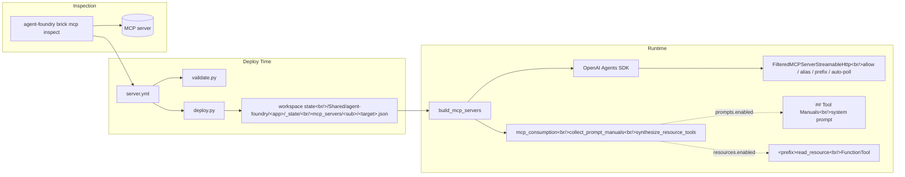

# payloads/agent/deploy/mcp/

> **Technical reference** for deployers and developers.

Declarative MCP server registry. Each MCP server is described by a single `server.yml` under `instances/<app>/payloads/agent/mcp_servers/<name>/`. The capability validates the YAML, builds the canonical URL, writes a per-target state file, and consumes server-supplied `prompts/` (the "tool manual" pattern, injected into the agent system prompt) and `resources/` (exposed as a synthetic `<server>__read_resource` tool).

> **Scope:** this capability is the only MCP attachment path. It covers the deploy-time scaffold, the runtime hook, and prompts/resources consumption with a bounded LRU for `per_conversation` caching. There is no approval-gating layer: `execute_sql_read_only` already hard-guards destructive SQL upstream. Skill `tools.yml` references MCP-served tools with the reduced `{name, description}` shape.

> **An agent-payload capability.** MCP server registration is a **capability of the agent payload**: during `agent-foundry deploy` it runs inside the `app` deploy via the payload's provision manifest (`payloads/agent/deploy/mcp/step.py` → `payloads/agent/deploy/assembly.py`), which publishes the `mcp__<server>` URLs into the app config before `app.yaml` renders. The deploy-time adapter (`MCPBrick`) and state schema live here under `payloads/agent/deploy/mcp/`. The `server.yml` authoring surface lives under the agent payload at `instances/<app>/payloads/agent/mcp_servers/`; the `agent-foundry brick mcp {deploy,validate,inspect,resolve}` CLI verbs are unchanged.



## Structure

```
payloads/agent/deploy/mcp/
|-- _scaffold/
|   `-- server.yml                # Copy to instances/<app>/payloads/agent/mcp_servers/<name>/
|-- step.py                       # McpStep provision step (manifest entry)
|-- deploy.py                     # URL build + state write (orchestrator entrypoint)
|-- validate.py                   # YAML structural + Pydantic checks
|-- resolve.py                    # `brick mcp resolve`: what a gateway-mode agent mounts
|-- inspect.py                    # `brick mcp inspect`: live list_* against a configured server
|-- brick.py                      # Deploy-time adapter + McpServerState schema
`-- README.md                     # You are here

Tests live under payloads/agent/tests/unit/deploy/mcp/.
```

## Quick start

1. Copy the template to your instance:
   ```bash
   cp -r payloads/agent/deploy/mcp/_scaffold instances/<your-app>/payloads/agent/mcp_servers/<server-name>
   ```
2. Edit `server.yml`. Pick exactly one `type:` and fill its required fields. Add the tools you want surfaced under `tools.allow:`.
3. Validate offline:
   ```bash
   uv run agent-foundry brick mcp deploy --instance <your-app> --target dev --dry-run
   ```
4. Inspect the live server to see what tools / prompts / resources it actually advertises:
   ```bash
   uv run agent-foundry brick mcp inspect <server-name> --instance <your-app> --target dev
   ```
   Already-allowlisted tools appear with `[x]`; the rest with `[ ]` are candidates to add.
5. Deploy through the orchestrator (`agent-foundry deploy --instance <your-app>`) or alone (`agent-foundry brick mcp deploy --instance <your-app> --target dev`).

## CLI reference

| Command | Purpose |
|---------|---------|
| `agent-foundry brick mcp deploy --instance <app> [--server <name>] [--target dev] [--dry-run]` | Validate + write state for every server (or one named via `--server`). |
| `agent-foundry brick mcp validate <path/to/server.yml> [--vars k=v ...]` | One-shot offline validation. |
| `agent-foundry brick mcp inspect <name> --instance <app> [--target dev] [--profile <p>]` | Live `list_tools` / `list_prompts` / `list_resources` against the resolved URL. Requires the `[call]` extra. |

## Server types and canonical URLs

| `type` | URL pattern | Required fields |
|--------|-------------|-----------------|
| `managed_functions` | `{host}/api/2.0/mcp/functions/{catalog}/{schema}` | `catalog`, `schema` |
| `managed_genie` | `{host}/api/2.0/mcp/genie/{space_id}` | `space_id` |
| `managed_vector_search` | `{host}/api/2.0/mcp/vector-search/{catalog}/{schema}` | `catalog`, `schema` |
| `managed_sql` | `{host}/api/2.0/mcp/sql` | (none) |
| `external` | `{host}/api/2.0/mcp/external/{connection_name}` | `connection_name` |
| `custom_app` | `{app_url}` (full URL) | `app_url` |

`{host}` resolves from `var.host` (set by the orchestrator from `target.host`).

## AI Search MCP options

For `managed_vector_search`, `tools.default_meta` presets Databricks AI
Search behavior without asking the LLM to generate those values. The runtime
forwards the mapping as the MCP call's top-level `_meta` field.

- `columns` (`str`): comma-separated result columns. Omit to return all
  non-internal columns. Include `doc_uri` here to return citation links.
- `columns_to_rerank` (`str`): comma-separated reranker input columns.
  Omit to disable reranking.
- `filters` (`str`): JSON-encoded Vector Search filters.
- `include_score` (`bool`): include similarity scores; defaults to `false`.
- `num_results` (`int`): positive result count.
- `query_type` (`str`): `ANN` (default) or `HYBRID`.
- `score_threshold` (`float`): exclude results below this similarity score.

```yaml
tools:
  allow:
    - match: "*__*__docs_index"
      expose_as: docs_index
  default_meta:
    columns: "id,content,doc_uri"
    columns_to_rerank: "content,title"
    filters: '{"category": "documentation"}'
    include_score: true
    num_results: 10
    query_type: "HYBRID"
    score_threshold: 0.5
```

Only configure columns and filters that exist on the selected index.
`doc_uri` is a normal synced index column, not a dedicated MCP setting.

## State file shape

State is persisted to the workspace (the single source of truth). Local `_state/` directories are not read and are safe to delete.

`/Shared/agent-foundry/<app>/_state/mcp_servers/<name>/<target>.json`:

```json
{
  "url": "https://...",
  "type": "external",
  "name_prefix": "github__",
  "tools":     {"allow": [...], "name_prefix": null, "default_meta": {}},
  "prompts":   {"enabled": false, "allow": [], "inject_into": "dynamic_instructions", "cache": "per_conversation"},
  "resources": {"enabled": false, "allow": [], "expose_as": "read_tool"}
}
```

The runtime hook reads `url`, `name_prefix`, `tools.{allow,default_meta}`, `prompts`, and `resources` to construct `FilteredMCPServerStreamableHttp` instances. `prompts` and `resources` are snapshotted on the wrapper and consumed by `payloads/agent/runtime/mcp_consumption.py` at request time.

## Validation rules (enforced by `validate.py` + Pydantic)

- `tools.allow` must be non-empty (fail-closed).
- Each `tools.allow[]` entry is either a bare string (exact match against the upstream tool name) or a mapping `{match: <str|glob>, expose_as: <alias>}`. Globs use `fnmatch` syntax (`*`, `?`, `[abc]`); `expose_as` must be a literal alias (no glob metacharacters).
- All entries must collapse to unique LLM-visible names (a bare string aliases to itself; the validator rejects duplicate aliases across entries).
- Per-type required fields must be present.
- `${var.*}` placeholders must all resolve.
- `tools.name_prefix` (when set) must match `^[a-z][a-z0-9_]*__$`. Set to `""` to opt out of prefixing entirely.
- `prompts.cache: per_process` is rejected (forward-compat literal only).
- `auto_poll.trigger` and `auto_poll.poll_with` must differ; `forward_args` must be non-empty. Soft warning when either alias is missing from `tools.allow`.
- Soft warning when `prompts.enabled: true` (or `resources.enabled: true`) but the corresponding `allow` list is empty.

## Auto-poll (managed_sql + managed_genie default)

Async `submit -> poll` MCP shapes (Databricks SQL warehouse, Genie spaces) are absorbed by the wrapper into a single transparent `call_tool`: the LLM sees one call, one response. `managed_sql` and `managed_genie` ship with sensible defaults (the trigger / poll-tool aliases, the receipt ID forwards, the pending-state set, and a per-type timeout); other types must opt in explicitly. See the [`server.yml` template](_scaffold/server.yml) for the YAML knob (`auto_poll: true | false | { ... }`).

## Integration with other bricks

| Upstream brick | What MCP brick consumes |
|----------------|------------------------|
| `warehouse`, `data`, `sql_function` | UC objects referenced by `managed_functions` / `managed_vector_search` / `managed_sql` `tools.allow` entries. |
| `genie` | `space_id` for `managed_genie`. |
| `vector_search` | `catalog` / `schema` for `managed_vector_search`. |

| Downstream consumer | What it reads from MCP brick state |
|---------------------|------------------------------------|
| `payloads/agent/runtime/brick_mcp_servers.py:build_mcp_servers` | `url`, `name_prefix`, `tools.{allow,default_meta}`, `prompts`, `resources` per server -- via `agent_foundry.state.load_state` (workspace-only). |
| `payloads/agent/runtime/mcp_consumption.py` | `prompts` (`enabled`, `allow`, `inject_into`, `cache`) and `resources` (`enabled`, `allow`, `expose_as`) snapshotted on each wrapper; fetched at request time. |
| Consumer-side `mlflow.pyfunc.log_model` calls | `DatabricksMCPClient(server_url=url).get_databricks_resources()` -> `resources=[...]`. The framework itself does not call `log_model` (agent is served via `mlflow.genai.agent_server.@invoke`/`@stream`). |

## Removed `managed_mcp` / `external_mcp` tool types

Deprecated skill `tools.yml` entries with `type: managed_mcp` or `type: external_mcp` fail validation. Register each URL as an `mcp_servers/<name>/server.yml` (`managed_functions`, `managed_genie`, `managed_vector_search`, `managed_sql` or `external`; see [Server types and canonical URLs](#server-types-and-canonical-urls)) and reduce the `tools.yml` entry to `{name, description}`.
