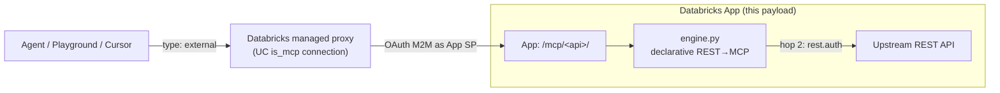

# payloads/rest_mcp/

> **Technical reference** for power users and deployers.
>
> The **REST→MCP proxy** payload: a config-driven Databricks App that wraps one
> or more arbitrary REST APIs as governed **MCP servers**, with no agent-runtime
> changes. Selected by one line — `adapter: rest_mcp` in `payload.yml`.
>
> Design rationale + platform validation live in
> [docs/explanation/mcp-proxy-payload-design.md](../../docs/explanation/mcp-proxy-payload-design.md).
> This README is the **as-built** summary of what ships today.

## What it is

One hosting App fronts **N upstream REST APIs**. Each API becomes its own
Streamable-HTTP MCP surface mounted at `/mcp/<api>/`, fronted by its own Unity
Catalog `is_mcp` HTTP connection. Agents (or Playground, Cursor, the Supervisor
API) consume each surface through the framework's existing `type: external` MCP
path — so the proxy needs **zero** changes to the agent runtime.

The payload's durable value is the **declarative REST→MCP translation layer**:
you *declare* endpoints in YAML instead of hand-writing an `@mcp.tool()` per
endpoint. A single tool declaration is the one source of truth for three
artifacts that can never drift: the MCP `inputSchema` on the card, the `httpx`
request the engine builds, and the response projection.



## Package layout

`payloads/rest_mcp/` mirrors `payloads/agent/` one-for-one — if you know the
agent payload you already know this one.

| Path | Purpose |
|------|---------|
| `contracts.py` | The payload-owned typed `spec` — **the config service** (Pydantic, `extra="forbid"`). |
| `adapter.py` | `RestMcpPayloadAdapter` — fills the framework's `AppPayloadAdapter` seam (spec → neutral `AppPayloadSpec`/`AppInfraSpec`, and the UC connection lifecycle). |
| `runtime/server/app.py` | Assembles the multi-API Starlette ASGI app (one stateless `/mcp/<api>/` mount each + `/health`). |
| `runtime/server/registry.py` | Builds one low-level MCP server per API from the spec (tool list + dispatch). |
| `runtime/server/auth.py` | Hop-2 token provider + `ForwardedIdentityMiddleware` (captures OBO `x-forwarded-access-token`). |
| `runtime/engine.py` | Pure REST→MCP engine: builds `inputSchema`, renders the request, projects + byte-caps the response. No FastAPI/SDK imports. |
| `runtime/http_client.py` | `HttpClient` facade injected into Tier-3 code tools (same rails: auth, egress guard, byte cap). |
| `runtime/code_tools.py` | Discovers/loads instance-side `code_tools[].module` files onto an API's server. |
| `runtime/start_server.py` | Process entrypoint: resolves `INSTANCE_DIR`, loads the spec, serves with uvicorn on **:8000**. |
| `deploy/connection.py` | Deploy-time CRUD for the governed `is_mcp` UC connection per API (+ state, + M2M secret lifecycle). |
| `deploy/spec.py` | Builds the neutral `AppPayloadSpec` / `AppInfraSpec` the generic App host consumes. |
| `schemas/` | Payload-owned JSON schema for editor validation of `payload.yml`. |

## The configuration service (`payload.yml`)

The entire authoring surface is one file:
`instances/<name>/payloads/rest_mcp/payload.yml`.

```yaml
payload:
  adapter: rest_mcp
  spec:
    apis:                          # each entry -> its own /mcp/<name>/ mount + UC connection
      - name: orders               # safe slug: ^[a-z][a-z0-9_]*$
        rest:                      # hop 2: app -> upstream REST API
          base_url: "https://orders.internal.example.com"
          allowed_hosts: ["orders.internal.example.com"]   # egress allow-list, https-only
          auth:                    # discriminated union on `mode`
            mode: static           #   none | static | obo
            secret_scope: orders_api
            secret_key: bearer_token
          defaults:
            timeout_s: 30
            max_response_bytes: 100000     # hard cap keeps LLM context lean
        tools:                     # each tool -> one MCP method
          - name: get_order_status
            description: "Fetch the current status of an order by id."
            request:
              method: GET
              path: "/orders/{order_id}/status"
              args:
                - { name: order_id, in: path, type: string, required: true }
            response:
              project: ["status", "updated_at"]   # whitelist top-level keys (omit = whole body)
```

### Authoring tiers

A tool climbs only as high as it needs:

| Tier | Use when | Authored as |
|------|----------|-------------|
| **1 — flat declarative** | path / query / simple body | `request.args[]` |
| **2 — declarative + template** | shaped JSON body (most ML serving) | `args[]` + `body_template` with `{{arg}}` substitution (validated at load time; no logic) |
| **3 — code tool** | the input needs *computation*, not just structure | `code_tools[].module` → an instance-side `.py` implementing the payload's `@tool` contract |

Tier-3 code tools receive an injected `HttpClient` **pre-bound** to `rest.auth`,
the `allowed_hosts` egress guard, and the byte cap — so bespoke code cannot
bypass the rails. Module paths are confined to the instance tree (no absolute
paths, no `..`).

### Fail-closed guarantees (baked into `contracts.py`)

- `extra="forbid"` on every model — a typo'd key fails at deploy, not runtime.
- Non-GET requires `mutating: true`; GET forbids it.
- `base_url` must be `https://` and its host must appear in `allowed_hosts`.
- `{{arg}}` / `{path}` placeholders must resolve against declared args.
- Secrets referenced by scope/key only — never inlined, never logged.

## Two-hop auth

| Hop | Boundary | Owned by | How |
|-----|----------|----------|-----|
| **1** | agent → hosting App | UC `is_mcp` HTTP connection (managed proxy) | **OAuth M2M as the App's own service principal** (see below) |
| **2** | hosting App → upstream REST API | the engine (`rest.auth.mode`) | `none` / `static` (Databricks secret bearer) / `obo` (forward caller identity — Databricks-ecosystem targets only) |

Only hop 2 is modelled in the `spec`. Hop 1 is provisioned at deploy time and
referenced by the paired `mcp_servers/<api>/server.yml`
(`connection_name: ${var.rest_mcp_connection__<api>}`), which is why "no
agent-runtime changes" holds.

## MCP registration paths — external connection and Unity Gateway discovery

Databricks ships **three** MCP categories: **Managed** (native — UC functions,
Genie, Vector Search), **External** (a server outside Databricks, reached
through a UC HTTP connection), and **Custom** (your own server hosted as a
Databricks App at `{app_url}/mcp`). This payload supports the Custom path (A)
and the external connection (B) at the same time; this section explains how
they relate.

The key insight is a **layering model**, not three parallel choices. There is one
*substrate* (the actual MCP endpoint) and separate ways to *consume / govern* it:

```
SUBSTRATE (the MCP endpoint itself)
  ├─ external server (someone else hosts)
  └─ custom app  {app_url}/mcp   ← we host this
       │
  CONSUMPTION / GOVERNANCE
  ├─ A. Custom-app (Playground-native)  Playground discovers the app directly. No connection.   ← single-API proxies
  ├─ B. External UC connection          is_mcp HTTP connection -> type: external.             ← every proxy
  └─ C. MCP Service                     a UC securable built ON TOP of a (B) connection -> AI Gateway governance
```

So **C is not a third substrate — it is layered on top of a B connection**
(Databricks docs: "Create the MCP Service *from that connection*"). That
connection's target can be either an external server or our app.

| | **A. Custom app (Playground-native)** | **B. External UC connection** | **C. MCP Service** (on top of B) |
|---|---|---|---|
| UC connection | none | `is_mcp` HTTP | created *from* the B connection |
| Caller reaches | the App URL directly | the UC gateway | the UC gateway |
| Governance | Apps permissions only | connection grants | tool selection, service policies, rate limits, audit, grants |
| Multi-API (`/mcp/<api>/`) | **one server per App** at `/mcp` | **clean** — one connection per API | clean — one service per connection |
| Naming constraint | **App name must start with `mcp-`** | none | none |
| Maturity | GA-ish, documented | GA-ish (first-gen external) | **Beta** (account previews) |

### Unity Gateway discovery (path A)

Unity Gateway and AI Playground only discover an App-hosted MCP server when
the **App name starts with `mcp-`**. The `rest_mcp` adapter therefore names
its App `mcp-<target>-<app_name>` (for example `mcp-dev-github`) instead of
the framework default `<target>-<app_name>-app`. You configure nothing: the
adapter owns the name through the framework's optional `AppNamingAdapter`
hook.

- **One API per App.** Discovery expects the server at the App's `/mcp`. A
  single-API proxy is served there in addition to `/mcp/<api>/`. A proxy with
  several APIs has no `/mcp` root (deploy prints a note), so use the B
  connections for those.
- **Callers connect directly to the App.** They need `CAN USE` on the App and
  an OAuth token; Apps reject personal access tokens. Grant `CAN USE` to the
  users or groups who should see the server.
- **Per-caller identity** needs Apps user authorization (`user_authorization`
  scopes in `app/config.yml`) plus `auth: obo` on the API, so the upstream call
  uses the forwarded user token. See #835 for the open design questions.
- **Existing deployments get a new App.** Apps can't be renamed, so the first
  deploy after upgrading creates `mcp-…` next to the old `…-app`. The B
  connections follow automatically (they detect the new App URL and service
  principal); delete the old App by hand.

## Optional governance layer (Beta): the UC MCP Service (path C)

Path **C** adds AI Gateway governance (tool selection, service policies, rate
limits, `EXECUTE` grants, audit/traces) by creating a UC **MCP Service**
securable (`catalog.schema.<api>`) *on top of* the B connection. It is
**opt-in per API** and lives in its **own** `deploy/mcp_service.py` module +
`McpServiceSpec` contract, strictly layered on the connection: it reads the
connection name and builds the service *from* it, but never mutates the
connection and keeps its own state partition (`rest_mcp_service`).

**Enable it** by adding an `mcp_service:` block to an API (omit it → connection
only, exactly as before):

```yaml
apis:
  - name: github
    rest: { ... }
    tools: [ ... ]
    mcp_service:                    # OMIT this block = path B only (no service)
      enabled: true                 # enabled: false keeps the block but skips it
      # catalog / schema default to the instance's <catalog> + <schema_prefix>_rest_mcp
      include_tool_selectors: ["get_*", "search_repositories"]   # empty = all tools
      service_policies:
        - name: block_writes
          policy_type: builtin      # a platform built-in policy name
          handler: <builtin_policy_name>
        - name: redact
          policy_type: custom       # a UC function catalog.schema.function
          handler: my_cat.my_schema.redact_pii
      rate_limits:
        - { key: user, principal: "analyst@acme.com", calls: 100 }   # per-minute, per-principal
      grants:
        execute: ["group:analysts"]
```

**Prerequisites (all Beta, account-gated).** The service is created only when the
account has the **Unity AI Gateway** + **Managed MCP Servers** previews enabled,
and the deploy identity holds `USE CATALOG`/`USE SCHEMA` + `CREATE SERVICE` on
the target schema and `USE CONNECTION` on the B connection. When the preview is
off, `after_reconcile` logs a warning and skips path C — **the connection still
works via `type: external`**, so deploy never fails on account of the service.

> **Govern-only caveat.** AI Gateway policies/rate-limits are enforced **only
> when the service is invoked through the gateway URL**
> (`/ai-gateway/mcp-services/…`). The scaffold keeps agent consumption on the
> `type: external` connection, which works without the Beta previews. To put
> the governance surface on the hot path, pin the service in the agent's
> `payload.yml` instead of the `server.yml`:
>
> ```yaml
> spec:
>   runtime:
>     tools:
>       mcp:
>         gateway:
>           pinned:
>             - fqn: "${var.rest_mcp_service__example_api}"
>               identity: sp       # deploy grants the agent App EXECUTE
>               tools:
>                 allow: [get_item]
> ```
>
> `rest_mcp_service__<api>` is published only after the service is deployed;
> until then the agent deploy fails instead of running without the tools.

> **Known limitation — AI Playground cannot render governed (non-ALLOW)
> responses (upstream bug, fix in flight).** The MCP Service itself works: every
> standards-compliant MCP client (Python MCP SDK, Claude, `curl`) can drive it
> end-to-end through the gateway URL — verified with full `tools/call` results.
> But the AI Gateway returns **governed / non-ALLOW** responses (policy
> `DENY`/`ASK`, and rate-limit-exceeded / unauthorized) as `application/json`,
> while **ALLOW** responses stream as `text/event-stream` (SSE). The Playground
> UI currently ships an **SSE-only decoder** (behind the `mcp.enableInlineElicitation`
> flag), so any governed `application/json` response surfaces there as
> *"SSE stream closed without a JSON-RPC response event."* This is a Databricks
> Playground bug with UI + gateway fixes in
> flight — **not** an issue with this payload or the provisioned service. Until
> it lands, consume the proxy in Playground via the **`type: external`
> connection** (path B), which bypasses the gateway's governed-response framing.

Field shapes (enum tokens, the `tokens` rate-limit field, `connections/{fqn}`
reference, `EXECUTE`-grant call) were all live-confirmed against the Beta
`mcp-services` API and are mapped from the friendly config values in
`deploy/mcp_service.py`.

## Deploy lifecycle (rides the generic App-host seam)

`agent-foundry deploy` reads `adapter: rest_mcp` and runs the identical
`deploy_on_host()` sequence the agent payload uses. The adapter fills the seam:

1. `build_payload_spec` → lean `AppPayloadSpec` (`command = python -m
   payloads.rest_mcp.runtime.start_server`, `requirements_extras = ("rest_mcp",)`
   — no agent runtime / Lakebase / UI sidecar).
2. `provision` → stashes the instance dir + target into the shared variable bag
   (the App URL is not known yet on a first deploy).
3. **`after_reconcile`** → the App exists and its URL + service principal are
   known, so for **each** API it creates the governed `is_mcp` UC connection
   pointing at `{app_url}/mcp/<api>/`, then (only for APIs with an enabled
   `mcp_service:` block) provisions the optional MCP Service *from* that
   connection — strictly after it, never mutating it.
4. `load_state_outputs` → republishes `rest_mcp_connection__<api>` (and, when
   path C is enabled, `rest_mcp_service__<api>`) into the variable bag so each
   `server.yml` resolves its `${var...}`.
5. `plan_destroy` / `destroy` → tears down each MCP Service **first** (it
   references the connection), then deletes every connection, **revokes its
   minted secret**, and clears state; the App itself is removed by
   `destroy_on_host()`.

### Hop-1 auth: OAuth M2M via the App service principal

The connection authenticates to the OAuth-gated App as the App's **own** service
principal (the one identity guaranteed to have `CAN_USE` on the App). U2M mapping
was rejected because it drives a browser authorization-code flow whose redirect
URI is not registered on the App's OAuth client (and the workspace does not
support dynamic client registration).

`after_reconcile` therefore, **only when creating a connection**:

- mints a fresh OAuth secret for the App SP via `service_principal_secrets_proxy`,
- writes it into the connection's `options.client_secret` (with `client_id` =
  the SP's `applicationId`, the workspace `token_endpoint`, `oauth_scope=all-apis`),
- persists **only the secret's id** (never the secret) to workspace state so
  `destroy` can revoke exactly that secret — a clean 1:1 connection↔secret
  lifecycle with no sprawl.

The `base_path` intentionally carries a **trailing slash** (`/mcp/<api>/`): the
App's Starlette mount 307-redirects `/mcp/<api>` → `/mcp/<api>/` and the managed
proxy does not follow the redirect.

> **Security note (for reviewers).** Because hop-1 mints an SP OAuth secret at
> deploy time, the **deploy identity needs workspace permission to mint service
> principal secrets** — deploying this payload is more privileged than a plain
> code push. And teardown **must** run via `agent-foundry destroy`: deleting the
> App by hand orphans the minted secret (valid until its default lifetime
> expires). The secret value never touches state, logs, or the variable bag.

## Local testing

```bash
# Auth via a CLI profile (or DATABRICKS_* env vars)
export DATABRICKS_CONFIG_PROFILE=my-profile

# Point at your instance and serve on :8000
export INSTANCE_DIR=instances/<your-proxy>
python -m payloads.rest_mcp.runtime.start_server

# In another shell:
curl localhost:8000/health                      # {"status":"ok","apis":[...]}
```

The engine and server are pure/seamed (`client_factory`, `secret_resolver`), so
the test suite runs fully offline with an `httpx.MockTransport` — no network, no
SDK. See `tests/unit/runtime/` and `tests/unit/deploy/`.
